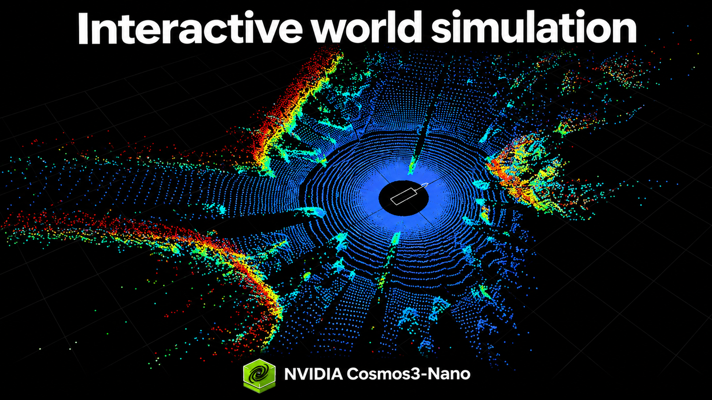

# Cosmos 3：把世界模型变成交互模拟器

模拟器能算出车辆、机械臂和周围环境如何运动，却不一定能直接生成可供策略使用的逼真画面；视频生成模型可以产出画面，又未必能持续响应新的动作与控制信号。NVIDIA 新开放的四个 Cosmos 3 Nano 检查点，正是围绕这条断链展开：让驾驶场景同时生成多视角视频与 LiDAR，让物理模拟器的状态转成 RGB 图像，也让双臂机器人的动作直接推动后续画面变化。

这四个模型分别是 **Cosmos3-Nano-Transfer-Auto、Cosmos3-Nano-Sim-Auto、Cosmos3-Nano-Sim-Transfer 和 Cosmos3-Nano-Sim-Bimanual**。它们都是 Cosmos 3 Nano 的后训练示例，各有 160 亿可训练参数，采用 OpenMDW1.1 许可证，在其条款下允许商业与非商业使用。开放的不只是权重，还包括后训练流程，方便研究团队针对自己的传感器、机器人构型和应用环境继续适配。

> 图解：Cosmos 3 新增模型面向交互式世界模拟，以及多传感器、多视角驾驶场景生成。

## 四个检查点，分别补上哪一环

这组模型并不是同一功能的四种规格，而是四种不同的输入输出关系。Transfer-Auto 负责离线构造多传感器驾驶数据，Sim-Auto 将这种能力改成可持续接收控制的流式生成；Sim-Transfer 给物理模拟器补上视觉外观，Sim-Bimanual 则直接根据场景和机器人动作预测下一段观察。

它们共同指向一个问题：世界模型生成的内容能否进入交互过程。每次观察都可能影响下一个动作，因此模型不能只生成一段看起来合理的离线视频，还要利用已经生成的历史，并及时接纳新的控制信号。不过，NVIDIA 也明确保留了判断边界：这些模型在多大程度上能忠实支持策略学习与评估，仍需要测量，其局限和失败之处也有待继续研究。

## Transfer-Auto：一次生成最多 11 路驾驶画面

Cosmos3-Nano-Transfer-Auto 是双向模型，用于离线生成合成驾驶数据。它能同步生成最多 11 个相机视角的视频，其中包括鱼眼相机，也支持 RGB 与 LiDAR 联合生成。多视角同步意味着研究者不必把每路传感器当成彼此独立的生成任务，这对需要保持场景一致性的驾驶数据尤其重要。

控制分为场景结构与外观两层。每个相机的 World Scenario Map（WSM）控制负责指定场景结构和交通运动，文本提示负责引导天气、光照、时段等外观条件；也可以提供初始 RGB 图像，固定场景的视觉起点。联合生成 LiDAR 时，还需要与相机控制对齐的高精地图距离图控制。

这套分工让开发者可以改变道路布局、交通运动和信号灯状态，再观察驾驶策略如何响应，同时扩展训练与评估所覆盖的环境条件。若自己的相机布局、LiDAR 配置或目标环境不同，NVIDIA 建议先用自有数据后训练 Transfer-Auto，而不是直接从流式模型开始。适配后的模型既能离线生成数据，也能继续经过因果训练和少步蒸馏，发展为 Sim-Auto。

## Sim-Auto：把离线生成改成连续交互

Cosmos3-Nano-Sim-Auto 是 Transfer-Auto 经因果蒸馏得到的流式版本。它不再一次处理完整片段，而是依据已生成的历史和更新后的驾驶控制，用少量去噪步骤连续生成一小块同步的相机视频与 LiDAR。逐块生成让新的驾驶输入可以更频繁地影响后续观察，从而支持较长的交互式推演。

它的输入仍包括逐相机描述、同步 WSM 控制，以及可选的初始 RGB 图像；生成 LiDAR 时同样要对齐高精地图距离控制。模型本身只负责依据滚动历史产生后续数据块，闭环交互还需要模拟运行时和 WSM 渲染器，根据驾驶输入持续更新控制信号。

因此，从 Transfer-Auto 到 Sim-Auto 的变化不是简单提高生成速度，而是改变模型参与模拟的方式。对于新传感器或新领域，推荐路径仍是先适配 Transfer-Auto，再将其蒸馏为 Sim-Auto。

## Sim-Transfer：物理归模拟器，外观归模型

Cosmos3-Nano-Sim-Transfer 采用另一种分工。物理模拟器继续计算运动、接触和真实物理状态，模型接收模拟器提供的空间控制与文本提示，生成策略可以消费的 RGB 图像：

**动作 → 模拟器更新 → 空间控制 → 生成 RGB → 下一个策略动作**

空间控制可以包括深度、分割、边缘和模糊信息。深度表示相对相机的距离，分割提供区域和物体边界，边缘描述场景轮廓，模糊控制则给出较粗的外观与布局。文本负责引导视觉风格，但物理与真实状态仍由模拟器掌握。

这种设计没有把物理正确性交给视频模型猜测。模型补上的主要是从结构化状态到可见外观的一层，适合希望保留现有物理模拟、又需要生成视觉观察的流程。

## Sim-Bimanual：直接预测动作之后的画面

Cosmos3-Nano-Sim-Bimanual 不走“模拟器更新状态，再渲染画面”的路线，而是直接模拟环境如何响应双臂机器人的动作。它支持 YAM 和 AgiBot 两种机器人构型，可以由策略控制，也可以由人操纵摇杆。给定一张初始图像后，机器人或相机的运动会转化为后续观察；同一段控制序列还可以在视角变化与操作动作之间切换。

这里的动作输入有严格的数据约定。混合动作示例使用 59 个控制值，训练时补齐到 64 个；其模式定义了坐标系、旋转、夹爪标定、有效性掩码和控制域。只有遵循这些约定，每个数值才会表示预期的运动。

时间对齐同样不能省略：若有 $T$ 次状态转换，就需要 $T+1$ 份观察。训练过程会把原始采集数据转换成模型的动作表示，而已发布的推理动作已经完成归一化。简而言之，Sim-Transfer 从物理模拟器更新后的状态生成视觉，Sim-Bimanual 则直接从场景和机器人动作生成下一份观察。

运行这套已发布配置需要 Linux、NVIDIA GPU、Docker 和 NVIDIA Container Toolkit。公开的 vLLM-Omni 部署曾在一块 GB200 上测试，但这只是已测试环境，并不是最低显存要求；服务端会下载权重，客户端则获取示例输入。

## 流式生成为什么能持续接收控制

Cosmos 3 使用 Mixture-of-Transformers 骨干，通过注意力连接分别处理文本和生成视觉的网络。生成器依据提示、可用控制和已经产生的历史预测短片段，流程可以概括为：

**控制与历史 → 生成数据块 → 解码图像 → 更新历史**

去噪过程把带噪的压缩视频表示逐步细化成一个片段。时间因果注意力允许模型读取已有历史和控制，同时屏蔽未来的目标观察；键值缓存保留注意力信息，供下一次预测继续使用。

这些压缩视频表示称为 latent。在初始图像之后，每个 latent 时间步对应四帧 RGB 画面。Transfer 每个数据块预测一个时间步，技术报告中优化后的 Bimanual 配置则预测两个。数据块越小，新控制就能越频繁地进入生成过程，但原文没有给出不同配置的统一速度对比，因此不能据此推断具体的实时性能。

## 四阶段训练，重点处理“自己生成的历史”

这套后训练流程从双向适配逐步走向流式生成：

1. **阶段 0：双向适配。** 从完整录制片段中学习目标领域，以及控制与视频之间的关系。
2. **阶段 1：教师强制。** 根据较早的真实观察和可用控制预测每个数据块，同时遮住干净答案与未来目标。
3. **阶段 2：一致性蒸馏。** 使用冻结的教师模型训练学生，让学生以四步去噪生成每个数据块。
4. **阶段 3：自我强制。** 改用学生自己生成的历史进行训练，由冻结教师和辅助评分模型提供分布匹配信号。

最后一个阶段处理的是长序列交互中的误差积累。假设某个物体的预测稍有偏差，这个偏差会成为后续帧的上下文，并可能继续放大；只依据真实历史训练，无法让模型充分接触这种情况。自我强制把生成历史纳入训练，而蒸馏和缓存则降低持续产生观察的计算开销。

## 用自己的数据适配，短跑通不等于训练收敛

四个模型都提供了从 Cosmos3-Nano 或兼容基础权重出发的后训练路径。驾驶方向先适配 Transfer-Auto，再按需进行因果训练与蒸馏得到 Sim-Auto；Sim-Transfer 和 Sim-Bimanual 则分别针对目标环境和机器人构型准备本地数据、配置各训练阶段并交接检查点。

训练检查点需要完整保留，以便中断后恢复；导出的推理权重不包含优化器等其他训练状态。NVIDIA 建议先完成环境检查、验证一个样本，并测试训练与重启流程，再开始长时间运行。质量评估应放在保留的剧集上进行，因为一次短流程成功执行，只能证明流程能跑，不能证明模型已经收敛。

这组开放检查点最值得关注的，不是又一个“会生成视频”的模型，而是控制、历史与观察开始形成可持续的闭环。驾驶研究者可以用它扩展多视角、多传感器数据并研究策略响应，机器人团队则可在“物理模拟器加视觉生成”与“动作直接预测观察”之间选择。当前材料没有提供统一的画质、延迟或策略提升基准，所以更稳妥的使用方式是从自己的保留数据评估开始，先确认生成结果是否真正适合训练与评估，再决定是否扩大部署。

> 本文参考自 [New NVIDIA Cosmos 3 Open Models for Interactive World Simulation](https://huggingface.co/blog/nvidia/cosmos-interactive-world-simulation)