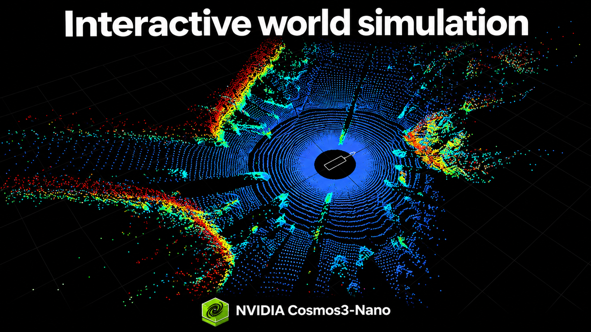

# Cosmos 3：把世界模型变成交互模拟器

模拟器能计算车辆、机械臂和环境的运动，却未必能生成可供策略使用的逼真画面；视频模型能生成画面，又未必持续响应控制。NVIDIA 新开放的四个 Cosmos 3 Nano 检查点，正试图补上这条断链：同步生成多视角驾驶视频与 LiDAR，把模拟器状态转成 RGB 图像，或让双臂机器人的动作直接推动后续画面。

**Cosmos3-Nano-Transfer-Auto、Sim-Auto、Sim-Transfer 和 Sim-Bimanual** 各有 160 亿可训练参数，采用允许商业与非商业使用的 OpenMDW1.1 许可证，并开放后训练流程。它们不是同一功能的四种规格，而是四种输入输出关系。

## 从离线数据到连续驾驶交互

Transfer-Auto 是离线双向模型，最多同步生成 11 路相机视频，包括鱼眼视角，并支持 RGB 与 LiDAR 联合生成。逐相机 World Scenario Map（WSM）控制场景结构和交通运动，文本调整天气、光照与时段，可选初始 RGB 图像固定视觉起点；生成 LiDAR 还需对齐的高精地图距离图控制。

Sim-Auto 则由 Transfer-Auto 经因果蒸馏而来，依据生成历史和更新的驾驶控制，以少量去噪步骤连续产出同步数据块。闭环仍需模拟运行时和 WSM 渲染器持续更新控制。适配新传感器或领域时，推荐先训练 Transfer-Auto，再因果训练、蒸馏为 Sim-Auto。

## 机器人视觉的两条路线

Sim-Transfer 保留物理模拟器计算运动、接触和真实状态，模型根据深度、分割、边缘、模糊等空间控制及文本生成 RGB：**动作 → 模拟器更新 → 空间控制 → 生成 RGB → 下一个策略动作**。它补的是视觉外观，不让视频模型猜测物理状态。

Sim-Bimanual 则直接从场景和双臂机器人动作预测下一份观察，支持 YAM、AgiBot，可由策略或摇杆控制。其混合动作示例使用 59 个控制值、训练补齐到 64 个，并严格约定坐标系、旋转、夹爪标定等；若有 $T$ 次状态转换，就需 $T+1$ 份观察，时间对齐不能省略。

## 能持续交互，不等于已证明有效

Cosmos 3 以 Mixture-of-Transformers 分别处理文本和视觉，通过注意力连接；时间因果注意力读取历史与控制并屏蔽未来目标，键值缓存供后续预测复用。初始图像之后，每个 latent 时间步对应四帧 RGB。训练依次经历双向适配、教师强制、四步去噪的一致性蒸馏，以及使用学生自身生成历史的自我强制，以应对长序列误差积累。

因此，这组模型的价值在于让控制、历史与观察形成闭环，而非单纯“又会生成视频”。NVIDIA 未给出统一的画质、延迟或策略提升基准，也未证明它们能忠实支持策略学习与评估；短流程跑通同样不代表收敛。更稳妥的路径，是用自己的保留数据先验证生成结果是否适合训练与评估，再决定扩大部署。

> 本文参考自 [New NVIDIA Cosmos 3 Open Models for Interactive World Simulation](https://huggingface.co/blog/nvidia/cosmos-interactive-world-simulation)