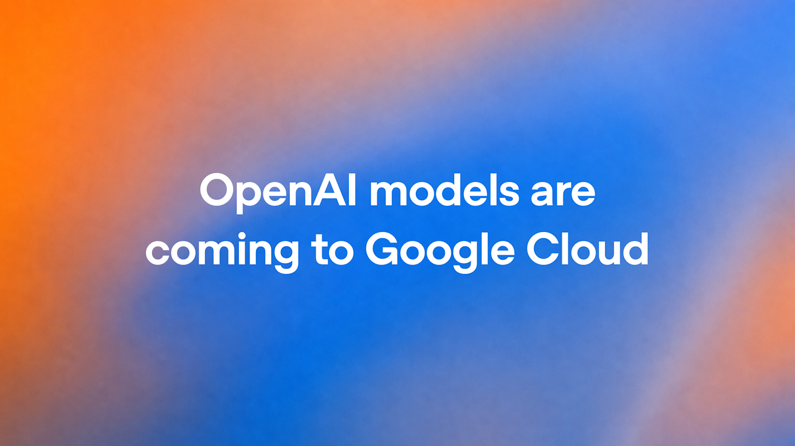

# OpenAI 模型登陆 Google Cloud：前沿模型与 Codex 将进入 Model Garden

> 图解：OpenAI 官方发布的合作公告封面图。

2026 年 10 月 21 日，OpenAI 宣布与 Google Cloud 达成合作：其前沿模型（frontier models）和 Codex 智能体工作流将进入 Google Cloud 的 Model Garden。企业客户不必离开已有的 Google Cloud 环境，就能直接调用这些模型，支撑大规模的复杂智能体（agentic）工作流。

## 为什么值得关注

对企业团队来说，能不能上线 AI 往往不只取决于模型好不好，更取决于模型在哪里、怎么买、数据归谁管。Google Cloud 已是大量 AI 工作负载及其开发者、数据科学家的落脚点，这次合作让这些团队在熟悉的环境里直接用上 OpenAI 的前沿模型——无论是改造软件开发生命周期，还是搭建智能体工作流。

受监管行业的诉求更具体：部署 AI 的前提是控制谁能访问敏感数据、数据被如何使用。按公告的说法，这次集成会把 OpenAI 模型与 Google Cloud 内置的访问控制、集中式数据治理和高性能基础设施组合在一起，面向的正是这类要求严苛的企业负载。

## 怎么买、在哪用

采购走企业熟悉的路径：通过 Model Garden 购买，交易走 Google Cloud Marketplace。已签了 Google Cloud 消费承诺（spend commitments）的企业，这笔采购可直接抵扣既有的 GCP 承诺额度——对预算流程繁琐的大公司，这一点往往比模型能力本身更能加速决策。

入口也不止 Model Garden。公告提到，OpenAI 模型后续还将接入 Google Antigravity 和 Gemini Agent，让企业客户可以按任务选择最合适的模型。

OpenAI 总裁兼联合创始人 Greg Brockman 在公告中表示："通过在 Google Cloud 上扩大访问，我们让企业可以更自由地选择如何发现和使用前沿模型，并提供一条从评估走向更广泛采用的路径。"Google Cloud CEO Thomas Kurian 也为此次合作站台（原文附有其引言，提取文本未保留具体内容）。

## 几个需要注意的边界

- 正式可用（general availability）计划在"未来几周内"，目前处于申请访问阶段。
- OpenAI 明确表示，微软仍是其首要云合作伙伴（primary cloud partner）——这次合作是扩大分发渠道，而不是更换阵营。
- 公告未给出具体的模型清单、定价和服务等级细节，要等正式上线后才能确认。

## 小结

这件事的本质是分发渠道的扩张：OpenAI 的前沿模型和 Codex 进入了企业已经付费、已经合规、已经在用的另一个云平台。对正在 Google Cloud 上构建 AI 应用的团队，值得关注的点是采购与数据治理门槛的降低，以及 Codex 智能体工作流的原生可用；但具体的模型范围和商用条款，还要等未来几周正式上线后才能评估。有采购意向的团队可以先通过官方渠道申请访问。

> 本文参考自 [OpenAI models are coming to Google Cloud](https://openai.com/index/openai-models-google-cloud)