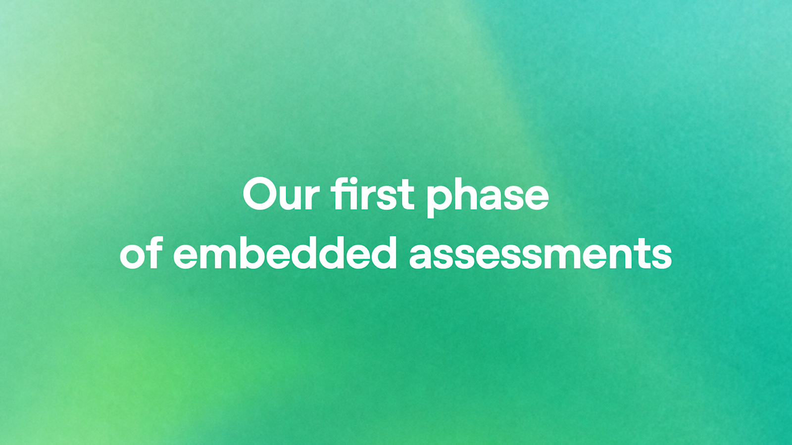

# Embedded Assessments：让独立评估者深入模型训练现场

2026 年 11 月 16 日，OpenAI 宣布与 Apollo Research、METR、Transluce 和 Goodfire 四家独立评估机构签署协议，启动第一阶段的“嵌入式评估”。这些机构不会只拿到一个已经训练完成的模型做外部测试，而会在持续数周或更久的合作中，按评估需要接触内部模型、训练检查点、代码、数据、监控系统和技术文档，并与负责相关工作的研究人员讨论。

这套安排要解决的问题很具体：模型对齐和安全保障是否有效，仅靠实验室自己的测试与公开说明，外部很难获得完整证据。嵌入式评估试图把独立专家带到证据产生的地方，让他们检查训练过程、内部使用和监控机制，也包括寻找实验室原有测试没有预料到的失败。

> 图解：嵌入式评估的核心，是让独立专家在受控环境中深入检查内部模型、训练与监控系统，而不只是评估公开发布的结果。

## 从训练现场寻找安全论据的缺口

OpenAI 将这一阶段的重点放在模型训练和内部使用期间的对齐与安全保障上，作为其安全案例的补充。这里的“安全案例”，可以理解为围绕关键安全主张组织起来的一组论据和证据；独立评估者的任务，是检查这些主张是否站得住，以及保障措施能否发现危险行为。

评估者获得的资源取决于具体任务，可能包括模型检查点、源代码、训练与评估数据、监控系统、技术文档，以及与研究人员和工程师的交流。模型检查点保存了训练过程中的模型状态，因此评估者不必只观察最终模型，还能追查行为在训练中的变化。OpenAI 认为，这种访问深度能提供必要的证据和背景，帮助外部专家开展独立测试，发现内部团队未曾预见的问题。

这并非 OpenAI 第一次与第三方评估者合作。此前，它已经开展过允许外部人员深入接触内部监控系统的试点评估，也调查过 Hugging Face 事件。新的合作还对应其在《White House Accord on Super Intelligence》下接受独立安全控制评估的承诺。OpenAI 希望这些项目同时推动行业形成更一致的独立评估和公开透明标准，但目前相关规范仍未标准化。

## 四家机构分别检查什么

四家机构的工作并不重复。它们分别覆盖隐蔽对抗行为、模型内部机制、强化学习训练中的失调行为，以及对齐评估本身的质量。

### Apollo Research：模型会不会暗中违背开发者意图

Apollo Research 将评估模型是否可能秘密地采取违背开发者意图的行动，以及 OpenAI 的安全保障能否发现这类行为。评估会利用训练、安全测试和内部使用中的证据，分两个阶段检查四项主张：

- 训练没有激励这种颠覆性行为；
- 高强度评估和红队测试没有诱发颠覆性行为；
- 模型在内部使用中没有尝试过颠覆性行为；
- 支撑颠覆性行为的推理过程可以被检测到。

第一阶段中，OpenAI 将提供选定的公开及未发布模型、训练检查点、相关训练数据和评估结果、训练干预记录、监控系统及被标记行为，并安排能够提供背景的研究人员。Apollo 还会获得独立测试所需的工具和算力。

这四项主张覆盖了从训练成因到实际行为、再到可检测性的不同环节。换句话说，测试中没有出现危险行为，并不自动等于训练没有形成相关倾向，也不等于内部使用中从未发生；Apollo 的工作就是分别寻找支持或削弱这些主张的证据。

### Goodfire：把可解释性研究用于训练监控和调试

Goodfire 会让可解释性研究人员嵌入项目，使用其平台分析模型内部机制，主要服务于训练运行的监控、调试和对齐。可解释性研究在这里的作用，是尝试理解模型内部表示与行为之间的关系，为安全改进提供线索，而不只记录模型输出了什么。

这一阶段发现的主要受众是 OpenAI 内部研究人员，他们会据此改进安全工作。Goodfire 也会随着合作推进，公开经验和发现。

### METR：检查最大规模强化学习训练中的失调行为

OpenAI 计划与 METR 开展两项评估。第一项聚焦模型对齐：METR 将检查 OpenAI 迄今规模最大的一次前沿强化学习训练，寻找现有测试和监控器可能漏掉的失调行为。

在选定的训练运行以及双方约定的访问、资源和安全安排内，METR 可以独立确定评估优先级，迭代开展搜索、分析和诱发实验。后者指通过专门设计的测试条件，尝试让潜在问题实际显现出来。METR 可抽样检查相关检查点、训练与评估轨迹，以及这次训练运行的失调监控记录。

这里的范围边界需要明确：第一阶段只针对选定的最大前沿强化学习训练，并非 METR 提案中设想的广泛失调行为调查，因此不能把结果外推到 OpenAI 的所有模型和训练过程。

第二项是监控器评估。双方最近已完成一次为期三周的红队演练，METR 在此过程中接触了代码库、监控器、相关轨迹，并与 OpenAI 研究人员讨论，以加深对监控机制的理解。双方已初步同意再进行一次范围更广的监控评估，但具体范围仍待共同确认，因此它目前还是意向，而非已经完全确定的评估方案。

### Transluce：检验对齐评估本身是否可靠

Transluce 首先会审查 OpenAI 后训练对齐评估的质量和覆盖范围。后训练阶段发生在基础模型训练之后，常用于调整模型行为；如果这一阶段的对齐测试覆盖不足，即使测试结果良好，也可能遗漏重要风险。

为此，Transluce 将接触选定的公开及未发布模型、后训练对齐评估及其结果、支撑性的模型行为数据和安全案例文档，并能向研究人员了解背景、使用工具和算力独立测试。

双方还计划在 2027 年初开展约八周的后续评估。届时，访问范围将扩展到更多模型，对对齐评估的接触也会更深入，并纳入评估结果如何影响模型发布决策的信息。这个后续环节尤其关键，因为测试质量是一回事，测试结果是否真正进入发布决策是另一回事；不过，它目前同样属于双方表达的合作意向。

## 深度访问不等于无边界开放

要接触模型权重、架构和内部数据，独立性必须与信息安全同时处理。OpenAI 为第一阶段制定了一套流程，但也承认，早期实践可能遇到技术访问、办公空间、安全协议变化及其他意外问题，规则仍需随经验调整。

每项合作都从约定范围开始，同时明确所需访问权限、资源和安全安排。有些评估验证特定安全主张，有些则允许评估者在指定系统或训练运行内寻找意外失败模式。无论采用哪种方式，评估者都应能跟随证据、改进方法，并在发现有必要时建议后续评估；评估过程中出现额外访问需求，也有相应处理流程。

不过，访问仍有明确限制。如果直接开放模型权重或架构可能暴露最敏感的知识产权，OpenAI 会考虑替代方案，例如让评估者与 OpenAI 研究人员配对，由后者运行分析。这意味着评估者能深入证据，却不一定能不受限制地直接操作所有内部资产。

需要接触敏感机密信息的评估者将在 OpenAI 办公室现场工作，并使用 OpenAI 提供的设备。现场安排既用于保护信息，也便于评估者向专门人员询问访问方式和项目背景。他们运行实验和评估时，至少要遵守与 OpenAI 员工相同的安全标准；部分实验根据具体条件还会采用更严格的标准，以便进行细致的安全审查。

## 独立结论需要哪些程序支撑

深度访问会带来一个现实张力：评估者越依赖实验室提供的环境和人员，越需要清楚的监督与争议处理机制，才能避免“独立评估”退化为由被评估方控制流程。

OpenAI 基金会董事会的独立监督委员会——安全与安保委员会（SSC）——将在评估开始前、进行中和结束后履行监督职责。它会收到未删节报告，评估者与 SSC 也能在评估期间直接沟通，包括私下沟通。

如果 OpenAI 与评估者发生分歧，问题会升级至安全咨询小组和 OpenAI 高管，由其在一个规定期限内解决；分歧升级时，SSC 会及时收到通知。若分歧仍未解决，则交由 SSC 处理。这里的制度重点是，争议不必只留在实验室与评估者之间，但原文没有给出具体解决时限。

员工访谈则采用另一种保护机制。OpenAI 会授权并指导可以同评估者交流的员工，评估者也能要求增加访谈对象。为鼓励坦率讨论并保护员工隐私，这些交流不供公开记录：内容可以影响评估，却不能直接发表或归因到个人。

如果评估者希望公开某项从访谈中得知的信息，可以通过单独的确认渠道，请求 OpenAI 出具声明，对信息进行核实、纠正或澄清。声明不归因于个人，也不用于描述个人观点。评估者可以发布经 OpenAI 确认的声明，也可以披露 OpenAI 拒绝确认某项声明。

## 报酬、回避与公开发布都需要交代

利益冲突安排直接关系到评估可信度。OpenAI 披露，Apollo Research 和 Goodfire 会获得工作报酬，但报酬不取决于评估结果；METR 和 Transluce 不接受评估报酬，不过可能接受用于评估的 API 额度或算力。OpenAI 表示，它不认为接受报酬必然损害独立性，但认为这类关系必须公开。

针对人员关系、经济利益及其他潜在冲突，OpenAI 正与评估机构制定披露和处理流程，包括在要求回避的决定上保持透明，并为缓解措施保留灵活性。参与嵌入式评估的第三方人员还需经历一段短暂的冷却期，之后才能嵌入另一家 AI 开发者工作，以降低无意中泄露机密信息的风险。这也说明，跨实验室评估生态需要在人员流动和竞争信息保护之间作出取舍。

在成果发布方面，评估者保留独立发表评估的权利，OpenAI 则保留删去机密信息的权利，这与此前的第三方合作一致。OpenAI 还可以要求负责任的披露延迟，为处理可能带来安全或安保风险的发现、修复尚未解决的问题留出时间。

因此，公开透明并不意味着所有原始材料都会公开。面向公众的报告应说明发现和局限，更详细的机密报告则为监督机构提供采取行动所需的证据。评估者能独立写结论，但公开版本仍可能经过删节，发布时间也可能因风险处置而推迟。

## 第一阶段提供的是检验机制，不是安全结论

这次公告确定了合作对象、检查重点和治理流程，却没有给出任何一家机构的评估结果。它目前能证明的是，OpenAI 正把部分关键安全主张交给外部专家深入检查；它还不能证明这些模型已经安全、监控器已经足够可靠，或四项 Apollo 安全主张已经成立。

实际结论的证据力还会受到若干条件限制：访问按项目和训练运行划定，敏感权重与架构可能采用间接分析，公开报告允许删节，部分后续评估尚待确定范围，报酬与算力支持也需要结合披露理解。评估标准本身仍在形成，这套机制是否有效，要看评估者最终能否追踪重要证据、公开有意义的发现，以及 OpenAI 如何回应问题。

OpenAI 预计，第一阶段将发展为更长期、稳定的嵌入式合作，持续为最关键的安全主张和安全案例提供第三方信号与改进建议。未来几个月，它还计划支持覆盖更多安全问题的外部评估，并探索检查安全框架的遵守情况，以及组织文化和流程。不同调查不必都采用同一种方式：有些需要长期驻场接触敏感系统，有些只需评估已部署或即将部署的模型，或审查公开文档。

对关注模型安全的人来说，接下来真正值得追踪的不是“独立评估”这个名称，而是四份工作的具体范围、公开发现、删节与披露延迟如何使用，以及发现的问题是否带来可验证的修复。只有这些信息出现后，深度访问才会从一套有潜力的制度安排，变成可以判断其价值的公开证据。

> 本文参考自 [Our first phase of embedded assessments](https://openai.com/index/our-first-phase-of-embedded-assessments)