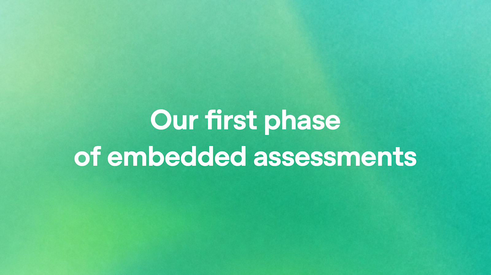

# Embedded Assessments：让独立评估者深入模型训练现场

2026 年 11 月 16 日，OpenAI 宣布与 Apollo Research、METR、Transluce 和 Goodfire 启动第一阶段“嵌入式评估”。在持续数周或更久的合作中，四家机构可按任务接触内部模型、训练检查点、代码、数据、监控系统和技术文档，并与研究人员讨论，而非只测试训练完成的模型。

这套安排针对一个具体难题：模型对齐和安全保障是否有效，外部很难仅凭实验室自测与公开说明获得完整证据。独立专家因此进入证据产生的地方，检查训练、内部使用和监控机制，寻找原有测试未预料的失败，为 OpenAI 的安全案例补充独立论据。

> 图解：嵌入式评估让独立专家在受控环境中检查内部模型、训练与监控系统，而不只是评估公开发布的结果。

## 四家机构分别寻找什么证据

Apollo Research 检查模型是否会秘密违背开发者意图，以及保障措施能否发现此类行为。它将分两阶段检验四项主张：训练和高强度评估没有激励或诱发颠覆性行为，内部使用中没有相关尝试，支撑这类行为的推理可被检测。为此，它可获得选定公开及未发布模型、检查点、训练数据、干预记录、监控系统和独立测试所需工具与算力。测试未出现危险行为，并不等于这些主张已经成立。

Goodfire 将可解释性研究人员嵌入项目，用其平台分析模型内部机制，服务训练监控、调试与对齐，发现主要供 OpenAI 内部改进安全工作，后续再公开经验。METR 的一项工作是检查 OpenAI 迄今最大规模的一次前沿强化学习训练，抽样检查点、训练与评估轨迹及失调监控记录，寻找现有测试可能漏掉的问题；范围仅限选定训练，不能外推到所有模型。双方近期还完成了为期三周的红队演练，但更广的监控评估仍待确定范围。

Transluce 先审查后训练对齐评估的质量和覆盖范围，并可独立测试。双方计划在 2027 年初开展约八周后续评估，扩展到更多模型，并考察结果如何影响发布决策；这目前仍属合作意向。测试质量与测试是否真正进入发布决策，是两个需要分别验证的问题。

## 深度访问不等于无边界开放

访问按项目和训练运行划定。若直接开放权重或架构会暴露敏感知识产权，OpenAI 可能改由研究人员与评估者配对运行分析。接触敏感信息的评估者须在其办公室使用公司提供设备，至少遵守与员工相同的安全标准，部分实验要求更严。OpenAI 也承认，技术访问、现场安排和安全协议仍需随实践调整。

独立监督委员会安全与安保委员会（SSC）将在评估前、中、后监督并接收未删节报告，评估者可与其直接甚至私下沟通。分歧先升级至安全咨询小组和高管，仍未解决则交由 SSC，但原文未给出解决时限。员工访谈可用于评估，却不能直接发表或归因个人；如需公开，可请求 OpenAI 确认声明，评估者也可披露其拒绝确认。

利益关系同样需要披露：Apollo 和 Goodfire 获得与结果无关的报酬，METR 和 Transluce 不接受报酬，但可能接受 API 额度或算力。评估者保留独立发表权，OpenAI 则可删去机密信息，并要求为风险处置和修复延迟披露。因此，公开报告未必包含全部原始材料。

## 第一阶段提供检验机制，不是安全结论

公告没有给出任何机构的评估结果，因而不能证明模型已经安全、监控器足够可靠，或 Apollo 的四项主张成立。它目前证明的是，部分关键安全主张开始接受外部专家深入检查。

接下来真正值得追踪的，是四项工作的实际范围、公开发现、删节与披露延迟如何使用，以及问题是否得到可验证的修复。只有这些信息出现，深度访问才会从一套有潜力的制度安排，变成能够判断其价值的公开证据。

> 本文参考自 [Our first phase of embedded assessments](https://openai.com/index/our-first-phase-of-embedded-assessments)