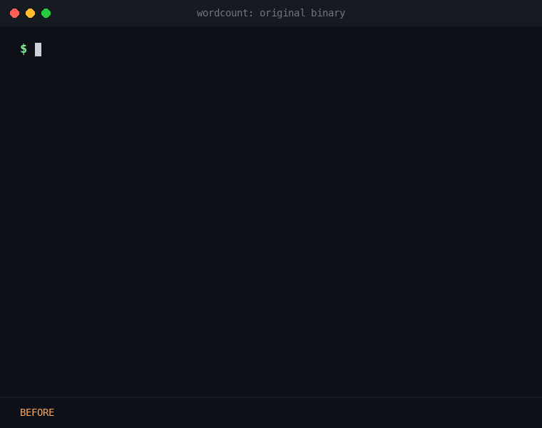
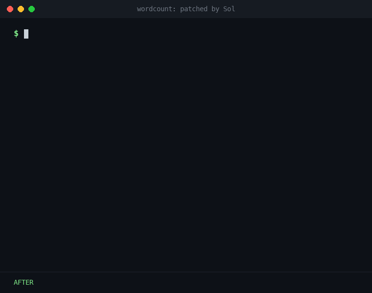
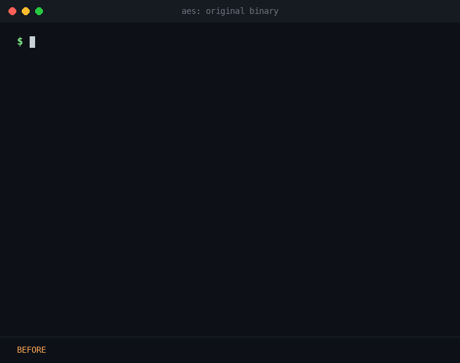
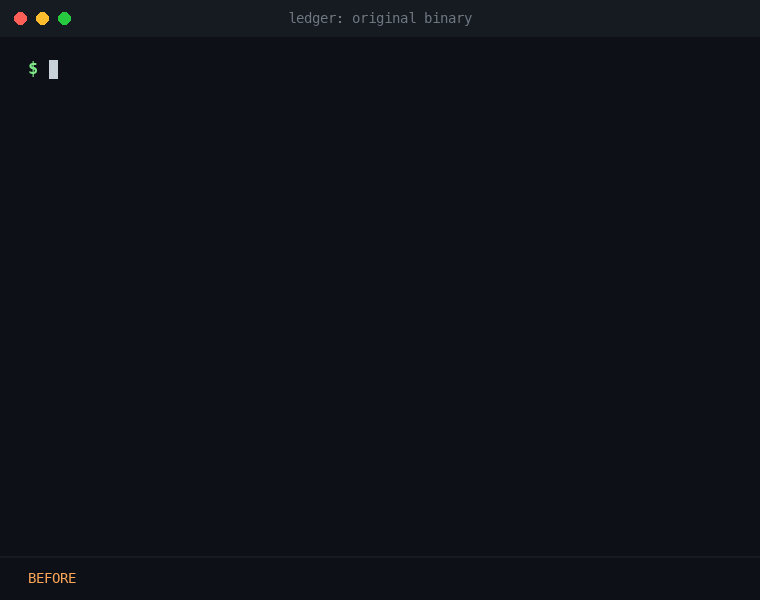

# Machine Code Programming：大模型直接读写可执行文件字节

一个已经编译、剥离符号的程序，还能不能被大模型读懂？George Xenos 和 Sotiris Giannopoulos 的实验给出了一个颇有分量的初步答案：只把可执行文件的十六进制转储放进提示词，不提供反汇编器、编译器或任何工具，GPT-6.1 Sol 不仅解释了四个测试程序，还为三个程序直接改字节添加功能，并从零写出了三个可运行程序。

更贴近实战的一次测试中，模型分析了一个未知 Windows 恶意软件样本，判断它会下载机器码并在内存中执行，还给出了正确的服务器地址和请求 URL。作者因此提出“机器码空间编程”（Machine Code Programming）：通用大模型不经过源码、汇编或反编译这一中间层，直接围绕可执行文件的字节推理。

这些结果还很早期，样本规模也小，但它们指出了一个值得认真对待的变化：反汇编器把字节翻译成人类可读的形式，而模型未必需要这层翻译。

## 没有反汇编器，实验怎样限制模型

实验对象不是专门训练的二进制分析系统，而是通过 Codex CLI 0.166.0 调用的 GPT-6.1 Sol，推理强度设为 high。除“从零写程序”一项外，输入都是 `xxd` 生成的十六进制转储；这种表示每字节约消耗 2.4 个 token。

作者用本地中继移除了每次请求中的全部工具，并审计每轮事件流。他们还做了实时检查，要求模型读取植入文件、运行命令和访问 URL，以确认工具限制确实生效。每个程序只有一次回答机会，没有反馈和第二次尝试。

对涉及可执行文件的实验，评分方式是把模型生成的程序和 GCC 参考构建放在同一组测试上运行，标准输出和退出码必须逐字节一致。程序在 Apple Silicon 上通过 qemu-x86_64 执行。读程序和恶意软件分析两项输出的是报告，不做这种形式化评分。

这套约束很关键。它测试的不是模型会不会调用 Ghidra、编译器或沙箱，而是它能否在只有一次机会的情况下，自己处理指令边界、相对跳转、调用目标和可执行文件头字段。

## 只看字节，认出四个程序并发现上游缺陷

第一项实验输入三个作者编写的程序，以及 FreeBSD 的真实工具 `ministat`。模型对四个程序的功能判断都正确。

| 程序 | 大小 | Sol 6.1 的报告 |
| --- | ---: | --- |
| wordcount | 5,368 B | 行数、单词数和字节数统计器 |
| AES 工具 | 9,152 B | AES-128/256，ECB 模式，仅加密 |
| Bank ledger | 8,872 B | 面向命名账户的命令解释器 |
| ministat | 67,392 B | 带合并 t 检验和 ASCII 图的统计工具 |

最难的是 `ministat`。作者用 `-O3` 构建它，静态链接 musl，剥离符号，删除程序自身的文本，还把最后三个字符串的每个字节最高位设为 1，使它们不能直接读出。Sol 找到了解码循环，恢复选项列表，并描述了全部八个选项。

它还在没有源码的情况下发现了一个真实缺陷：模型把 t 分布表当作原始 64 位浮点数读取，注意到标为 99.5% 置信度的选项实际使用了约 99.8% 的临界值，因此 `-c 99.5` 执行的检验比标签声称的更严格。作者随后借助 Claude 对照原始源码确认了这个上游问题。

这一案例比“识别出一个统计工具”更说明问题。模型没有依赖程序名或可见说明，而是从数值表和控制逻辑中发现了实现与界面承诺之间的不一致。

## 直接修改机器码，一次通过全部测试

第二项实验要求模型为三个现有程序各添加一个功能。回答必须是一组等长字节替换，不能靠扩大文件来避开布局问题。隐藏测试同时检查旧功能、新功能和长输入处理，三个修改后的程序全部通过。

| 程序 | 要求添加的功能 | 修改字节 | 输出 token | 耗时 |
| --- | --- | ---: | ---: | ---: |
| wordcount | 输出第四个数：最长一行的长度 | 74（1.4%） | 3,440 | 93 秒 |
| AES 工具 | 添加可解密的 `dec` 命令 | 544（5.9%） | 9,324 | 201 秒 |
| Bank ledger | 添加账户间 `transfer` 转账命令 | 379（4.3%） | 6,859 | 140 秒 |

模型的做法类似人类手工打补丁：寻找文件中的填充区域，修改段头使其可执行，把新代码写进去，再用指向新代码的调用覆盖原有指令。作者特别指出，Sol 自己定位了 `wordcount` 中位于 `0x1110` 和 `0x1190` 的输出例程。

下面三组动态图分别展示三个程序修改前后的实际运行结果。命令确实分别在原程序和补丁程序上通过 qemu-x86_64 执行，面板保留各自的真实输出，只有输入过程做了动画处理；这些命令上，补丁程序也与参考构建一致。

> 图解：wordcount 在保留原有统计功能的同时，新增了最长行长度输出。

> 图解：AES 工具原来只能加密，补丁加入了 `dec` 解密命令。

> 图解：Bank ledger 在账户命令解释器中加入转账操作，同时保持原有命令行为。

这个实验的意义不在于节省了几百字节，而在于模型必须同时维护原程序的控制流和新功能的正确性。只读懂某段指令还不够，跳转距离、段权限和入口位置都要一致，程序才能继续加载并运行。

## 从文字需求到完整 ELF，连文件头也自己写

第三项实验进一步取消了现有二进制。模型只拿到行为规格，必须返回一个完整 ELF64 文件的每个字节，包括文件头，没有汇编器和编译器可用。三个生成文件都成功运行，并在所有测试用例上与参考实现一致。

| 程序 | 模型生成文件 | GCC 构建 | 输出 token | 耗时 |
| --- | ---: | ---: | ---: | ---: |
| wordcount + 最长行 | 391 B | 5,432 B | 6,035 | 124 秒 |
| AES + 解密 | 4,144 B | 9,408 B | 22,812 | 474 秒 |
| Ledger + 转账 | 3,584 B | 8,896 B | 25,069 | 504 秒 |

Sol 自行计算了每次跳转、调用和文件头字段。AES 工具的查找表也与 AES 标准完全一致。相比从零写文件，直接扩展现有程序少用了约 1.8 至 3.7 倍的输出 token：已有文件提供了大部分结构和代码，模型只需修改相关位置。

这里的文件大小差异不能直接解释为“机器码编程普遍优于编译器”。测试只有三个小型程序，比较的是特定构建结果；真正被验证的是，在严格的一次性生成条件下，模型产出的字节可以构成完整且行为正确的可执行文件。

## 真实恶意软件分析：结论正确，但并非每项都被证实

第四项实验把同样的方法用于真实样本。输入是一个 4,608 字节的 PE32+ Windows 可执行文件，提示词没有告诉模型它是恶意软件。文件唯一可见的导入是 `Sleep`，其他 API 调用隐藏在名称哈希之后，字符串则在栈上动态构造。

211 秒后，Sol 得出结论：该程序下载机器码并在内存中运行。它给出了硬编码服务器 `165.154.205.34:443`，以及通过明文 HTTP 发出的请求。作者在事后按 SHA-256 找到同一样本的 VMRay 公开动态分析报告，逐项比对模型输出。

| Sol 6.1 的报告 | 作者的核验方式 |
| --- | --- |
| 遍历已加载模块并比较循环右移 13 位哈希，找到 13 个 API | 独立重算全部 13 个哈希，13/13 一致 |
| 如果 `%TEMP%\log_de.log` 存在则退出 | 沙箱记录了对该文件的访问；公开报告把它描述为终止开关 |
| 连接 `165.154.205.34:443`，以明文 HTTP 发送 `GET /?a=w64&h=165.154.205.34&t=ws_&p=443` | 沙箱唯一联系的地址正是该 IP，通过 443 端口使用 HTTP，并请求了相同 URL |
| 每 10 秒重试，直到连接成功 | 未确认：沙箱把样本 9 分 15 秒的睡眠缩短到 20 秒，随后服务器响应 |
| 用 `0x99` 异或解码响应，再从可写、可执行缓冲区调用它 | 沙箱下载了 5,158,400 字节的 `windows_amd64.exe`，创建读写执行页，内存转储匹配 VShell 规则；公开的 VShell stager 报告也给出相同密钥 |

这份核验保留了重要的边界：一个样本、一次运行，而且沙箱只确认了地址、请求和下载，没有直接确认 10 秒重试或异或密钥本身。循环右移 13 位哈希也是公开工具中常见的技术，模型的识别可能受益于训练经验。作者没有要求模型修改或编写恶意软件。

尽管如此，这个案例仍把前面的“小实验”推进到了真实分析任务：模型面对的不是为测试设计的清晰程序，而是刻意隐藏 API 和字符串的样本，并给出了可用于后续调查的正确线索。

## 开放权重模型也得到相同结论，代价是更多推理

作者随后用 opencode 和开放权重模型 DeepSeek V4.1 Flash 重复恶意软件实验。样本和请求不变，推理强度仍为 high，只回答一次，opencode 没有记录工具调用。这为“能力不只属于闭源模型”提供了初步证据，但两个模型的准确性和成本并不相同。

| 指标 | Sol 6.1 | DeepSeek V4.1 Flash |
| --- | --- | --- |
| 结论 | 下载代码并在内存中运行 | 相同 |
| 与作者核验一致的 API 名称 | 13/13 | 9/13 |
| 服务器地址 | `165.154.205.34:443` | 相同 |
| 请求 URL | 完全一致 | 一个参数名写错：用 `fh` 代替 `h` |
| 推理 token | 5,178 | 89,902 |
| 回答耗时 | 211 秒 | 859 秒 |

DeepSeek 的推理轨迹展示了几个可核查的字节推导。它通过 PE 节头把入口映射到文件偏移 `0x400`，将 `e9 03 00 00 00` 解码为跳到 `0x408`；又把写入相邻栈位置的两组字节 `47 45 54 20` 和 `2f 3f 61 00` 拼成 `GET /?a`，而输入转储并没有 ASCII 辅助列。

在判断下载数据如何执行时，它跟踪 `rbx` 中的缓冲区指针，把 `80 34 19 99` 识别为对该缓冲区字节执行 `0x99` 异或，再把 `ff d3` 解码为调用同一缓冲区。这些步骤说明它不是只凭文件名或表面特征猜出“下载并执行”。

不过，DeepSeek 用了约 17 倍的推理 token，反复修正自己的读取，也显式调用了对常见 API 哈希的记忆。它只正确识别 13 个隐藏函数名中的 9 个，其中两个命名错误还导致它误读标记文件检查。

这项补充实验的隔离也不如前几项严格：模型由 opencode-go 提供商托管，作者无法确认具体服务的是哪个 V4.1 Flash 构建；opencode 跳过了作者的 MCP 禁用设置并连接了继承的服务器，且没有使用此前的中继，因此无法核实提供商请求中实际包含哪些工具。记录中没有工具调用，但这不等于完整复现了 Sol 实验的“无工具证明”。

## 真正的限制是上下文，而不只是指令知识

这套方法最硬的约束是上下文长度。十六进制转储每字节约需 2.4 个 token，67 KB 的 `ministat` 就消耗约 163,000 个 token；按同样比例，10 MB 程序约需 2,400 万个 token。一次性把全部字节放入提示词显然无法扩展到大程序，而作者最大的测试只有 67 KB，尚不知道接近上下文上限时分析质量如何变化。

作者设想用递归语言模型（Recursive Language Model，RLM）式的执行框架缓解这一问题：长提示词作为变量保存在 REPL 中，不直接进入模型上下文；模型先读文件头，再按偏移跟随调用和跳转，把各个函数分给子调用检查。这是后续方案，不是本文已经验证的结果。

相关研究也提示，不应把这次实验理解成“此前模型完全不能处理字节”。MalConv 等专用模型早已研究原始字节上的恶意软件检测；Large Byte Model 则通过加入字节 token 扩展词表，其出发点是 LLM 不能直接处理原始字节表示。本文的小样本结果至少表明，通用前沿模型在字节以十六进制写出时，已经能完成更复杂的任务。

在汇编层面，还有 SLaDe 反编译器和生成式汇编模型 Nova；BinMetric 基准则发现，二进制提升和汇编合成仍然困难。Project Ire 使用 Ghidra、angr 等工具大规模逆向和分类恶意软件，与这里的单次无工具实验规模和条件都不同，不能直接比较。作者没有找到通用 LLM 在完全无工具条件下补丁并写出可执行程序的既有记录，但也明确表示检索并不穷尽。

## 反汇编仍属于人，机器码却可能直接属于模型

这组实验最值得关注的不是“大模型即将取代编译器”，而是它绕过了为人设计的表示层。反汇编器和反编译器把字节变成人能阅读的汇编或类 C 代码；在作者的测试中，模型直接读取、修改和生成了字节。对人类分析者，这些工具仍然不可替代；对模型，它们未来可能只是可选组件。

恶意软件分析可能因此改变初步筛查流程：如果通用模型能直接从样本中恢复行为与 IOC，就不必先完成耗时且依赖工具的反编译，再开始判断样本用途。但目前证据只覆盖少量小程序和一次真实样本分析，远不足以证明它能稳定处理大型、复杂或强混淆软件。

对逆向工程和恶意软件分析从业者，值得关注这种新的工作方式，也应保留同样严格的核验习惯：模型报告中的地址、API、重试逻辑和解码步骤，仍要通过哈希重算、沙箱和内存证据分别确认。本文已经展示“直接读写字节”可以发生；它尚未证明，这种方式能在真实工作负载中持续、可靠地替代现有工具链。

> 本文参考自 [Programming in the Machine Code Space: LLMs can read & write executables byte by byte](https://sgiannopoulos.github.io/blog/machine-code-programming/)