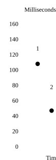

# Habitat：全球读延迟降低 12 倍

服务超过 10 亿用户、40 个地域和 500 PB 数据时，一个热门键就可能拖慢登录，跨国读取也会进入产品关键路径。OpenAI 的在线存储平台 Habitat 先改造 Cosmos DB 的多租户能力，再结合复制、缓存和 Rust 重写。团队报告，全球读取 p50 从约 120 ms 降至约 10 ms；最大 Cosmos DB 账户可存数十 PB 数据，服务超过 2000 万 QPS。

## 共享、独立，再回到共享

Cosmos DB 的限制常发生在物理分区：多个逻辑分区共享其吞吐量，而分区拆分后，若容器总 RU/s 不变，每个分区分到的能力还会下降。Habitat 最初共用一个默认容器，结果不同业务可能撞用同一逻辑分区键，“坏邻居”也会跨逻辑分区扩散；类似 Blob 的负载甚至会在请求量不变时，仅因数据增长而被更多限流。

独立容器确实把许多全站故障缩小为单功能降级，却把容量规划推回各产品团队。新功能相对内部试用基线可能增加 1000 倍流量，忘记预扩容时，工程师只能在发布当天进入 SEV 事故响应。于是 Habitat 重回默认共享，但与 Azure 补上热点键限流、保护交互请求的 QoS 分级，以及同时按存储量和 RU 使用量拆分的 Serverless 模式。团队报告，此后数月未再发生预配或“坏邻居”相关事故。

托管服务在极端规模下也需要共同运维。2024 年末，大型账户的区域切换需数小时；约一个月后的回切又引发连接风暴，压垮网关。此后 OpenAI 与 Azure 开始共同监控全链路、在与生产规模相当的无生产流量账户上测试，并联合改进 SDK、网关和控制面。

## 12 倍提速来自组合改造

读取占 Habitat 请求的 90% 以上，团队因此把认证元数据等少量敏感数据广泛复制：部分账户覆盖全部 40 个服务区域，其他账户至少覆盖每个大洲。其余热点读取交给基于 Valkey 的分布式缓存，再以变更数据捕获（CDC）消费 change feed、主动失效旧缓存，全球传播通常需数秒，最后用 Rust 重写 Python 服务，降低代理开销。

> 图解：关键数据就近复制、区域缓存和 Rust 重写共同将读取 p50 从约 120 ms 降至约 10 ms。原文未给出各阶段的独立收益，不能把提升归因于某一项。

缓存主要改善中位数，未命中请求仍可能跨地域访问，尾延迟并未消失。CDC 也已扩展为平台能力：每秒处理数百万条变更，连接一百多个 Kafka 主题，同时支撑索引、数据移动和实时功能。

面向下一个十亿用户，OpenAI 正自研 EB 级在线存储，将 RocksDB Cloud 与 Raft 复制结合，以存算分离和物理复制减少闪存容量，代价是峰值 QPS 更低；其实际收益尚无上线结果。Habitat 的经验不是“共享必然更好”，而是先划清故障与容量责任，再为不同数据选择复制或缓存。

> 本文参考自 [Rapidly scaling online storage to serve over 1 billion ChatGPT users (Part II)](https://openai.com/index/scaling-storage-one-billion-users-part-two)