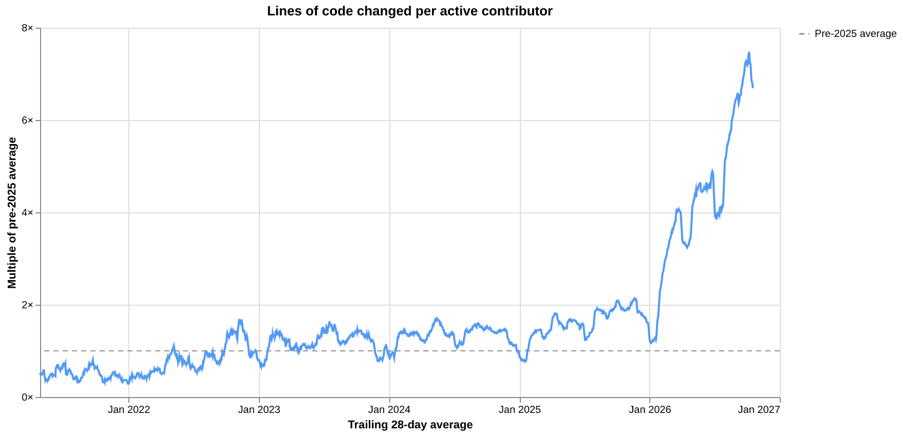
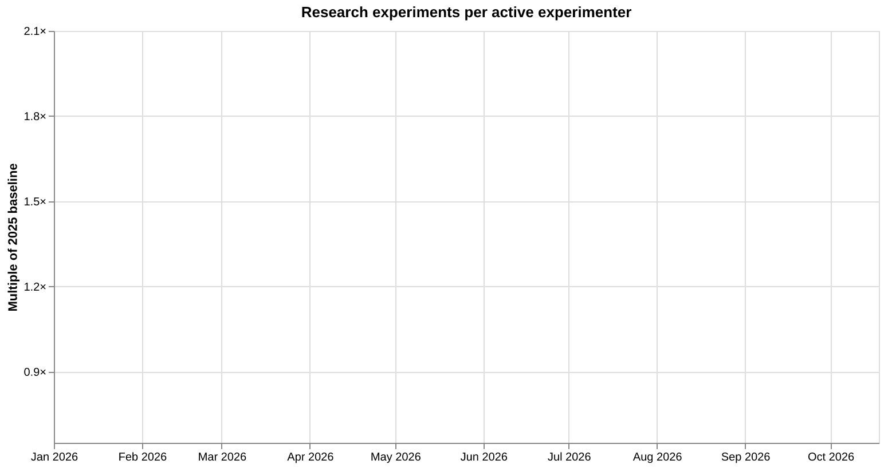

# Research acceleration：智能体加速AI研究，任务表现仍参差

监控训练任务时，编码智能体无需人工干预的成功率达到79%；编写推理与服务栈代码时，这一数字只有25%。在预计需要人类工作2至4小时的任务中，智能体的自主完成率已接近一半，但这远不等于可以把整个AI研发流程交给它。

OpenAI在2026年11月18日发布的研究加速报告，用内部用量、任务成功率、研究者调查和模型能力指标描述了这条“参差不齐的前沿”。从3月到10月，2至4小时任务的自主完成率由23%升至46%，4至8小时任务由13%升至35%。增速背后还有分工变化：机器承担了更多实现、监控和批量分析，人仍然负责选题、判断质量，并收拾智能体走偏后的局面。

这份报告也试图为“递归自我改进”（RSI）提供可观察的指标。RSI指AI参与并加速后续AI系统的开发；OpenAI主张实验室跟踪并公开相关迹象，同时明确表示，发布这些数据不代表其打算追求完全的RSI。以下数字均来自OpenAI内部测量，覆盖范围和测量方法都有边界，不宜直接外推到其他团队。

## 投入研究的不只是人，还有并行运转的智能体

OpenAI研究组织的智能体使用强度在2026年持续上升。按API标价折算，10月研究者每日使用量的中位数达到2400美元，比9月的1500美元增长62%；第90百分位从1.1万美元升至2.3万美元，增长105%。

这不是实际账单：折算结果同时受使用频率、模型价格、模型行为和智能体运行框架影响。OpenAI还披露，8月21日一次临时的框架效率调整压低了输入token用量，相关调整从9月10日起逐步撤回，因此跨月比较支出时尤其需要谨慎。

另一个指标是“智能体工作日”：每累计运行8小时，记作一个智能体工作日。每名研究者每天对应的智能体工作日从0.5增至5.7，约为原来的11倍；预训练和后训练团队约为8个，扩展与基础设施团队约为4个。该指标看的是运行时长，不反映模型能力或价格变化，而且通常只统计交互式使用，可能漏掉自动化任务。

并行使用也在增加。到10月中旬，纳入统计的研究者中，超过三分之二的人每日并发智能体峰值的平均值至少为4个，超过10%的人至少为16个。一个研究者不再只是与单个助手轮流对话，而是在同时监督多个工作进程。

按API标价折算的智能体支出，与人力成本放在一起看更直观。2026年9月，前者约为研究人员非股权激励薪酬的两倍，预训练和后训练团队的比例更高。不过，这一比较排除了通常占OpenAI研究人员目标薪酬70%至80%的股权激励；工资、加班费、奖金、福利和雇主税则包含在内。

与此同时，内部Codex、ChatGPT和API合计只占研究总计算量的2%。这说明“API等值支出很高”与“消耗了大部分研究算力”并不是一回事。

## 人力没有消失，安全与对齐投入反而增长最快

为了估计研究者把时间花在哪里，OpenAI收集了2026年1月至9月公司内部公开的Slack帖子、代码拉取请求和内部文档，再用分类器归入研究领域。每位研究者每周的时间，会在其当周已验证的项目之间均分。

这里衡量的是实际贡献，而非正式组织归属：一名后训练团队成员如果把一半时间用于基础设施，就会被记为两个方向各半周。

按这套方法，各研究领域记录到的人力投入都在增长，其中安全与对齐的绝对增量最大。1月至9月，其记录到的工作周数增加77%，来源既包括新招聘，也包括原有研究者转向安全项目，涉及对齐评估、可监控性和奖励作弊等方向。

明显加速出现在2026年7月Hugging Face事件及OpenAI后续改进前沿AI训练安全论证之后。不过，后训练与安全对齐之间的分类边界并不清晰，OpenAI也表示定义可能继续调整。

这组数据至少说明，研究加速并没有简单等同于“用智能体替换研究者”。工具和人力都在增加，而新增人力中有相当一部分流向了监督、评估和安全工作。

## 自主性在提高，但不同任务之间差距很大

报告采用Epoch AI开发的O*NET AI R&D分类法，考察研究者把哪些任务交给智能体，以及智能体能否在零人工干预下完成。2026年8月1日至10月18日，沟通类和分析类任务的成功率分别为69%和58%，构建类只有43%。

具体到任务，差异更明显：监控训练运行中的问题为79%，回答技术问题为72%，启动训练运行为35%，构建评估、强化学习和智能体环境为29%，编写推理与服务栈代码为25%。即便智能体已经能稳定处理某些研发环节，低成功率环节仍可能成为整个项目的瓶颈。

按时长统计的成功率也在上升，但这里有一个重要混杂因素：随着模型变强，研究者会改变委托的任务类型。因此，同一时长档位从23%升到46%，既可能反映能力进步，也可能反映任务选择变化，不能全部解释为模型在同一批任务上的提升。

报告这次按任务出现次数统计用途，也与此前按输出token统计不同：回答技术问题等短任务会获得更高权重，而启动、监控训练或实现复杂功能等token密集型任务的权重会相对降低。

## 研究者怎样评价智能体，又怎样防止它帮倒忙

2026年8月底至9月初，OpenAI调查了101名研究人员，设置了一个假设：如果团队未来3个月不能使用所有强于GPT-5.2的编码智能体，愿意付出什么代价恢复访问？回答的中位数是团队40%的人手，或当前团队算力的30%；若把同样问题放到2027年1月，考虑他们对模型进步的预期，愿意交换的算力中位数升至50%。

受访者还表示，如果只能使用GitHub Copilot和ChatGPT，团队完成与上一个月等价值工作的所需时间，中位数会变成3个月。

另一个10月下旬的小样本调查中，28名受访者有27名选择或倾向于使用最新内部模型，而不是“一名中级人类研究工程师加o1-preview等2024年模型”；剩下一人没有选择题目给出的两个选项，而是表示会选GPT-6 Astra。这些结果反映了研究者对工具价值的主观判断，但自报误差和非随机、临时性的抽样方式都限制了结论强度。

访谈揭示了更具体的工作方式。一名做安全评估的研究者说，过去移植开源评估并判断它是否可用，连同研究和消融实验可能要一周半到两周；现在从零到运行起来通常是一天或几天，具体取决于评估。

批量处理是另一项明显收益：研究者用模型扫描数千个样本，诊断实验问题、标记令人担忧的模型行为，并构建和质检新数据集。一名做数据质量的研究者让模型多轮检查全部数据并校准输出，最终得到一张整理好的大表，认为没有AI会非常痛苦。

但智能体也会写出低质量的拉取请求、生成不可用的数据、作出错误的分析假设，或在不必要的步骤上反复兜圈子。一名后训练研究者因此改变了委托方式：不再让模型照另一个任务直接批量生成，而是先做一个，人工审查修改，再让它完成剩余部分。

受访者也批评模型在研究想法、代码质量、数据质量和写作上的“品味”不足，例如反复生成相似的数据点。不过，一名预训练研究者虽然认为自己在想法判断上仍占优势，却明确表示没有信心这一优势会长期保持。

## 关键研究想法仍主要来自人，但边界开始松动

提出并筛选概念性研究想法，也就是所谓“研究品味”，可能是RSI的瓶颈。OpenAI请预训练、后训练和安全监控三个领域中，每个领域1至4名关键贡献者，分别列出对GPT-6 Astra和GPT-6.2 Astra最重要的1至3个想法，再追溯其来源。

对于两个版本的后训练和安全监控工作，受访者认为所列想法都由人提出，模型负责帮助实现；GPT-6 Astra的预训练想法也全部归因于人。

到了GPT-6.2 Astra，预训练研究者开始描述与Codex共同形成想法的过程：一人称Codex在讨论中识别出了关键洞察，另一人表示主要想法属于自己，但Codex建议的一项修改让它真正运转良好。样本很小，不能据此判断AI已普遍具备选题能力，却清楚显示了人机分工正在何处变化。

## 代码和实验数量增加，还不能直接证明研究加速

OpenAI用两项活动指标观察产出。第一项是每名活跃贡献者修改的代码行数。图表使用28天滚动平均值，以2025年前的平均水平为1倍；2026年增长明显，10月18日对应值约为6.69倍。

与9月报告相比，这次不仅把季度平均改成28天滚动平均，还调整了代码变更的纳入标准，特别是排除了测试代码，因此不能把新旧序列不加说明地拼接比较。

> 图解：横轴为28天滚动窗口的结束日期，纵轴为2025年前平均水平的倍数，虚线表示1倍基线。曲线在2026年快速上升，也包含多次回落；代码行数衡量活动量，不等于代码质量或研究成果。

第二项是每名活跃实验者记录的研究实验数。截至10月18日的四周内，该指标平均为2025年基线的1.68倍。周度数据从1月11日的0.72倍逐步上升，中间经历波动，10月11日和18日均为1.68倍。

> 图解：横轴覆盖2026年1月至10月18日，纵轴为2025年平均水平的倍数。整体趋势向上，但实验数量增加仍只是研究活动增强的证据，不能单独证明模型能力提升得更快。

为了更接近研究结果，OpenAI引入了内部版Epoch能力指数OECI。它结合公开基准与OpenAI内部基准，覆盖20个公开发布的OpenAI模型和28个其他模型。

自2025年8月以来，OpenAI模型的OECI前沿每年提高16.4分；作为对照，Epoch观察到的趋势是自2024年末以来每年提高14分。趋势线拟合于9次刷新OpenAI纪录的发布，竖线表示90%自助法区间。

OECI仍不是无争议的加速证明。OpenAI模型在该指标上相对竞争对手的得分高于在Epoch原始ECI上的表现，团队认为这可能来自基准组合不同；内部基准与公开基准如何混合，也会影响跨机构比较。代码行数、实验次数和能力指数因而需要放在一起看，而不能把任何单项当成因果结论。

## 这条前沿为什么值得持续跟踪

这份内部报告支持的最稳妥结论是：智能体已经显著增加AI研究中的代码、实验和批量分析活动，并能独立完成越来越多数小时的研发任务；但能力分布很不均匀，研究想法、质量判断、实验协调和失败纠正仍高度依赖人。

历史数据还来自深度人机协作，未必能预测更自主系统的未来表现。OpenAI也提到，前沿模型近期在数学上出现突然、快速的突破，并正在观察深度学习是否会发生类似变化。

对研究团队而言，当前更可行的用法是按任务分配信任：监控、技术问答和大规模扫描可以更多交给智能体，启动训练、构建环境和推理服务代码则需要更密集的审查；先做一个样本、人工校准再扩展，也比直接批量委托更符合访谈中的经验。

对实验室和治理者而言，下一步需要公开的不只是总用量，还包括能力研究与安全研究是否以不同速度加速、无需等待完整模型开发周期的领先指标，以及研究加速与整体能力趋势之间的关系。只有这些测量持续完善，“AI正在多快地参与制造下一代AI”才会从印象变成可检验的问题。

> 本文参考自 [Research acceleration: The jagged frontier](https://openai.com/index/research-acceleration-jagged-frontier)