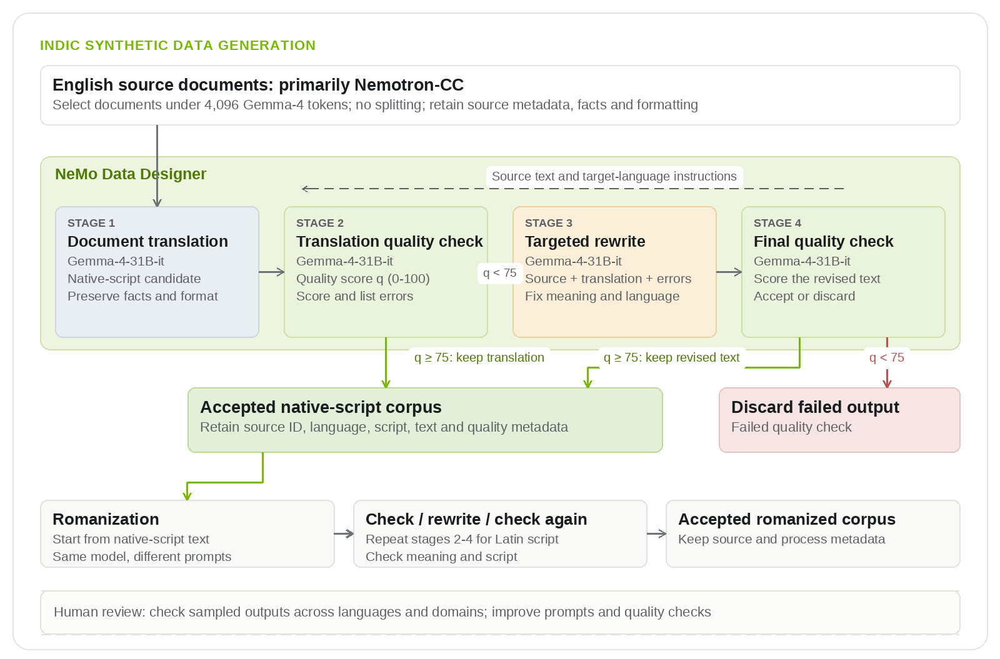
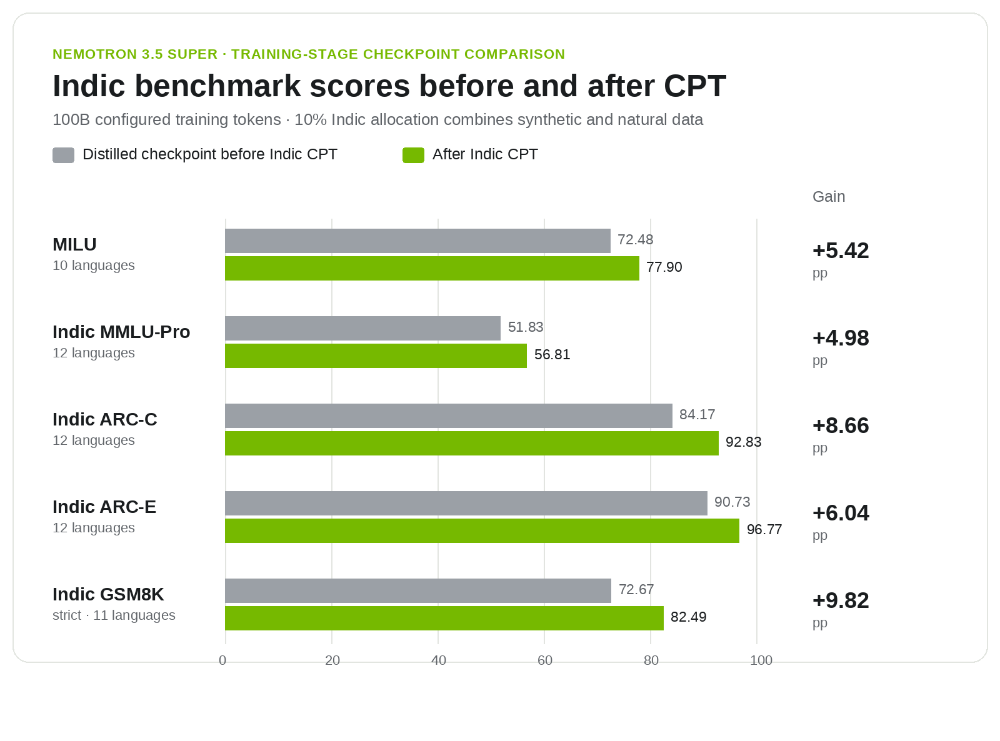

# Nemotron-Indic：2.8 万亿 Token 数据管线

印度语言模型要解数学、处理代码和回答专业问题，瓶颈之一是训练文本不足。AI4Bharat 负责人 Mitesh Khapra 直言：“我们没有足够的印度语言数据。”NVIDIA 与 IIT Madras 的 AI4Bharat 因此推出 Nemotron-pretraining-Indic-v1：约 2.8 万亿 Token，覆盖 22 种印度语言，并开放 GPU 加速的数据生成管线。

这不是批量翻译后就交付。相关 Nemotron 3.5 Super VL Indic 继续预训练（CPT）对照中，5 项印度语言知识与推理基准提高 4.98～9.82 个百分点；但该阶段混用了合成与天然文本，不能把提升全算在合成语料上。

## 从翻译到验收

22 种语言均为印度宪法列出的语言；以其为第一语言的人口占 97%，按 2011 年人口普查接近 12 亿。按 Gemma-4 tokenizer 统计，语料约 2.83T Token：原生文字 2,601.0B，12 种语言的罗马化子集另有 224.6B，共 34 种语言—文字配置。罗马化是用拉丁字母书写印度语言，不是译成英语；它由已验收译文的子集转换，也不等于新增独立内容。上述数字是保留语料库存，不是单次训练预算。

源文档来自 Nemotron-CC-v2 的 15 个子集，覆盖网页、问答、数学和代码等。团队用 NeMo Data Designer 和 Gemma-4-31B-it 串联翻译、质量检查、定向重写与复查，并保留源文档 ID。十二语言流程对少于 4,096 个 Token 的文档整篇翻译；译文按 0～100 分检查，低于 75 分就按错误反馈修复，复查仍不达标则丢弃。75 分并非“75% 准确率”。修复共挽回 438.4B Token，已计入总量。

> 图解：英文文档经翻译、评分和定向修复后进入原生文字语料，部分合格文本再经罗马化及同样的质量流程；源 ID 与质量元数据全程保留。

初步人工比较显示，先从原生文字译文再罗马化，比直接从英文生成更少幻觉性增译和残留英语，但尚不能推广到所有语言与领域。其余 10 种语言改用 Indic Translate，只保留至少 75 分的原生文字结果，不做反馈重写；桑塔利语长文采用重叠窗口，曼尼普尔语先译为孟加拉文字再转成 Meitei Mayek。统一管线仍需按语言和文字系统调整。

## 训练收益与边界

Indic CPT 的预算为 100B Token，其中 10B 用于合成与天然印度语言文本，合成部分取自十二语言子集，其余 90B 延续此前配比。CPT 后 5 项基准全部上升，Indic GSM8K 提升最多的 9.82 个百分点，但 Odia 因超出 serving 上下文长度限制未纳入。

> 图解：灰色为 CPT 前的蒸馏 checkpoint，绿色为 CPT 后的 checkpoint，5 项指标均上升，但各基准覆盖语言数不同。

完整发布模型 Nemotron 3.5 Super VL 相对 Nemotron 3 Super，GPQA 增加 11.83 个百分点，IFEval 1.5 却下降 2.04 个百分点；由于还包含后训练，这也不是语料消融实验。

回到“数据不够”的问题，这项发布提供了可追踪的语料与可复用生成配方，却不能替代天然印度语言文本。自动评分可能漏错，翻译模型兼任评审、人工抽样覆盖不均，通过 75 分门槛也不代表无误；源 ID 检查更不是语义去重。更稳妥的起点是选取少量语言与文字配置，检查样本和许可证，在固定 Token 预算下比较天然／合成及原生文字／罗马化配比，并避免同一源文档的派生记录造成评估泄漏。

> 本文参考自 [Scaling Indic Pretraining: 2.8 Trillion Tokens and an Open Data Generation Pipeline](https://huggingface.co/blog/nvidia/scaling-indic-pretraining)