# Psi-R2.5：让手机视频训练机器人

人类演示视频容易采集，却很难直接教会机器人完成精细操作：画面里是人手而不是机械手，动作轨迹也未必能在真实机器人上执行。Psi Robotics 在 Psi-R2.5 中给出的核心方案，是规模化生产严格对应的人手—机器人数据，再训练一个端到端转换模型，把人类视频变成带机器人动作的数据。团队称，转换后的数据可以直接在机器人上回放，也能用于后训练；在其手机盒装配任务中，结合 HIL 与强化学习后训练，经过几轮迭代可将成功率提高到 99%，耗时为 1—2 个工作日。

这条路线真正想改变的，不只是模型架构，而是具身智能的数据生产方式：不再单纯追求更多小时，而是提高每小时数据的信息量，并消除人类示范与机器人执行之间的鸿沟。

## 十万小时之后，重点不是继续堆时长

Psi-R2.5 采用上下两层架构。上层以 QwenVL3.5-4B 为骨干，使用团队自采数据预训练，负责把一段长指令拆成子任务，并传递包含 memory、soft prompt 等信息的 meta context，以及强化学习意义上的 value。下层以 Wan2.2-IT2V-5B 为骨干，同样经过自采数据预训练，结合这些信息和当前观测，输出机器人的具体操作轨迹。

> 图解：图像、状态和文本分别进入高层规划器与低层控制器。高层视觉语言模型负责拆解目标，以子任务文本和 value 引导下层；下层世界动作模型生成 Action，环境再通过真实交互、人工纠正和强化学习反馈形成闭环。

架构并不是团队强调的重点。他们的判断是，具身模型架构两三天就可能完成一轮替换，真正决定性能上限的是数据。R2.5 相比 R2 的主要升级，也落在数据质量和数据属性压缩上：积累到 10 万小时后，团队没有继续盲目增加规模，而是完整复盘全部数据，提取出真正高质量的 10 万小时数据。

这里看似矛盾的表述，恰恰说明“十万小时”本身不是目标。具身数据包含多种模态，清洗比单一文本或图像更困难。若把原始人类数据和机器人数据不加区分地混合训练，团队认为模型可能隐式学出一个分类器，先判断样本来自人类还是机器人，再调用不同参数推理，而不是学会一种统一的、可执行的操作理解。

数据时长也无法直接代表信息量。例如，1 万小时数据若只覆盖 100 个任务，每个任务 100 小时，其信息量未必高于覆盖同样 100 个任务、每个任务仅 1 小时的 100 小时数据。团队因此尽量压缩单个任务的数据量，通过运维保证任务多样性，再把任务拆成原子动作，进行细致的语言标注和审核。也就是说，所谓“压缩”不是简单删减，而是用更少的重复片段覆盖更多任务，并提供更精确的操作语义。

评测也随之进入训练过程。团队在大小脑训练中引入仿真测评，把仿真数据作为预训练任务之一，并直接在仿真器中做 zero-shot 评测；最终模型则使用包含 50 个复杂任务的真机多任务评测集，测试时持续随机化各任务初始状态，以考察组合泛化。这些设置说明了评测思路，但原文没有给出该评测集上的具体分数，因此不能据此推断相对其他模型的提升幅度。

## Pair Data 的强弱，取决于能否真正执行

解决人机数据混训问题，关键是让模型站在机器人的视角理解人类演示。常见做法是收集 pair data：让人和机器人执行语义相同的任务，例如都拿起同一瓶可乐，再把对应数据一起用于训练。

Psi Robotics 将其分为两类：

- **弱 pair data**：数据只按相同任务语义配对。人和机器人做了类似的事情，但画面、逐帧时序和动作并不严格对应。
- **强 pair data**：除操作本体不同外，图像中的其他内容基本一致，时序上每一帧都能对应，并且机器人 action 可以在真机上直接回放成功。

弱配对提供的是“做了同一件事”的对应关系，强配对则进一步回答“同一时刻，机器人应当怎样动”。团队把后者理解为将人类数据的 dynamic 拉入机器人数据的 domain，同时保留可扩展性。过去高质量的强 pair data 很难采集，多数数据只能停留在弱配对，因而难以直接完成这种对齐。

在此前一版于 4 月发布的 R2 和 W0 中，团队曾通过世界模型中的强化学习，把人类数据显式转换成对应的机器人数据。这套流程能够生成带 action、可在机器人上成功回放的轨迹，但过程复杂。R2.5 的重要进展，是先用这套重流程生产高质量强 pair data，再把整个转换过程蒸馏成端到端模型，降低后续数据生产的成本。

## 人类数据与机器人之间有两道鸿沟

为什么不能直接拿人类视频训练操作模型？文章把 embodiment gap 拆成视觉与动态两个部分，这与 sim2real 中讨论仿真和现实差异的思路相似。

**Visual Embodiment Gap** 是视觉差异。无论戴手套还是裸手，人类演示都与机器人推理时看到的画面不同；差异还来自相机参数和环境变化，并不只是把“手的像素”替换掉那么简单。

**Dynamic Embodiment Gap** 是动作与物理过程的差异。人类数据中的 action 通常由设备或视觉算法估计，与真机数据之间存在三类误差：手部姿态估计误差、人手与机器人关节结构不同导致的运动学误差，以及摩擦等物理参数不同造成的误差。即使视频中的任务看起来相同，估计出的人手轨迹也不一定能在机器人上执行。

已有方案大致沿两条路线处理这些问题。一条是把人类演示通过 real2sim 重建到仿真器，再用轨迹优化或强化学习训练策略，最后 sim2real。它不仅本身难以规模化，最终仍要面对仿真到现实的差距。

另一条路线也把仿真器引入流程，但不直接在其中训练最终策略，而是将其用于数据处理：视觉上先分割、修复图像，再渲染机器人；动态上用轨迹优化或强化学习修正数据，最后通过模仿学习训练视觉运动策略。这条路线仍受 real2sim 规模化能力限制，图像修复也难以可靠处理遮挡等复杂交互。文章举例指出，深度估计和传感器精度不足时，系统可能无法分辨手指与物体的遮挡关系，最终保留穿模效果；而对操作模型来说，丢失的交互信息恰恰最重要。

这些限制解释了为什么纯人类数据方案长期更适合简单、定制化的任务。团队由此提出一个更严格的质量标准：如果某项任务的人类演示经过处理后，连一个能完成该任务的模型都训练不出来，就不能默认把这些数据加入预训练会带来收益。低质量数据的噪声可能超过其信息量，尤其当模型已经用高质量数据训练后，再混入低质量数据反而可能使固定评测环境中的表现下降。

## 从正向转换到逆向造数据

Psi Robotics 的早期方案用世界模型 Psi-W0 代替传统仿真器。通过 10 万小时规模的人类数据预训练后，Psi-W0 承担环境模拟的角色，再配合强化学习，把一条人手轨迹优化为可执行的机器人轨迹。世界模型绕开了传统仿真流程中的部分 sim2real 和规模化问题，但策略与世界模型需要相互 rollout，还要用强化学习微调，整套系统依然很重。

团队随后收集了 Psi-W0 转换得到的强 pair data，用蒸馏训练直接对齐人机数据的转换模型。不过，正向生成仍有一个根本困难：面对一条现成的人类数据，系统必须“凭空”创造与之对应的机器人数据，所以需要轨迹优化或强化学习不断缩小差异。

真正的转折是把问题倒过来：不从人类数据寻找机器人答案，而从已经可直接使用的真机数据出发，逆向生成匹配的人手数据。机器人数据在视觉和动态上天然有效；有了大量一一对应的人机样本，就可以训练模型接收人手视频，输出匹配的机器人图像和 action。团队因此逆向使用 Psi-W0，从真机数据生成对应的人手数据，直接制造高质量 pair data，再用它们训练带 action 的端到端转换模型。

这一设计把繁重的搜索和优化留在配对数据的生产阶段，实际处理新的人类视频时则交给转换模型。它也是文章标题中“Scaling Pair Data”的具体含义：规模化的不是泛泛的同任务演示，而是可支撑人机直接映射的监督数据。

## 用回放和后训练检验数据，而不只看视频像不像

转换结果是否可信，不能只凭生成画面判断。团队使用两种测试：一是把处理后的数据直接在机器人上回放，看能否完成相同任务；二是用这些数据做后训练，检查训练后的模型能否泛化完成相关任务。

据团队报告，转换后的人类数据能够直接用于真机回放或训练模型。部分特别复杂的任务虽然仍无法直接完成，但双手轨迹基本接近。文章将这种泛化归因于模型本身并非策略模型，而是在执行带 action 的视频编辑任务，同时机器人的动作空间有限，因此更容易实现 zero-shot 泛化。

团队还展示了一个更贴近日常采集的结果：用手机在普通场景随手录制人手操作，即可通过管线转换成不同机器人的数据。原文认为其图像重建精度和物理一致性较好，因而有机会利用第一视角人类视频的多样性。不过，这里提供的是团队展示与定性描述，没有跨任务成功率、不同手机或场景的对照数据，也没有公开完整评测细节，实际适用边界仍需更多结果验证。

## 从预训练到真机部署，还需要后训练闭环

数据转换并不意味着基础模型可以直接覆盖所有客户现场。团队判断，预训练和后训练会长期共存：预训练构建通用能力底座，降低下游适配的数据规模与成本；现场的 SKU 和节拍高度定制，通用数据短期难以完整覆盖，因此仍需要后训练连接基础模型与真实任务。

为此，团队开发了基于灵巧手的 HIL 与强化学习后训练框架。HIL 即 Human-in-the-Loop，把人工干预纳入训练过程；系统先在基础模型上用少量数据微调，部署时持续收集失败案例并回流，再迭代提升能力。

手机盒装配是文章给出的具体案例。该任务步骤多、精度要求高，从零开始用模仿学习训练时成功率较低；借助上述框架，经过几轮迭代后成功率达到 99%，耗时 1—2 个工作日。团队称该方案也已部署到客户现场，用于处理复杂 corner case。需要注意，这个结果属于特定任务和团队流程，不能直接外推为所有任务的通用成功率或交付周期。

## 配对数据还为机器人 ICL 提供了入口

在人类视频能转成机器人数据之后，同一条管线还可以服务上下文学习（In-Context Learning，ICL）。其目标是无需重新训练或微调，只示范一次任务，再把轨迹像 prompt 一样交给模型，引导机器人完成此前未学会的任务。

机器人 ICL 与语言模型的一个区别是，示范上下文最初往往是人类视频，而非机器人自己的示教视频。配对转换模型可以先把它变成更适合机器人理解的形式，再作为提示输入。团队展示称，机器人无需更新任何参数，就能根据文本提示或物理提示推断做什么、怎样做，对新任务进行零样本泛化。

这一能力的吸引力在于省去每个新任务的单独训练，但文章明确表示更多 ICL 技术细节将在后续发布。目前材料没有给出任务范围、成功率或失败条件，因此它更适合作为已展示的方向，而不是已经被充分量化验证的通用能力。

## 数据规模之外，更重要的是可执行的对应关系

Psi-R2.5 的核心贡献不是又增加了多少训练小时，而是把“人类视频能否帮助机器人”拆成可检验的问题：画面和动作是否对齐，轨迹能否真机回放，数据能否训练出可泛化的策略。其强 pair data 路线，通过逆向生成降低配对数据生产难度，再蒸馏为端到端转换模型，为利用手机视频和第一视角人类数据提供了一条清晰路径。

对于关注具身数据、遥操作替代方案或机器人快速适配的读者，这套思路值得持续跟踪。现有证据主要来自团队的案例展示，99% 的成功率也有明确任务与后训练条件；转换模型在更多开放场景、复杂遮挡和长程任务中的稳定性，以及 ICL 的系统评测，仍是下一步需要回答的问题。

> 本文参考自 [Scaling Pair Data for Embodied Intelligence](https://cypypccpy.github.io/scaling-pair-data.github.io/)