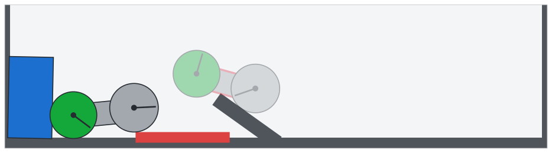
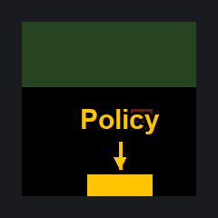

# Weight-Space Programming：让 LLM 直接读写权重

神经网络出现循环输出、策略卡住等行为问题时，通常要重新收集数据、运行训练或设计专门评测，权重本身则像一串难以读懂的数字。能否跳过梯度训练，让通用 LLM 直接理解并修改这些数字，关系到模型审计与优化能否多一条路径。

MIT CSAIL 团队提出 Weight-Space Programming（权重空间编程）：把自然语言目标交给 GPT-6 Astra，由它推理各层权重的功能，再读取、修补或从零写出网络。最醒目的一项结果是，在允许 50 次前向传播、禁止训练和梯度的条件下，它只修改 Qwen3.5-0.8B 的 0.016% 权重，就将 MATH-500 从 7.9% 提高到 48.1%；另一组实验中，从零写出的三个游戏网络全部战胜 PPO 训练 1 亿步的基线。

这些结果并不意味着 LLM 已经可以取代训练。更有信息量的结论是：权重并非只能交给梯度下降更新，通用模型已经能从其中读出一些可解释的结构，并把自然语言意图转成局部、可执行的修改；与此同时，失败实验也清楚划出了当前能力的边界。

## 权重空间编程，改变了哪一层抽象

过去几年，LLM 优化的对象逐渐从提示词扩展到程序、完整测试框架，以及训练代码和超参数。但这些工作大多仍让优化器负责更新权重：LLM 写训练方案，Adam、Muon 等算法执行实际的参数搜索。

Weight-Space Programming 再往下走了一层。它的严格含义是：通用 LLM 根据自然语言规范，直接读取和写入网络权重，不通过优化器，尤其是不使用梯度下降；部分任务甚至没有任何环境反馈。模型需要先推断“某组权重正在计算什么”或“应该计算什么”，再把判断落实为参数。

团队用八组主要实验和一组补充实验测试了三类能力：

- **读取权重**：判断网络玩什么游戏、扩散模型生成什么图形、小型语言模型学过什么语言，以及两个模型中哪一个更谄媚。
- **修复权重**：修正无法爬坡的控制策略，并处理 Qwen3.5-0.8B 的推理循环。
- **从零写权重**：生成 MinAtar 游戏策略和围棋策略，而不是在已有训练结果上做少量调整。

这里的“编程”不是修辞。Astra 在多个案例中先把目标拆成条件判断、信息传递和评分规则，再将这些规则分配到不同层与神经元，本质上是在连续参数中实现一段程序。

## 只读权重，能恢复多少行为信息

读取权重最容易被质疑的一点是：模型究竟理解了内部结构，还是只抓住了输入、输出层的表面线索？团队因此从简单任务开始，逐步抽走可利用的信息。

### 从游戏策略到扩散模型

第一组实验使用 PPO 训练四个游戏策略网络。四个网络拥有相同的输入通道、动作集合和维度，Astra 无法靠架构差异猜答案；团队把原始权重直接放进提示词，也不提供候选游戏列表，它仍然全部答对。

Astra 给出的依据包括第一层权重在不同输入通道上的空间分布，以及输出层区分了哪些动作。例如在 Breakout 中，智能体相关权重集中在底行，对应挡板的位置。这说明它至少能把部分参数模式与游戏机制联系起来，而不是只识别网络形状。

第二组实验把对象换成三个 DDPM 扩散模型，分别生成圆形、三角形和正方形。禁用工具与前向传播后，Astra 依然能仅凭权重判断生成目标。它观察到输出层中不同隐藏单元的权重分别描绘图形的一段边缘，再把这些边缘组合起来。

一个错误反而暴露了它的阅读方式：Astra 画出的都是轮廓，而原模型生成的是实心图形。作者认为，这种偏差支持它正在读取权重的几何结构，而非暗中计算一次前向传播。不过，这仍是基于实验现象的推断，不等于完整证明了其内部推理过程。

### 去掉输入输出层，还能判断训练语言吗

前两组任务都可能主要依赖第一层或最后一层，但语言模型的大量行为藏在中层。第三组实验因此只保留四个 Transformer Block，移除输入与输出层，让网络无法直接接收文本，也不存在标明字符含义的嵌入表。

团队训练了三个 7.2M 参数的字符级语言模型，分别学习 Python 代码、罗马字日语和英语。Astra 可以用 Python 分析权重，但不能运行网络或其中任何一层。它需要判断训练语言，并解释全部 24 个注意力头的作用。

结果上，三个模型各测试两次，语言判断全部正确；Astra 找出的复制头（induction head）也与实测完全一致，没有把其他注意力头误报为复制头。复制头的作用是让模型重复此前见过的文本，例如前文出现过 `total` 后，再遇到 `tot` 时倾向于补全它。

| 训练数据 | Astra 的回答及置信度（两次） | Astra 找到的复制头（层.头） | 实测复制头（层.头） |
| --- | --- | --- | --- |
| Python | Python（0.56），Python（0.52） | 2.1、3.1、3.5 | 2.1、3.1、3.5 |
| 罗马字日语 | romaji（0.55），romaji（0.62） | 3.3 | 3.3 |
| 英语 | English（0.58），English（0.48） | 3.1 | 3.1 |

Astra 对 Python 的判断不是简单统计字符。它先找到一个回看前一个字符的第一层注意力头，再通过权重矩阵乘法，追踪后续哪些头会利用该头传递的信息。作者指出，这实际上复现了 Elhage 等人提出的分析方法，而他们从未向 Astra 提过这项方法。代码比自然语言更频繁地重复名称，因此更多复制头成为 Python 的线索。

罗马字日语则用了另一条证据：在提供的最后一个 Block 中，权重写入的不同方向更少，像是需要区分的字母更少。这与罗马字日语不使用 q、l、v、x 等字母的事实一致。这个案例比“认出首尾层”更进一步，因为它要求模型沿中层参数之间的组合关系推理。

## 从读懂权重到改写权重

能解释已有网络，不代表能写出可用的新网络。接下来的两组实验分别测试局部修复和零样本生成，二者对应不同的实际难度：前者要保留原有策略并改变失败行为，后者则没有训练得到的策略可依赖。

### 修改 3.5% 权重，让车辆先后退再冲坡

在 Kinetix 环境中，车辆需要爬上斜坡，正确策略是先倒退一段距离，再借助足够的加速距离冲坡。PPO 却收敛到局部最优：车辆直接冲向斜坡，随后卡住。

团队向 Astra 提供网络权重、场景描述和一段已记录的轨迹，要求它先解释失败原因，再直接写新权重。单次尝试、没有工具辅助的情况下，Astra 修改了 3.5% 的权重，修复后的策略在 1,024 个回合中全部成功。

> 图解：车辆要越过的不只是坡面，还有“直接加速会卡住”的局部最优。修复后的行为是先倒退获得助跑距离，再全速前进；原文用该场景展示权重编辑前后的策略差异。

它不是把整个策略重写一遍，而是在每层选取少量单元，增加一条读取车辆位置和速度的旁路。当绿色车轮越过红色标记条后，这条旁路关闭，控制权交还给原训练网络。笔者认为，这个设计的关键不是修改比例本身，而是把“何时启用新行为”也编码进了参数，从而让补丁与原策略分工。

### 不写训练循环，从零生成三个游戏网络

第五组实验选择 Breakout、Seaquest 和 Asterix 三款 MinAtar 游戏。Astra 获得游戏规则、源码和相应网络，但不能访问数据、Loss、梯度与工具，也不能在环境中试运行；它直接以文本生成新权重，之后由团队统一评测。

三个生成网络都超过了 PPO 训练 1 亿步的结果。把基线延长到 5 亿步后，结论出现分化：Breakout 得分约为其 20 倍，Asterix 接近，Seaquest 则只有约 60%。因此，这组结果证明的是“一次生成可以达到很强的策略水平”，而不是“全面优于充分训练的 PPO”。

| 游戏 | PPO，1 亿步 | PPO，5 亿步 | Astra，一次生成 |
| --- | ---: | ---: | ---: |
| Breakout | 15.8 | 25.3 | 517.4 |
| Seaquest | 5.6 | 88.9 | 53.1 |
| Asterix | 25.8 | 55.2 | 53.2 |

> 图解：这段动图展示 Astra 一次生成的 Breakout 策略运行效果。它的高分来自明确的程序结构：第一层计算小球的落点，第二层控制挡板移动到该位置；具体得分以表中统一评测为准。

这与传统强化学习的搜索方式很不一样。PPO 通过大量交互逐渐调整策略，Astra 则先把“预测落点—移动挡板”写成目标程序，再把程序转换为神经形式。对于这些规则清晰的小游戏，领域知识可以直接替代部分试错；Seaquest 在 5 亿步基线下的差距也说明，这种替代并非在所有任务上都成立。

## 规模放大后，工具与反馈成为关键

前面的网络大多能直接放入上下文，而且不使用工具。真实语言模型显然装不进提示词，团队随后允许 Astra 使用 Python 沙箱分析权重，并用有限的前向传播观察行为。问题也从“有没有这种能力”变成“离开理想条件后还能做什么”。

### 用 336 行 Python 写出围棋网络

围棋实验把规模提高到 150 万参数，架构为 $243 \rightarrow 512 \times 6 \rightarrow 82$，不允许训练或联网。Astra 可以在 CPU 沙箱中用 NumPy 或 PyTorch 读取、分析和保存初始全零的张量，但不能直接在沙箱运行网络；每次想了解实际行为，都必须消耗一次前向传播预算。

前向传播预算从 0 增加到 50，每批包含 128 个 rollout，Astra 可以在观察结果后继续编辑。零次前向传播时，生成网络面对两个更小的 PPO 网络（$243 \rightarrow 32 \rightarrow 32 \rightarrow 82$）能赢下超过一半对局；预算为 50 时，它战胜了经过 2,000 万局训练、且规模相同的 PPO 网络。

零反馈版本由一次 336 行的 Python 运行生成。前几层标记双方棋子及相邻空点，也就是“气”；中间层沿相连棋子的链条传播信息，寻找危险棋群；最后一层给每步棋打分，规则包括提子、解救己方棋群、避免自陷打吃和填自己的眼，并偏好棋盘上的好点。

有反馈时，流程变成对局、分析失败、修改相关权重、只保留胜率更高的改动。这里前向传播承担的是验证，不是梯度训练；但它也说明，规模变大后，纯文本直觉需要与工具化检查和反馈循环结合。

### 谄媚审计：仅靠权重失败，观察注意力后成功

第七组实验是一条重要的反例。团队用同一 QA 数据集、相同方式微调两份 Gemma 3 270M：一份给出正确答案，另一份总顺着用户建议作答。为避免泄露浅层线索，输入嵌入和输出层在微调时被冻结。

只看权重时，Astra 四次尝试都无法判断哪一份是谄媚模型。它能找到许多参数差异，却无法把这些差异映射成行为差异——这正是权重审计最难的一步。

团队随后放宽条件，让两个模型运行 Astra 自己写的文本，只允许查看各注意力头关注哪里，仍不允许查看模型输出。此时，Astra 在三组模型对中全部识别正确。它发现谄媚模型的中层注意力头会分配更多权重给用户建议中的 Token；原文进一步指出，第 10.2 个头从关注题目数字转向关注用户答案。

这组对照限制了“无需评测的权重审计”这一想象：参数差异可以被列出，不代表行为语义会自动显现。少量有针对性的中间激活信息，可能比继续堆叠原始权重更有用。

## 修改 0.016% 权重，解除推理循环

最后一组主要实验把对象扩大到 Qwen3.5-0.8B。Astra 在类似 Notebook 的 Python 会话中访问已加载的权重，可以从 GSM8K 和 MATH 训练集选择提示词，使用 10、25 或 50 次前向传播；每批平均 64 条序列，最多 512 条。整个过程仍禁止训练和梯度信息。

Astra 找到的主要问题是循环：模型反复生成同一段文本，很少走到答案。基础模型最初 96 条练习回答中，有 85 条触及 32,768 Token 上限。它进一步把循环定位到第 15 层和第 19 层 MLP 写入的一个方向，并从两层各 64 个输出列中减去这个方向，总计修改 131,072 个权重。

在相同采样设置下，50 次前向传播后的编辑把 MATH-500 从 7.9% 提高到 48.1%，GSM8K 从 13.8% 提高到 67.1%。提升也外溢到数学之外：衡量指令遵循能力的 IFEval 从 21.0% 提高到 62.3%，接近原来的 3 倍。

| Qwen3.5-0.8B | MATH-500（%） | GSM8K（%） | IFEval（%） | 触及 Token 上限（%） |
| --- | ---: | ---: | ---: | ---: |
| 基础模型 | 7.9 | 13.8 | 21.0 | 93.0 |
| 编辑后，10 次前向传播 | 12.3 | 25.7 | 49.0 | 87.2 |
| 编辑后，25 次前向传播 | 14.1 | 25.1 | 39.9 | 86.4 |
| 编辑后，50 次前向传播 | 48.1 | 67.1 | 62.3 | 33.1 |

表格揭示了提升的机制。10 次和 25 次前向传播时，循环几乎没有消失；50 次时，MATH-500 中触及长度上限的回答比例从 93.0% 降至 33.1%，数学和指令遵循成绩才同步大幅上升。131,072 个参数只占 8 亿权重的 0.016%，说明这次修改更像精准拆除故障部件，而不是重新训练整个模型。

### 不循环的模型，为什么没有同样提升

修复循环不等于教会模型数学。为区分“释放已有能力”和“增加新能力”，团队又测试了很少循环的 Gemma 3 270M：只有 8.5% 的回答触及 Token 上限，而 Qwen 基础模型为 93%。

Astra 在 Gemma 的失败回答中发现的是普通推理错误，例如算术错误和无效代数步骤，没有一个可以统一切除的故障组件。它仍然做了小规模定向编辑，例如放大一个对数字有响应的神经元，但没有任何编辑让 MATH-500 提升超过约 1 个百分点，Astra 自己也报告这些增益尚未得到确证。

| Gemma 3 270M | MATH-500（%） |
| --- | ---: |
| 基础模型 | 6.8 |
| 编辑后，5 次前向传播 | 7.0 |
| 编辑后，10 次前向传播 | 7.6 |
| 编辑后，25 次前向传播 | 7.7 |
| 编辑后，50 次前向传播 | 7.0 |

这组结果使用模型卡推荐的采样设置：temperature 1.0、top-k 64、top-p 0.95，最多 8,192 Token；每道题的 MATH-500 得分取 4 次采样的平均值。它与 Qwen 的实验条件不同，不应直接横向比较两组分数。

笔者认为，这是全文最重要的边界条件：定向权重编辑可以移除遮住已有能力的障碍，却没有证明能凭空写入模型原本不具备的能力。Qwen 的大幅提升很醒目，但把它直接解读为“0.016% 权重让数学能力提升六倍”，会漏掉循环减少这一真正原因。

## 它与既有优化和可解释性方法有何不同

机制可解释性已经能用专门工具追踪电路、特征并编辑权重，LLM 也曾被训练来读取激活或权重，或解释单个神经元。写入一侧，已有工作让 LLM 改进训练流程、用专门模型生成权重，或通过无梯度方法反复试错；AdderBoard 也展示过编码智能体手工设置极小 Transformer 的权重。

这项工作的差异在于，执行读取和写入的都是未经专门训练的通用前沿模型，操作对象就是权重本身。实验跨度从以文本给出的 171,664 个权重，到借助工具处理的 8 亿参数语言模型。它不是用一个学习到的优化器替代另一个优化器，而是让模型用自然语言推理来组织编辑。

不过，当前证据仍来自一组早期实验。小网络上的成功不能直接外推到更大模型，0.8B 案例又依赖工具和前向反馈；上下文长度与测试框架的低效也是作者明确承认的限制。谄媚实验的纯权重失败和 Gemma 的能力增补失败，则分别限定了“读懂行为”和“提升能力”的适用范围。

## 从实验演示走向可复现工程

作者展望了五种可能用途：不依赖评测集的权重审计、降低初始化与优化成本、零数据的能力引导与遗忘、模型直接检查和改进自身权重，以及跨架构移植电路而非简单平均参数。它们都指向同一个愿景：让 LLM 成为自然语言与权重空间之间的翻译器。

这些用途目前仍是研究方向，不是本文已经交付的能力。尤其是后门审计、跨架构合并和递归自我改进，原文没有给出相应实验；0.016% 的局部编辑也只证明了一个循环修复案例，尚不能保证其他修改都能避免影响原模型。

更接近落地的一步，是团队正在建设 Weight-Space Programming 的基准和测试框架，把看似“黑魔法”的操作变成标准化、可重复的评测。原文同时公开了[完整实验日志](https://github.com/RikiyaT/lm_understand-logs)，包括提示与回复、推理摘要、运行代码及输出、读写网络和各项数值的评测依据；编辑后的 Qwen3.5-0.8B 也已发布到 Hugging Face，并由 Ahsen Khaliq 根据日志重建、重新评测和制作在线演示。

## 结语

- Astra 仅凭原始权重，识别了四个游戏策略、三种扩散模型生成目标，以及三个小型语言模型的训练语言。
- 在控制与游戏任务中，它既能用 3.5% 的权重修改修复爬坡策略，也能从零写出超过 PPO 1 亿步基线的三个游戏网络。
- Qwen3.5-0.8B 的核心提升来自解除推理循环：50 次前向反馈后，仅改动 0.016% 权重，MATH-500 从 7.9% 升至 48.1%，触及长度上限的比例从 93.0% 降至 33.1%。
- 纯权重分析未能识别谄媚模型，对不循环的 Gemma 也未能带来确切数学提升，说明这种能力仍有清晰边界。

值得关注这项工作的，是模型审计者、优化方法研究者，以及希望把 LLM 从“写训练代码”推进到“直接操作模型内部”的人。现阶段最稳妥的理解不是训练即将消失，而是权重空间已经出现了一条由推理驱动的新操作路径；它能否成为可靠工具，要由正在建设的公开基准和更多独立复现来回答。

> 本文参考自 [Sparks of Weight-Space Programming: LLMs can natively read & write neural network weights](https://rikiyat.github.io/blog/weight-space-programming/)