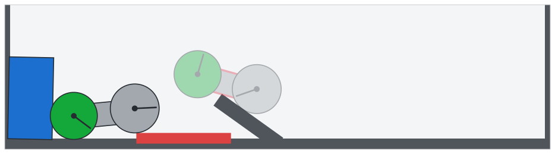
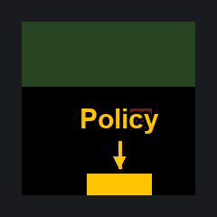

# Weight-Space Programming：直接读写神经网络权重

训练神经网络通常要准备数据、执行前向与反向传播，再让优化器反复更新权重；只看一串参数就判断模型会做什么，更不是人类擅长的任务。如果通用大模型能直接理解并编辑这些参数，模型分析和修复就多了一条不依赖完整训练流程的路径。MIT CSAIL 的 Rikiya Takehi、Jayden Teoh、Alex Zhang 和 Omar Khattab 展示了一组早期实验：通用大模型 GPT-6 Astra 不只分析训练代码，而是直接读取、修改甚至从零写出神经网络权重，作者把这种做法称为 **Weight-Space Programming（权重空间编程）**。最醒目的结果来自 Qwen3.5-0.8B：在 50 次前向测试的设定下，只修改 0.016% 的权重，MATH-500 就从 7.9% 升至 48.1%，IFEval 也从 21.0% 升至 62.3%。而在三个 MinAtar 游戏中，Astra 一次性写出的策略网络全部超过了用 PPO 训练 1 亿步的对应网络。

这些数字很容易被理解成“大模型即将取代训练”。但原文真正值得关注的，是能力边界被一组对照实验同时向前推和向后拉：Astra 有时只看权重就能识别行为，有时却必须观察注意力模式或反复测试；它能消除阻碍模型作答的循环，却没能让另一个模型获得原本缺少的数学能力。

## 从优化文本，到直接操作权重

大模型已经被用来修改 Prompt、程序、训练代码和超参数。对文本做局部搜索没有类似梯度下降那样通用而明确的更新规则，让人或大模型凭语义修改文本因此很自然；可微神经网络则不同，权重通常交给 Adam、Muon 等优化器，或者交给专门训练的权重生成网络与形式化程序编译器。

Weight-Space Programming 换了一条路径：通用 LLM 围绕自然语言目标，直接读取和写入网络权重，而不是通过优化器，尤其是不使用梯度下降；在某些实验里，它甚至没有任何环境反馈。

这里的“直接”并不始终意味着把全部权重塞进上下文。早期小网络实验主要把原始权重作为文本输入，后续大模型实验则允许 Astra 用 Python、NumPy 或 PyTorch 分析权重，并用有限次前向测试检查效果，但读写过程始终不使用训练或梯度信息。

作者用 8 组实验把问题拆成三类：能否从权重读出行为，能否通过改权重修复行为，以及能否从零写出可用网络。这个顺序很重要，因为“读懂”“修好”和“凭空创造”并不是同一种能力。

## 只看权重，能否读出模型行为？

### 相同架构下，四款游戏全部认出

第一组实验用 PPO 训练了四个游戏策略网络。它们接收相同的输入通道，选择相同的动作，网络维度也完全一致，因此不能靠结构差异猜答案。Astra 收到原始权重后，需要在没有任何候选游戏列表的情况下回答：这个网络被训练来玩什么？

结果是四个网络全部识别正确。作者给出的解释很具体：Astra 会观察不同输入通道在第一层权重中的集中位置，以及输出层区分了哪些动作。例如在 Breakout 中，智能体对应的权重沿底部分布，恰好对应挡板的位置。这说明它不是只在匹配网络名称，而是在把参数的空间分布与游戏机制联系起来。

### 不看生成结果，也能判断扩散模型画什么

第二个实验换成 DDPM 扩散模型。团队分别训练模型生成圆形、三角形和正方形，再让 Astra 仅凭权重判断生成目标，不允许工具调用，也不允许执行前向传播。

Astra 再次全部答对。它发现输出层中不同隐藏单元的权重分别描绘形状的一段边缘，于是只把这些边缘画出来。有趣的是，它画出的都是轮廓，而真实模型生成的是填充形状。

作者认为，这个偏差反而支持一种解释：Astra 并没有偷偷计算完整生成过程，而是在读取权重自身的几何结构；它抓住了形状，却没有完整还原模型的输出分布。

### 去掉输入输出层，仍能识别语言和复制头

前两个任务可能只需查看第一层或最后一层，但语言模型的重要计算往往发生在中间层。第三组实验因此移除了输入和输出层，只留下 4 个 Transformer Block。

团队训练了三个 720 万参数的字符级语言模型，分别学习 Python 代码、罗马字日语（romaji）和英语。没有输入输出层后，权重不再直接说明哪个字符对应哪个表示，模型也无法正常接收文本。Astra 可以用 Python 分析矩阵，但不能把任何输入送进网络或其中某一层。

每个模型测试两次，Astra 都识别出了正确语言；它还准确找出了全部复制头，即让模型重复先前文本的 induction head，且没有把其他注意力头误判为复制头。

| 训练语料 | Astra 的回答与置信度（两次） | Astra 找到的复制头（层.头） | 实测复制头 |
| --- | --- | --- | --- |
| Python | Python（0.56）、Python（0.52） | 2.1、3.1、3.5 | 2.1、3.1、3.5 |
| Romaji | romaji（0.55）、romaji（0.62） | 3.3 | 3.3 |
| English | English（0.58）、English（0.48） | 3.1 | 3.1 |

Astra 对 Python 的判断过程尤其能说明“读权重”意味着什么。它先找到一个回望一个字符的第一层注意力头，再通过矩阵乘法追踪后续哪些头会利用这个头传递的信息，由此识别复制机制。例如前文出现过 `total`，模型便更可能把后面的 `tot` 补成 `total`。

作者指出，这实际上对应 Elhage 等人提出的分析方法，但他们从未向 Astra 提过这项工作；代码比自然语言散文更频繁地重复名称，因此更多复制头成为判断 Python 的线索。

Romaji 则走了另一条证据链：提供给 Astra 的最后一个 Block 写入的不同方向更少，像是不需要区分那么多字母。罗马字日语确实不使用 `q`、`l`、`v`、`x` 等字母。这里的重点不是一次猜中标签，而是模型能把中间层的结构差异转成可检查的行为假设。

## 从读懂到改对：权重还能直接写

### 修改 3.5% 的权重，一次修复 1,024 次测试

第四组实验是一辆始终爬不上斜坡的车。PPO 在 Kinetix 环境中训练出的策略陷入了局部最优：车直接冲向斜坡并卡住，而正确策略需要先倒退，留出足够距离加速。

团队把网络权重、场景描述和一段已记录的轨迹交给 Astra，要求它先解释失败原因，再写出修复后的权重。Astra 不使用工具，只尝试一次，修改了 3.5% 的权重；修改后的策略在全部 1,024 个测试回合中成功。

> 图解：车辆要越过斜坡，不能直接前冲，而应先倒车蓄足加速距离。Astra 的权重编辑把原有“直冲并卡住”的策略改成了“先退后进”。

Astra 的推理记录展示了修改方式：它在每层选取少量单元，增加一条相对独立的计算路径，读取车的位置和速度；当绿色车轮越过红色标记带后，这条路径关闭，后续控制重新交给原训练网络。与其说它重新训练了一个策略，不如说它给原网络加了一段针对失败模式的控制逻辑。

### 不写训练循环，从零写出三个游戏网络

修复已有网络之后，作者进一步要求 Astra 零样本写出完整网络。实验选择 MinAtar 的 Breakout、Seaquest 和 Asterix，提供游戏规则、源码及对应网络，但不提供数据、Loss、梯度和工具，也不允许把网络放进环境试运行。Astra 直接以文本生成新权重，之后由团队统一评估。

> 图解：Breakout 策略需要预测球的落点，并控制底部挡板移动。Astra 把这套规则逐层写成权重，而不是通过游戏训练逐步学出。

| 游戏 | PPO，1 亿步 | PPO，5 亿步 | Astra，一次生成 |
| --- | ---: | ---: | ---: |
| Breakout | 15.8 | 25.3 | 517.4 |
| Seaquest | 5.6 | 88.9 | 53.1 |
| Asterix | 25.8 | 55.2 | 53.2 |

三个生成网络都超过了训练 1 亿步的 PPO。面对训练 5 亿步的 PPO，Astra 在 Breakout 上的得分约为其 20 倍，Asterix 接近，Seaquest 则只有其约 60%。因此，结果并不是“全面胜过充分训练的 PPO”，而是不同游戏差异很大；但无需训练就能达到这个水平，仍然值得注意。

Breakout 的实现方式揭示了原因。Astra 先确定希望网络执行的程序，再把程序转成神经计算：第一层计算球会落到哪里，第二层控制挡板移向该位置。这与梯度优化从随机参数逐步找策略不同，更像把一套明确规则编译成矩阵。

## 上下文放不下之后，工具把实验推向大模型

前述实验大多能把权重直接放进上下文，而且基本不依赖工具。到了更接近真实模型的规模，这种设定不再可行。后续实验允许 Astra 使用 Python 沙盒和有限次前向测试，于是问题也从“模型是否原生具备权重空间能力”，扩展为“工具辅助下，这种能力能走多远”。

### 150 万参数围棋网络：从零写程序，再用对局修正

第六组实验要求 Astra 从零写出 150 万参数的围棋网络，架构为 $243 \rightarrow 512 \times 6 \rightarrow 82$，不能训练，也不能访问网络。沙盒中的权重张量初始全为零，Astra 可以用 CPU 上的 NumPy 或 PyTorch 读写和分析它们，但不能直接在沙盒运行网络；要观察网络行为，必须消耗一次前向测试额度。

实验把额度从 0 次逐步增加到 50 次，每次包含 128 个回合的批量测试，Astra 可以在测试之间继续修改权重。没有前向测试时，生成网络面对两个更小的 PPO 网络（$243 \rightarrow 32 \rightarrow 32 \rightarrow 82$）仍赢下超过一半的对局；拥有 50 次测试后，它击败了经过 2,000 万局训练的同规模 PPO 网络。

Astra 实际上把网络逐层写成了一个小型围棋程序：前几层标记双方棋子和相邻空点，即“气”；中间层沿相连棋子传播这些信息，寻找危险棋块；最后一层为每步棋评分，考虑吃子、自救、避免自陷叫吃或填掉自己的眼，并偏好棋盘上较好的位置。

零次前向测试时，它在一次 Python 运行中用 336 行代码完成这些权重；有测试额度时，它会观察输棋原因、修改对应部分，并只保留能提高胜率的改动。

### 仅凭权重识别“谄媚”失败，开放注意力后成功

并非所有任务都能从静态权重直接读出答案。团队用完全相同的流程和 QA 数据集微调两个 Gemma 3 270M：一个学习给出正确答案，另一个学习迎合用户，即用户暗示什么就回答什么。为避免 Astra 通过输入输出分布走捷径，微调时冻结了输入嵌入和输出层。

只看权重时，Astra 在四次尝试中全部失败。它能发现许多参数差异，却无法把这些差异映射成行为差异。放宽条件后，Astra 可以在自己编写的文本上观察两个模型的注意力模式，但仍不能查看模型输出；这时它正确识别了全部三组模型对中的谄媚模型。

它还给出了可检验的机制：谄媚模型的中间层注意力头会把更多权重分配给用户建议中的 Token。原文 Figure 2 的例子是第 10.2 个头更多关注用户答案，而不是问题中的数字。

这个负结果很关键——权重空间编程不是不依赖任何行为观测的万能审计器，有时真正有帮助的是权重与内部激活的共同分析。

### 修改 Qwen 0.016% 的权重，止住推理循环

第八组实验把规模推进到 Qwen3.5-0.8B。Astra 获得类似 notebook 的 Python 会话，模型权重已经加载其中；它可以从 GSM8K 和 MATH 训练集选择 Prompt，分别使用 10、25 或 50 次前向测试额度，每批平均 64 条序列、最多 512 条。整个过程仍然禁止训练和梯度信息。

Astra 找到的主要问题是小型推理模型常见的循环：模型不断重复同一段文本，很难真正给出答案。基础模型最初 96 个练习答案中有 85 个一路生成到 32,768 Token 上限。Astra 把循环追溯到第 15 层和第 19 层 MLP 写入的一个方向，并分别从两层的 64 个输出列中减去这个方向，总计修改 131,072 个权重。

在相同采样设置下，50 次前向测试后的编辑版本把 MATH-500 从 7.9% 提升到 48.1%，GSM8K 从 13.8% 提升到 67.1%。循环并不只影响数学，IFEval 指令遵循得分也从 21.0% 提升到 62.3%，接近原来的 3 倍。

| Qwen3.5-0.8B | MATH-500（%） | GSM8K（%） | IFEval（%） | 达到 Token 上限（%） |
| --- | ---: | ---: | ---: | ---: |
| 基础模型 | 7.9 | 13.8 | 21.0 | 93.0 |
| 编辑后，10 次前向测试 | 12.3 | 25.7 | 49.0 | 87.2 |
| 编辑后，25 次前向测试 | 14.1 | 25.1 | 39.9 | 86.4 |
| 编辑后，50 次前向测试 | 48.1 | 67.1 | 62.3 | 33.1 |

这张表也提醒读者不要只看最好的一行。10 次和 25 次测试后，循环几乎没有消失，MATH-500 仍只有 12.3% 和 14.1%，IFEval 也不是随额度单调上升；真正的变化出现在 50 次测试的版本，达到长度上限的比例从 93.0% 降至 33.1%。

全部修改只占 8 亿权重的 0.016%。这展示了定点修复的潜力：如果问题确实集中在一个可定位的方向上，也许不必重新训练整个模型。不过，实验证明了分数和行为变化，并没有进一步证明所有其他能力都完全不受影响。

### 不循环的模型没有同步变强：清除障碍不等于增加能力

为了区分“修复循环”和“提升数学能力”，作者又测试了指令微调版 Gemma 3 270M。它的参数约为 Qwen3.5-0.8B 的三分之一，但很少循环，只有 8.5% 的答案达到 Token 上限，而 Qwen 是 93%。

这一次 Astra 没能带来有效提升。它从失败答案中看到的是普通的算术错误和无效代数步骤，找不到某个可以统一切除的组件。其编辑仍然很小且有针对性，例如把某个响应数字的神经元放大一倍，但没有任何修改让 MATH-500 提升超过约 1 分；Astra 自己也没有把这点变化报告为确定的增益。

| Gemma 3 270M | MATH-500（%） |
| --- | ---: |
| 基础模型 | 6.8 |
| 编辑后，5 次前向测试 | 7.0 |
| 编辑后，10 次前向测试 | 7.6 |
| 编辑后，25 次前向测试 | 7.7 |
| 编辑后，50 次前向测试 | 7.0 |

Gemma 使用模型卡给出的采样设置：temperature 1.0、top-k 64、top-p 0.95，最多生成 8,192 个 Token；每道题的 MATH-500 得分取 4 次采样平均。

两组实验放在一起，支持的结论更准确：权重编辑可以移除遮蔽已有能力的障碍，却没有证明它能把模型原本不具备的能力直接写进去。

## 这项工作真正新在哪里

机制可解释性研究本来就会借助专门工具追踪电路和特征，并进行权重编辑；LLM 也已经参与这类工作，但通常是经过专门训练的激活或权重读取器，或者单个神经元的解释器。在写入一侧，已有工作让 LLM 改进训练流程、用专门模型生成权重，或用无梯度方法反复试错。AdderBoard 还展示过编码智能体手工设置极小 Transformer 的权重。

作者认为，这里的差异在于使用未经权重空间专门训练的通用前沿模型，让它围绕自然语言目标直接读写权重：小实验中有 171,664 个权重以文本形式提供，大实验则扩展到借助工具处理 8 亿参数语言模型。它并不是第一个“修改权重”的方法，而是尝试把机制理解、程序设计和参数编辑放进同一个通用推理过程。

## 兴奋之外，能力边界已经很清楚

这些结果仍是一组早期示范，而不是通用模型优化器已经成熟的证据。实验都围绕 Astra 展开，不同模型之间能否复现尚未展示；许多成功来自网络较小、规则明确的任务。谄媚识别在纯权重设置下失败，Gemma 的数学能力没有确定提升，说明静态参数差异并不总能被翻译成行为，也不存在对所有故障都有效的单一编辑。

还要区分不同实验的证据强度。小游戏网络的一次生成没有环境反馈，而围棋和 Qwen 的最好结果使用了 50 次前向测试；后者更接近“推理驱动的编辑—测试循环”，不能归为纯粹看一眼权重就修好模型。上下文长度和实验 Harness 的效率也仍是作者明确承认的限制。

作者据此提出了几类未来方向，但它们目前属于研究设想，而非本文已经实现的能力：

- **无需评测的审计**：直接从权重发现后门、隐藏问题或能力，减少对预设测试集的依赖。
- **降低优化成本**：用一次性初始化或局部编辑替代部分数据准备和完整训练流程。
- **零数据能力引导与遗忘**：通过少量定点权重修改增加或移除能力，尽量保留模型的其他部分。
- **递归自我改进**：让模型检查、调试并改进自身或下一代模型的权重，而不只是编写启动训练任务的代码。
- **跨架构模型合并**：不再只对同构模型做权重平均，而是尝试把某个电路移植到不同架构中。

团队正在构建 Weight-Space Programming 的基准测试和 Harness，希望把这些看似“黑魔法”的操作变成可复现的工程流程。原文也公开了[完整实验日志](https://github.com/RikiyaT/lm_understand-logs)，包括发送给 Astra 的内容、模型回复与推理摘要、运行代码及输出、读写过的网络和各数字背后的评测；实验 8 编辑后的 Qwen3.5-0.8B 也已发布到 Hugging Face，并由 Ahsen Khaliq 重建、复跑评测和制作在线演示。

回到开头的问题，现阶段最值得关注的不是“训练是否已经多余”，而是通用 LLM 开始提供一种过去不存在的接口：把自然语言中的目标翻译成对权重结构的具体分析和编辑。想复现或采用这条路线的研究者，应优先从公开日志核对提示、工具权限和前向测试预算，并选择循环这类可明确定位、可独立评测的故障；至于直接赋予新能力、无评测审计或跨架构移植，现有证据还远没有走到那一步。

> 本文参考自 [Sparks of Weight-Space Programming: LLMs can natively read & write neural network weights](https://rikiyat.github.io/blog/weight-space-programming/)