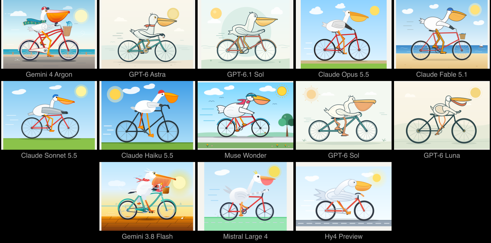

# 为什么所有大模型画的鹈鹕都长一个样：被忽视的多样性坍缩

给十三个最新的大语言模型同一个提示词——"生成一个骑自行车的鹈鹕的 SVG"——你会得到十三只几乎一模一样的鹈鹕。作者 Aman Rusia 用 Simon Willison 的这组经典测试跑了一圈当下前沿模型，每个模型都开到能返回 SVG 的最高推理档位，结果就在下面这张图里：

> 图解：十三只骑自行车的鹈鹕 SVG，来自不同模型。构图、视角、风格高度趋同——基本都是侧视图、卡通化、配色相近，仿佛出自同一只手。

问题在于，它们本可以不这样。同一只鹈鹕，完全可以出现在皇家巡游、季风、极夜、山地赛、沙漠、浓雾、霓虹小巷、婚礼、市集、维多利亚式漫步、暴风雨乃至月球上：

> 图解：同样一句提示词，可以衍生出场景、氛围、画风截然不同的十二种诠释。这才是"开放生成"该有的样子。

作者把这个现象称为 **大模型的多样性坍缩** （diversity collapse）：模型们不仅各自输出趋同，而且收敛到了同一个"安全答案"上。这不是某个模型的缺陷，而是整个梯队共同的行为模式——也正是他认为没人认真讨论的问题。

## 从鹈鹕到 UI：把"创造性"变成可测的指标

一句玩笑式的鹈鹕测试背后，作者指向了一项更系统的研究。他在文末提到，团队在 UI 设计任务上对这种多样性坍缩做了基准测试，作为其大模型创造力研究的一部分。这项名为 **Design Creativity Bench** 的基准由 Kombai 团队的 Dipanjan Dey 等人发布，结论相当直接：尽管前沿模型生成可用网站和产品界面的能力提升很快，它们在"做出有创造性的设计决策"上仍然明显落后。

基准的设置是：让 16 个前沿模型完成 80 个开放式 UI 任务，每个任务分别适配两个不同的产品领域，并配上人类设计师的参考方案作为对照。

和以往只测"单个输出质量"的 UI 基准不同，Design Creativity Bench 拆出了三个维度：

- **原创性（Originality）** ：对同一份需求简报，模型的设计与其它模型的输出有多大差异。这直接对应鹈鹕测试里的趋同现象。
- **创造幅度（Creative Range）** ：当产品领域变化时，模型的设计决策会调整多少。换个行业还是同一套布局，说明它只会背模板。
- **恰当性（Appropriateness）** ：生成的 UI 是否满足简报的功能要求。创造性不能靠牺牲可用性换取。

## 结果：最好的模型与人类差距近 27 分

综合得分上，表现最好的模型与人类参考基线之间存在明显断层：

| 排名 | 模型 | Creativity score |
| --- | --- | --- |
| — | Human reference | 92.3 |
| 01 | GPT-6 Astra | 65.5 |
| 02 | GPT-6.1 Sol | 63.7 |
| 03 | Grok 4.7 | 62.2 |
| 04 | Gemini 3.8 Flash | 60.6 |

> 表中为人类参考基线与得分最高的四个模型，完整榜单见基准官网。分数为基准的综合 Creativity score，具体构成以其方法论说明为准。

第一名 GPT-6 Astra 拿到 65.5 分，而人类参考是 92.3 分，差距接近 27 分。同时，前几名模型之间咬得很紧——65.5、63.7、62.2、60.6，彼此相差不过几分。这个分布本身就呼应了多样性坍缩的判断：模型们水平接近，输出也彼此相似，而人类设计师仍在另一个量级上。

团队同时公开了完整榜单、方法论和可复现的评估框架，包括论文（arXiv:2610.11539）、HuggingFace 数据集和 GitHub 仓库，希望把"设计创造性"变成前沿模型能力的一个可测量维度。

## 谁该关心这件事

如果你只用大模型生成代码和文案，多样性坍缩可能无伤大雅——趋同的答案往往就是"正确"的答案。但只要任务带有开放性——设计、创意、风格化的生成——鹈鹕测试揭示的就是一个实际约束：模型越对齐、越会猜"标准答案"，输出就越容易收敛到同一种平庸。Design Creativity Bench 给出的数字说明，这个差距目前接近 27 分，不是靠换个提示词就能抹平的。

也需要留意边界。鹈鹕 SVG 只是一组轶事式演示，真正有分量的是 UI 基准部分；而该基准的分数构成、评分者偏差等问题，要读它的论文和方法论才能下结论。作者本人的身份也值得说明——他自称是"一名工程师、一个有志于新式理性主义的人"，文章立场鲜明，但证据链条（公开的数据集和评估框架）是摆出来供检验的。下次再看到某个模型"设计感惊人"的演示，不妨多问一句：让它画十只鹈鹕试试。

> 本文参考自 [The Emperor Pelican Has No Clothes](https://arcfu.com/post/the-emperor-pelican-has-no-clothes/)