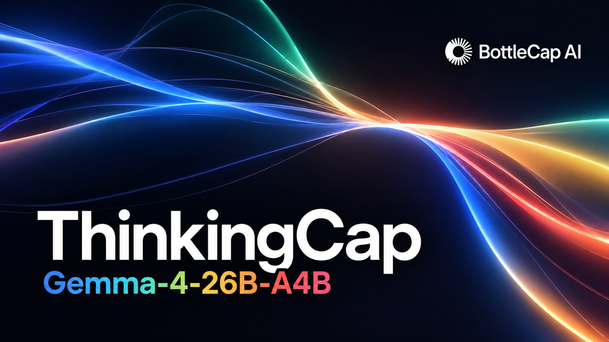
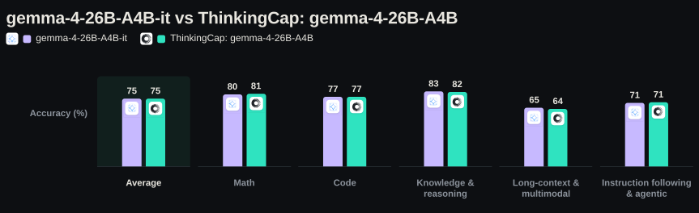

# ThinkingCap-Gemma-4-26B-A4B：平均少想 39%，准确率几乎不动

推理模型有个越来越实在的成本问题：答一道题，模型往往先生成上万 token 的思考过程——这些内容不进答案，却实打实占用延迟和算力。BottleCap AI 的 ThinkingCap 系列就冲着这个问题来。2026 年 10 月 23 日发布的第五个模型落在 Google 的 gemma-4-26B-A4B-it 上：平均减少 38.9% 的 thinking token，最高降幅 69.1%，而十二个基准的平均准确率只掉了 0.15 个百分点。

在此之前，团队已基于 Qwen3.6-27B、Qwen3.8-27B、NVIDIA Nemotron-3.5-Lightning-30B-A3B 和 Qwen3.8-Flash-Next 发布过四款。gemma-4-26B-A4B 是稀疏混合专家模型：总参数 26B，每个 token 实际激活约 4B。训练目标很克制——只砍思考长度，知识、推理能力、答案质量、指令遵循和安全行为都保持不变。

## 思考普遍变短，准确率纹丝不动

按任务家族看，所有家族的准确率差距都在 1 个百分点以内：指令遵循与智能体 +0.65pp、数学 +0.39pp 不降反升，代码基本持平，知识与推理 −0.51pp，长上下文与多模态 −0.92pp。thinking token 则每个家族都在缩短：长上下文与多模态 −54.4%，知识与推理 −44.4%，数学 −36.1%，代码 −27.6%，指令遵循最少 −17.2%。

十二个基准无一例外都变短了。砍得最深的是 LongBench v2（−69.1%）、AA-LCR（−59.3%）和 MMLU-Pro（−49.1%）；最浅的 IFBench（−13.7%）和 τ²-bench（−20.8%）——团队解释这两类任务本来就不依赖长篇思考，能省的冗余少。准确率方面，十二项里八项的变化小于运行间波动，五项反超原始模型；真正超出置信区间的只有四处，其中 AA-LCR −4.00pp 是整套测试里唯一实打实的代价。

还有一个容易被忽略的改进：陷入重复循环的回复比例从 3.64% 降到 0.76%；循环最严重的三个数学基准分别从 5.5%、8.6%、17.0% 降到 0.9%、1.2%、4.5%。

## 预算视角与评测口径

单点对比之外，团队给了一条更有部署意义的曲线：给定每题 thinking token 预算，ThinkingCap 的准确率曲线在整个中段都压在原始模型上方——同样的准确率只需更小的预算；预算放宽到两者都不受约束时，曲线汇合。对按 token 计费或有延迟上限的服务，省下的预算就是直接的吞吐和成本。

评测口径值得交代：官方推荐的 temperature 1.0 下推理噪声很大，每个基准都跑了多个种子，报均值和 95% 置信区间；两个模型在同一套内部管线（vLLM、同题同采样设置）各跑一遍，原始模型数字由团队实测，而非引用官方公布值。

## 获取与限制

模型已发布在 Hugging Face：`bottlecapai/ThinkingCap-gemma-4-26B-A4B-it`，附 GGUF 构建，采样设置和服务栈不用改，属直接替换式升级。另有 PRO 版：thinking token 平均 −62%、最多 −87.6%，面向成本更敏感的规模化部署，需邮件联系获取。

回到开头的问题：推理模型的思考能不能只剪长度、不伤脑子？就这份自测数据看，答案是基本可以——平均省 38.9% 的 token，精度代价低于多数基准自身的噪声，还顺手压了循环率，对正在用该模型做推理服务、对延迟或成本敏感的团队几乎是零成本替换。

限制也要说清：AA-LCR 上 −4.00pp 的掉分是真实存在的，长上下文任务用之前值得自己复测；全部评测来自模型作者一方的内部管线，方法描述得透明，但终归缺少第三方复现；训练方法细节未公开，想照着做的读者暂时拿不到配方。

> 本文参考自 [ThinkingCap: Gemma-4-26B-A4B — up to 69% and on average 39% less thinking, at unchanged accuracy](https://bottlecapai.com/post/thinkingcap-gemma-4-26b/)