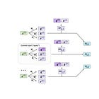

# RoPE：旋转查询与键，让注意力感知相对位置

同一个查询向量和一个键向量，初始特征对都为 $(1,5)$。在 Sebastian Raschka 给出的 RoPE 示例中，键位于位置 2、查询位于位置 5 时，这一对特征对点积的贡献是 13；只把键移到位置 3，贡献就变成约 19.92。若把两者同时向后移动三个位置，点积又回到原来的 13。

这组计算点明了旋转位置嵌入 RoPE 的核心：它不是给每个词贴上一个绝对的“座位号”，而是直接改变注意力中查询与键的相对关系。要理解它为什么成为现代大模型的主流选择，以及为什么一些新模型又开始减少甚至省略显式位置编码，需要从位置信息究竟解决了什么问题说起。

## 为什么 token 嵌入还需要位置信息

输入文本先被分词器转成 token ID，再由嵌入层映射为向量，经过若干 Transformer 块后，输出层计算下一个 token 的 logits。相同 token 在不同位置查到的嵌入完全相同，位置关系需要由其他机制补充。

以“The red fox jumps over the gray fox”和“The gray fox jumps over the red fox”为例，交换 red 与 gray，就改变了究竟是哪只狐狸在跳。两个 fox 的 token ID 都是 2，如果没有位置信息，它们进入模型时的向量没有区别。在不使用因果掩码、也不加入位置编码的普通自注意力中，交换两个词不会改变各 token 对之间的嵌入和注意力分数，模型因此缺少区分词序的直接依据。

GPT 式模型还有一层因果掩码：每个查询只能看到自己和之前的 token。这已经隐含了部分顺序信息。例如，jumps 在第一句里能看到 red，在第二句里能看到 gray，所以理论上，即使没有显式位置编码，因果模型也能区分这两句话。

但“能看到哪些 token”不等于“知道它们相隔多远”。因果掩码不会直接区分相隔一个位置与相隔十个位置。显式位置方法的价值，正是把这类距离信息交给注意力。

GPT-2 和较新的 MiniMax-M3 代表了两种注入位置的方式：GPT-2 在 token 进入第一个 Transformer 块之前，加上一个位置向量；MiniMax-M3 不在输入端加位置向量，而是在每个 Transformer 块的注意力内部使用 RoPE。

## 从 GPT-2 的位置表到固定正弦编码

### GPT-2：每个绝对位置学习一个向量

GPT-2 维护一张可学习的位置嵌入表。位置 $m$ 上的 token 为 $x_m$，进入第一个 Transformer 块的表示可以写成：

$$
h_m = E_{\mathrm{token}}(x_m) + P_m
$$

其中，$E_{\mathrm{token}}$ 是 token 嵌入层，$P_m$ 是位置 $m$ 对应的向量。两者维度相同，逐元素相加。于是，两个 fox 虽然拥有相同的 token 嵌入，但位置 2 和位置 7 分别加上 $P_2$、$P_7$ 后，就变成了不同表示；后续由它们投影出的查询、键和值也自然携带了位置信息。

实现上，位置嵌入与 token 嵌入都可用 `nn.Embedding`，只是前者的表大小由上下文长度决定：

```python
tok_embeds = self.tok_emb(in_idx)
pos_embeds = self.pos_emb(
    torch.arange(seq_len, device=in_idx.device)
)
x = tok_embeds + pos_embeds
```

这种做法直接，扩展上下文却要付出额外成本。原版 GPT-2 只有 1,024 个学习得到的位置向量，因此只能处理不超过 1,024 个 token 的输入；想扩大上下文，就得扩展并训练位置表。原文给出的测算是：在 GPT-2 Medium 中，1,024 个位置的位置嵌入仅占总权重的 0.30%；若把上下文扩到如今常见的 100k 量级，这部分将超过模型总权重的 22%。

### 原始 Transformer：用正弦和余弦生成位置向量

2017 年的原始 Transformer 同样把位置向量加到 token 嵌入上，但位置向量不学习，而是由固定的正弦、余弦函数计算。对位置 $m$ 和第 $i$ 个特征对：

$$
P_{m,2i}=\sin(m\theta_i),\qquad
P_{m,2i+1}=\cos(m\theta_i)
$$

$$
\theta_i=10000^{-2i/d_{\mathrm{model}}}
$$

原始 Transformer 还会在相加前将 token 嵌入乘以 $\sqrt{d_{\mathrm{model}}}$。论文没有解释这一缩放的动机；Raschka 认为，较可能的原因是让 token 嵌入与正弦位置编码在初始化时具有相近的数值尺度，避免位置项主导求和。GPT-2 不需要这一步，因为其 token 嵌入和位置嵌入的初始标准差分别设为 0.02 和 0.01，尺度已经大致接近。

不同特征对使用不同频率。以 $d_{\mathrm{model}}=8$ 为例，四个频率分别是每位置 1、0.1、0.01、0.001 弧度；在位置 2，第一对为 $(\sin 2,\cos 2)\approx(0.909,-0.416)$，第二对为 $(\sin 0.2,\cos 0.2)\approx(0.199,0.980)$。

它仍是绝对位置编码，因为每个向量都由 token 自身的位置决定；区别只是函数固定，不参与训练。函数可以计算训练范围之外的位置，但这并不保证模型在更长上下文上表现良好，因为模型没有在这些位置上训练过。

正弦结构还有一个重要性质：固定偏移对应固定旋转。位置 2 到 5 与位置 102 到 105 都相隔三个位置，同一正弦—余弦特征对会经历相同的旋转。原始论文据此推测，模型会更容易学习“三个 token 之前”这样的相对关系。不过，这种旋转仍只作用于加在输入上的位置向量，尚未直接进入查询与键的点积。

## RoPE 把相对位置放进注意力点积

RoPE 全称为 Rotary Position Embedding，由 Su 等人在 2021 年的 RoFormer 论文中提出。注意力会先把 token 表示投影为查询 $Q$、键 $K$ 和值 $V$，再用查询与键的点积决定注意力分数，经掩码和 softmax 后加权混合值向量。RoPE 在点积之前旋转查询和键，**值向量不旋转**。



> 图解：原文用这张自注意力主题图提示 RoPE 所处的计算背景。理解查询、键、值以及因果掩码后，就能看清 RoPE 的插入点：它作用于查询和键，发生在注意力分数计算之前。

### 旋转变换怎样保留长度、改变点积

多头注意力会把查询和键拆成多个头，RoPE 再把每个头的特征两两分组。以八维向量 $[1,2,3,4,5,6,7,8]$ 为例，常见的 split-half 实现把前后两半配对，得到 $(1,5)$、$(2,6)$、$(3,7)$、$(4,8)$。

若某个查询特征对 $(a,b)$ 位于位置 $m$，该对的频率为 $\theta$，旋转公式是：

$$
a'=a\cos(m\theta)-b\sin(m\theta)
$$

$$
b'=a\sin(m\theta)+b\cos(m\theta)
$$

键使用相同公式，只是将位置换成 $n$。旋转只改变方向，不改变向量长度。

回到开头的数值例子：令查询和键的初始特征对都为 $(1,5)$，频率为每位置 $20^\circ$。位置 2 的键旋转 $40^\circ$ 后约为 $(-2.448,4.473)$；位置 5 的查询旋转 $100^\circ$ 后约为 $(-5.098,0.117)$。两者长度仍为 $\sqrt{26}$，夹角为 $60^\circ$，所以点积为：

$$
26\cos(60^\circ)=13
$$

只把键移到位置 3，键的旋转角变成 $60^\circ$，两者夹角缩小为 $40^\circ$，点积变为 $26\cos(40^\circ)\approx19.92$。所有特征对的贡献相加，就构成该注意力头的查询—键点积；RoPE 因而能改变 softmax 分配给不同值向量的权重。

若查询和键同时从位置 $(5,2)$ 移到 $(8,5)$，两者都多旋转 $60^\circ$，夹角不变，这一对特征的点积仍为 13。更一般地，点积所依赖的旋转角差为：

$$
m\theta-n\theta=(m-n)\theta
$$

这就是 RoPE 的相对位置性质：在未旋转的查询、键保持不变时，真正影响点积的是两者的距离，而不是它们距离序列起点有多远。给句首增加 100 个 token，原本位于 2 和 5 的两个 token 会来到 102 和 105，但间距仍是 3。

这个结论有一个必要限制。真实模型里，新前缀会改变各 token 能注意到的内容，从而改变未旋转的查询和键本身；“整体平移后分数不变”是在固定这些向量的前提下成立的，并不意味着添加任意系统提示都不会改变模型行为。

### 多频率与 PyTorch 实现

完整的注意力头不会只用一个频率。标准全量 RoPE 对维度为 $d$ 的头，为 $d/2$ 个特征对分别计算：

$$
\theta_i=b^{-2i/d},\qquad i=0,\ldots,d/2-1
$$

$d$ 必须为偶数，$b$ 是控制频率间隔的超参数。RoFormer 沿用原始 Transformer 的设置，取 $b=10000$。当 $d=8$ 时，频率同样是 $[1,0.1,0.01,0.001]$：高频对随位置快速旋转，低频对变化更缓慢。

核心实现只需要先预计算余弦和正弦表，再对前后两半做逐元素运算：

```python
import torch

def rope_params(head_dim, positions, base=10_000):
    assert head_dim % 2 == 0
    indices = torch.arange(0, head_dim, 2, device=positions.device)
    inv_freq = base ** (-indices.float() / head_dim)
    angles = positions.float()[:, None] * inv_freq[None, :]
    return angles.cos(), angles.sin()

def rope_split_half(x, cos, sin):
    first, second = x.float().chunk(2, dim=-1)
    return torch.cat((
        first * cos - second * sin,
        first * sin + second * cos,
    ), dim=-1).to(x.dtype)
```

在注意力中，只需分别旋转 $q$ 和 $k$，随后照常计算分数、施加因果掩码并混合 $v$：

```python
cos, sin = rope_params(8, positions)
q_rot = rope_split_half(q, cos, sin)
k_rot = rope_split_half(k, cos, sin)
scores = q_rot @ k_rot.transpose(-2, -1) / q.shape[-1] ** 0.5

future_mask = positions[None, :] > positions[:, None]
masked_scores = scores.masked_fill(future_mask, -torch.inf)
weights = torch.softmax(masked_scores, dim=-1)
context = weights @ v
```

对于 1,024 个位置和 128 维注意力头，余弦、正弦表的形状都是 $(1024,64)$，因为一个头有 64 个特征对。表不需要批次或头维度，可以广播复用；即使模型有 32 个头，同一位置、同一特征对也使用相同角度，只是每个头旋转自己的特征值。表可预计算到最大上下文长度，而且计算成本很低，没有必要随模型权重存到磁盘。

原始 RoPE 论文和原版 LLaMA 实现采用另一种 interleaved 配对，即把相邻的奇偶特征组成一对。它与 split-half 在数学上等价，但必须同时、一致地调整查询和键的特征顺序；直接把两种布局用于同一个原始向量，会得到不同分数。许多现代实现采用 split-half，是因为更便于用逐元素正弦、余弦运算一次旋转所有特征对。

## 新模型正在减少 RoPE，而不是简单抛弃位置

RoPE 自原版 LLaMA 以来一直是开放权重模型的主流，但近年的变化更精细：有的模型只旋转部分特征，有的只在部分层使用 RoPE，还有的改为直接给注意力分数加偏置。

### Partial RoPE：节省的是旋转表，不是 KV 缓存

全量 RoPE 旋转每个查询、键头的所有特征；Partial RoPE 只旋转其中一部分。MiniMax-M3 的每个头有 128 维，只旋转 64 维，也就是处理 32 个特征对，另外 64 维保持不变。后面的层即使不旋转某些特征，它们仍可能从前面的层继承位置信息。

收益主要是缩小预计算的余弦和正弦表。对 MiniMax-M3 的 1M-token 上下文，旋转一半维度使两张表也减半：若以 BF16 存储，可节省 0.134 GB（128 MiB）；若表以 NVFP4 存储并计入 block scales，则节省 0.038 GB（36 MiB）。KV 缓存仍要保存每个缓存 token 的完整键和值向量，因此不会随旋转维度减半。

论文《Fractional Rotation, Full Potential?》在 1B 到 8B 参数模型上的实验发现，只旋转每个头约 10% 的特征，训练损失和基准准确率往往与全量 RoPE 接近，但全量 RoPE 在部分评测上更好。基于节省幅度与这些结果，Raschka 的个人判断是 Partial RoPE“很难称得上值得”，这不是一条普遍适用的性能定论。

### NoPE：因果掩码本身也能泄露位置

NoPE 指不使用显式位置编码。一个构造性例子可以说明因果掩码如何提供位置信号：在“The red fox jumps”中，假设值向量的某个特征只对 The 取 1，其余 token 都取 0；若所有可见键的注意力分数相同，softmax 就会均匀分配权重。

到了位置 2 的 fox，注意力平均 $1,0,0$，得到 $1/3$；到了 jumps，平均四个值，得到 $1/4$。这个输出恰好等于可见前缀长度的倒数，后续层便能把它当作位置线索。

相关论文的研究者从零训练了 1.07 亿参数的小型 decoder-only Transformer，在复制、排序、加法等任务上做消融。面对比训练样本更长的测试样例，NoPE 在十项任务上的总体排名第一，并领先 RoPE。另一组用代码训练的 13 亿参数模型实验中，NoPE 也能处理超出训练长度的上下文，但在测试的最长区间，下一 token 预测会变差。这些结果支持“因果掩码能提供位置信号”，却不等于 NoPE 已在所有大模型和长上下文任务上优于 RoPE。

开放权重模型中，更常见的折中是混合使用。3B 参数的 SmolLM3 在每四层中，三层使用 RoPE、一层跳过，并把这一模式重复到全部 36 层；其作者报告，这种层间模式改善了长上下文表现。跳过 RoPE 的后续层也并非完全没有位置信息，因为输入已经经过前面的位置感知层。

### 学习相对位置偏置：直接修改注意力分数

Thinky 的 Inkling 采用另一条路线：照常计算查询与键的缩放点积，在 softmax 前加上一个可学习偏置。这个数由查询 token 的隐藏状态，以及键相对查询向后相隔多少位置共同决定。

仍用位置 5 的 the 查询位置 2 的 fox，Inkling 会利用三个位置的间距和 the 的隐藏状态计算偏置，再加到注意力分数上。它不是旋转查询或键，也不依赖输入端的位置向量。这一思路可以追溯到 2019 年的 T5，后者使用了更简单的相对位置偏置。

## 从模型统计能看到什么趋势

Raschka 按发布日期整理了自己的 LLM Architecture Gallery，将 2025 年发布的模型与 2026 年快照中的前后两组进行比较。每张架构卡片计一次，因此同一架构的多个变体都可能影响统计。

全量使用 RoPE——即在每个 softmax 注意力层都采用它——仍是 2026 年快照中最常见的选择，但占比从 2025 年到 2026 年下降，并在 2026 年后一组中继续下降。混合 RoPE 与 NoPE 的模型则在增加，只是各组样本仍小，无法确定趋势是否会延续。

在采用 RoPE 的模型内部，Partial RoPE 从 2025 年的少数，变成 2026 年两组中的多数。仅使用 NoPE 的条目都来自循环混合架构，其 softmax 注意力层不使用显式位置编码。“其他”类别包括 xLSTM 7B 和 Inkling：前者没有 softmax 注意力层，后者使用前述学习偏置。至于闭源模型是否采用 RoPE，通常无法从公开信息中百分之百确认。

回到最初的问题，RoPE 的价值不是给序列增加一张更大的位置表，而是用保持长度、只改变相对角度的旋转，让查询—键点积直接感知 token 间距。它依然是当前最主流的方案；Partial RoPE、RoPE/NoPE 混合层和相对位置偏置，则说明“位置如何进入注意力”仍有设计空间。Raschka 预计 RoPE 的主导地位会延续到 2027，并可能出现更多类似 Inkling 的设计，但这属于作者基于当前开放权重模型快照的判断。想动手理解这些机制，较稳妥的路径仍是先实现 GPT-2 式基线，再把输入端的位置加法替换为注意力内的 RoPE，并用整体平移位置的检查验证相对偏移性质。

> 本文参考自 [Understanding Positional Embeddings in Modern LLMs](https://magazine.sebastianraschka.com/p/understanding-positional-embeddings)