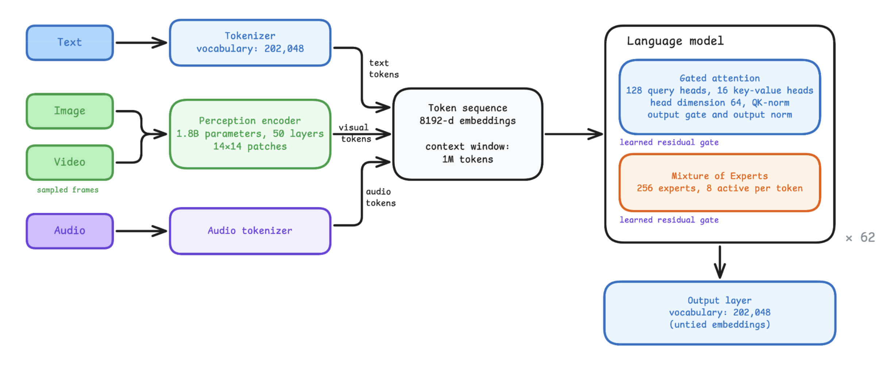
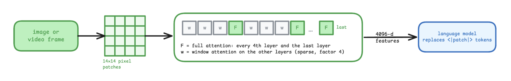
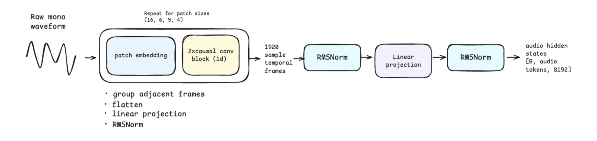
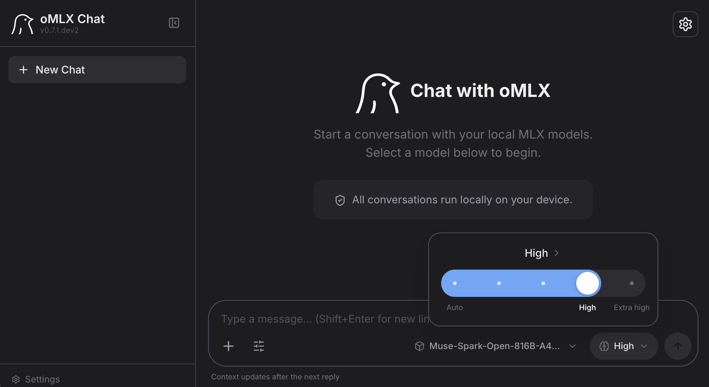
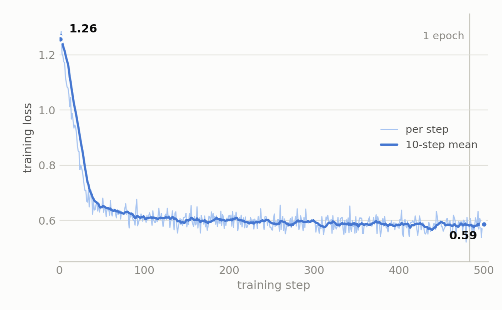
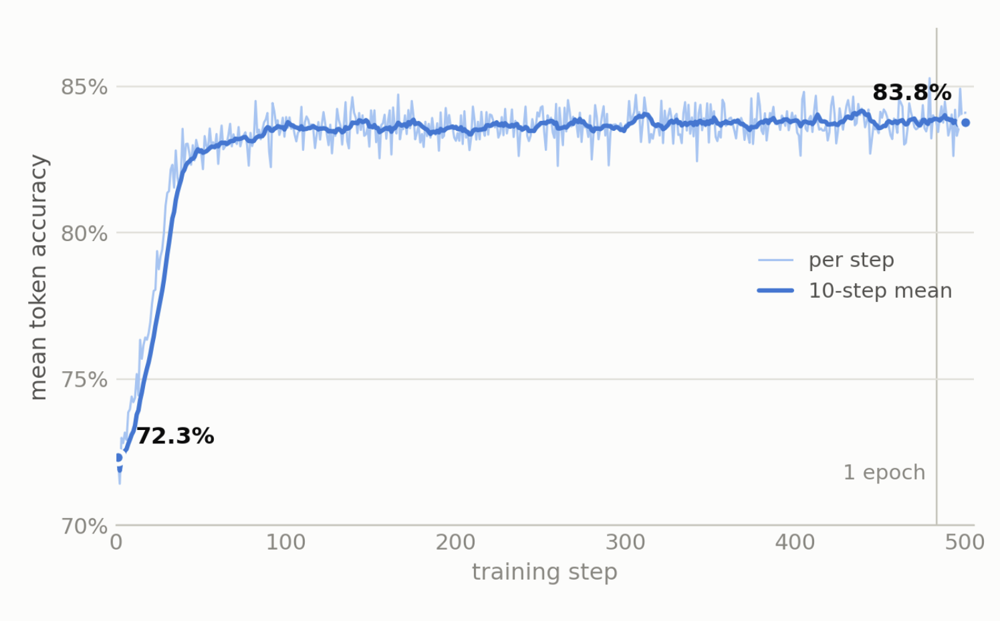
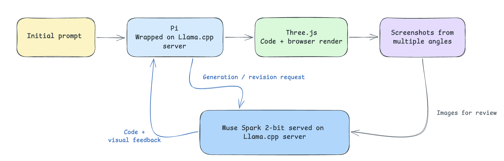
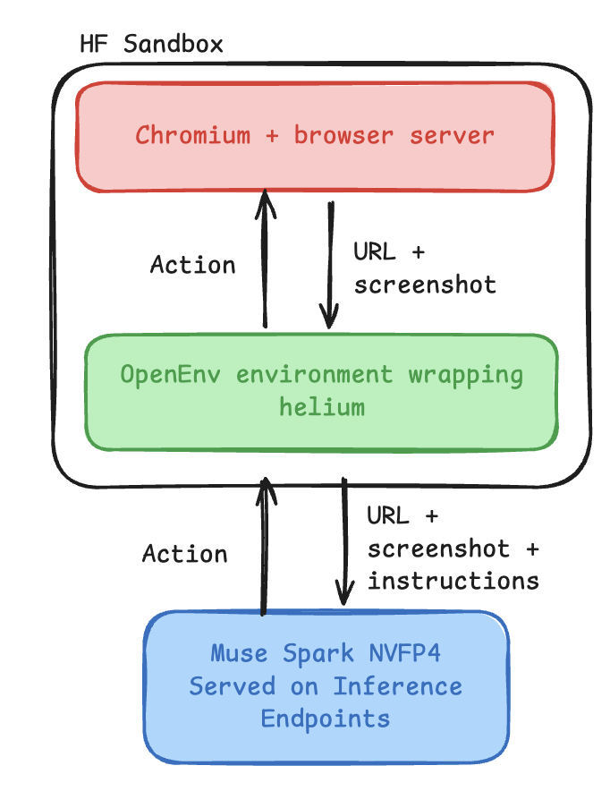

# Muse Spark Open：Meta 开源 816B 多模态 MoE 模型，单台 Mac 也能跑 2-bit 量化版

816B 参数的模型需要多大的机器才能跑？Meta 给出的答案跨度很大：BF16 原版要 4 台 8×H200 的节点，而 2-bit 量化版能在一台 512GB 内存的 Mac M3 Ultra 上跑出 18 tokens/s。

10 月 15 日，Meta 发布 Muse Spark Open——Muse 系列的全尺寸开放权重模型。它是一个混合专家（MoE）模型，总参数约 8160 亿、每个 token 实际激活约 420 亿，支持最长 100 万 token 的上下文，能读文本、图片、音频和视频（输出为文本）。Meta 把它定位成一个面向智能体编程（agentic coding）的模型：读代码库、写代码、调试、调用工具，并且能一边看截图、听语音、看录屏一边干活。Hugging Face 的这篇发布博客介绍了如何运行、微调它，以及官方用它做的几个演示。

| Feature | Muse Spark Open |
| --- | --- |
| Model size | ~816B total parameters; ~42B active per token |
| Expert routing | 256 experts per MoE layer; 8 selected per token |
| Inputs | Text, images, audio, and video |
| Output | Text |
| Context window | Up to 1M tokens |
| Checkpoint formats | BF16 and NVFP4 |

模型权重有两个 checkpoint 仓库：BF16 精度的 `Muse-Spark-Open-816B-A42B`，和针对 NVIDIA Blackwell GPU 的 4-bit 版本 `Muse-Spark-Open-816B-A42B-NVFP4`。

## 架构：816B 的体量，42B 的速度



> 图解：Muse Spark Open 的整体架构。图像/视频经感知编码器、音频经音频编码器分别转成 token，与文本 token 一起进入 MoE 语言模型，最终输出文本。

Muse Spark Open 是 Muse 系列的全尺寸成员。今年 8 月发布的 Muse Glimmer 是同系列的小尺寸稠密模型，适合本地运行；两者共用同一套 tokenizer 和词表，聊天模板也在 Glimmer 的基础上扩展了新模态。值得一提的是，模型的输入嵌入层和输出层是两个独立的矩阵，各约 16.6 亿参数（即不做权重共享）。

### MoE 语言模型：256 个专家选 8 个

语言模型部分有 62 层，隐藏维度 8192。注意力采用分组查询注意力（GQA）：128 个查询头、16 个键值头，每个头 64 维。注意力块带有输出门控和输出归一化层，并对 query 和 key 施加 QK-norm；每个块的输入和输出之间通过一个可学习的残差门控连接，而不是普通的直接相加——这些设计都是奔着大规模训练的稳定性去的。

Glimmer 每层用一个稠密前馈网络，Spark Open 则把它换成了 MoE 块：每层 256 个专家，路由器为每个 token 选 8 个。每个专家本身是一个 8192 → 4096 → 8192 的前馈网络，输出后再做一次自己的归一化。专家参数约占模型总参数的 97%——也就是说，这个模型的“大”几乎全大在专家上。

MoE 架构的核心取舍在这里体现得很直白：每个 token 只跑 8 个专家，计算量相当于 42B 模型；但 256 个专家都得驻留显存，所以部署时要准备 816B 模型的内存。BF16 checkpoint 约 1.5 TB（safetensors），NVFP4 版以 4-bit 存储参数、精度损失可忽略，专为 Blackwell GPU 设计。在 transformers 里，BF16 版需要 4 个 8×H200 节点做张量并行（TP=32），NVFP4 版单台 B200 节点即可。

### 感知编码器：图片和视频共用一套



> 图解：图像处理流水线。图片被切成 14×14 的 patch，经感知编码器输出 4096 维特征，再映射为语言模型可消费的 token。视频帧走同一条路径。

感知编码器负责把图像和视频帧变成 token，架构与 Muse Glimmer 30B 所用的一致，设计沿袭 Meta 的 Perception Encoder 工作。它有 18 亿参数、50 层、隐藏维度 1536、16 个注意力头；每张图切成 14×14 的 patch，输出 4096 维特征。位置编码同时使用可学习的绝对位置嵌入和 2D RoPE；每四层中的第四层以及最后一层用全注意力，其余层用稀疏注意力。视频输入和图像走同一个编码器。

### 音频编码器：每 80 毫秒一个 token



> 图解：音频编码器是一个卷积金字塔，patch 大小依次为 16、6、5、4，逐级压缩时间维度，末端经 RMSNorm → 线性投影 → RMSNorm 输出音频 token。

音频通过独立的音频编码器进入模型：音频 tokenizer 把波形转成 token，聊天模板用 `<|audio|>` 标记音频位置。编码器每 80 毫秒输出一个音频 token，即每秒 12.5 个——10 秒音频就是 125 个输入 token，可以据此估算音频对上下文窗口的占用。编码器本体是卷积金字塔：每个 stage 由一个特定 patch 大小的 patch embedder 和 2 个一维卷积块（kernel 为 7、stride 为 1）组成，patch 大小依次为 [16, 6, 5, 4]，逐级下采样；最后一个 stage 的时序帧再经过 RMSNorm → 线性投影 → RMSNorm 收尾。

### 100 万 token 上下文的真实成本

推理时上下文窗口为 1M token（`max_position_embeddings` 设为 1,048,576），图像、视频、音频 token 和文本共享这个窗口。

长上下文的开销主要在 KV cache。原文给了一笔明细账：每个 token 向缓存写入 $2 \times 16 \text{ heads} \times 64 \text{ dims} \times 62 \text{ layers} = 126{,}976$ 个数值，BF16 下约 250 KB；填满 1M token 上下文需要约 266 GB——这还只是缓存，不含模型本身。GQA（16 个 KV 头而非 128 个）在这里起了关键的压缩作用。

## 推理：四条官方路径

Muse Spark Open 的 transformers 实现提供 `MuseSparkForConditionalGeneration`（多模态生成）和 `MuseSparkProcessor`（整合 tokenizer、图像/视频处理器、音频特征提取器和聊天模板）。分布式加载通过 `DistributedConfig` 配置：`tp_size` 控制稠密层的张量并行切分，`ep_size` 控制专家在设备间的分布。

### 一个绕不开的设定：推理强度只能调低，不能关闭

这个模型是强制推理（reasoning）的。处理器把符号档位 low/medium/high/xhigh 映射为模型内部的整数 16/64/256/512，默认 xhigh；无法完全关掉推理，简单任务想省 token 就设成 “low”。也可以在系统提示里写一行 `Reasoning strength: 1` 直接指定数值。

```python
inputs = processor.apply_chat_template(
    messages,
    add_generation_prompt=True,
    tokenize=True,
    return_dict=True,
    return_tensors="pt",
    reasoning_effort="high",  # options: low/medium/high/xhigh
).to(model.device).to(model.dtype)
```

多模态输入的处理细节：图片标记会被展开成对应数量的 patch token，并用边界 token 包住，保持文本位置与视觉特征对齐，单个 prompt 可放多张图。视频默认按 2 FPS 抽帧、上限 96 帧，帧之间穿插 “Time: 3.5s” 这样的时间戳文本。抽帧越稀，事件之间丢的细节越多；但提高 FPS 会增加显存和 prefill 延迟，这是一个需要按任务权衡的旋钮。带声音的视频传 `load_audio_from_video=True` 即可（相比 Glimmer 的升级），并建议加 `return_metadata=True` 让处理器拿到正确帧率。音频走 chat template 时，重采样、padding 都自动处理；直接喂给处理器则需单声道 24 kHz，波形会补齐到 1920 个采样点的整数倍。

### 工具调用与 Harmony 聊天模板

模型支持纯文本和多模态工具调用。它使用按通道（channel）路由的 Harmony 聊天模板（由 gpt-oss 首次引入）：assistant 的开头刻意留空，由模型自己用 `to=` 选择去向——`to=self` 是推理，`to=commentary` 是工具调用前后对用户可见的注释，`to=user` 是最终回答，而 `to=weather.get` 这样的形式直接路由到某个工具。如果输出质量不对劲，官方建议检查模型路由到了哪个通道。

### llama.cpp：Mac 上的 2-bit 量化

对大多数开发者来说最实际的路径是 llama.cpp。模型已并入 llama.cpp 预编译二进制：

```bash
curl -LsSf https://llama.app/install.sh | sh
llama serve -hf ggml-org/Muse-Spark-Open-816B-A42B-GGUF:Q2_K
```

服务起在本地后，内置 WebUI（localhost:9931）支持传图片、音频和调节推理档位。官方在 512GB 的 Mac M3 Ultra 上实测：经 imatrix 校准的 2-bit 量化版模型本体占 304 GB，生成速度 18 tokens/s，剩余内存足够放 KV cache。Q2_K、Q4_K_S、Q8 等量化都在 Apple Silicon 上测过。

### SGLang 与 vLLM：面向 Blackwell 的 NVFP4 服务

SGLang 集成支持全部四种模态输入，NVFP4 参考配置跑在 4 张 GB300 上，使用 `flashinfer_trtllm` 的 MoE 后端，TP=4、EP=4；响应中推理过程和最终答案分别放在 `reasoning_content` 和 `content` 字段。

vLLM 的参考插件目前支持文本和图像输入，要求 Blackwell 系列 GPU，参考配置开 128K 服务上下文，并自带推理与工具调用的解析器。

### MLX 与 Inference Endpoints

苹果生态还有 oMLX 和 mlx-lm 两条路。官方在 M3 Ultra（512GB）上测了 oQ3e 量化：模型约占 344 GB，1024 token 输入、生成 128 token 的条件下 prefill 约 225 tok/s、生成约 21 tok/s。注意即使是 3-bit 量化也需要超过 256 GB 内存，不够的话可以用 mlx-lm 的多机分布式推理。



> 图解：oMLX 内置聊天界面。模型的推理过程以可折叠的 thinking 块展示，与最终答案分开；推理档位可在界面上从 low 到 xhigh 实时调整，默认 Auto 即 xhigh。

不想自己管硬件的话，Inference Endpoints 提供预验证的 SGLang 配方：8×RTX Pro 6000（98GB）跑 131072 上下文，或 8×H200（141GB）跑满 1048576 上下文。一条命令即可部署：

```bash
hf endpoints catalog deploy --repo meta-models/Muse-Spark-Open-816B-A42B-NVFP4 --name muse-spark
```

端点暴露 OpenAI 兼容 API，Chat Completions 和 Responses 两种接口都有。

## 微调：64 张 H100 上的 LoRA

官方用 TRL 的 SFTTrainer 在 8 节点 × 8 H100 上微调了 816B checkpoint，完整脚本在 TRL examples 里。方案的关键选择是只训 LoRA 适配器：LoRA 挂在四个注意力投影（q/k/v/o_proj，r=16、alpha=32）上，每层 256 个专家全部冻结。

模型并行用 `DistributedConfig(fsdp_size=64, ep_size=8)`：FSDP2 把模型分片到全部 64 张卡，每层 256 个专家分成 8 组，token 被路由到持有对应专家的 GPU 上训练。数据侧用 `packing=True` 把样本拼进 2048 token 的序列（块对角掩码隔离不同样本），`save_only_model=True` 只存适配器——因为加载时做了分片的模型无法从中断恢复。

实际跑了 500 步，约 2 小时，吞吐约 8000 tokens/s。结果：平均 token 准确率从 72% 升到 84%，loss 从 1.26 降到 0.57。这只是一个在开源数据集（tulu-3-sft-mixture 前 50 万条）上适配聊天模板的示例，但说明这套配方可以直接套到自己的数据上。



> 图解：微调过程的训练 loss 曲线，从 1.26 降至 0.57。



> 图解：微调过程的平均 token 准确率曲线，从 72% 升至 84%。两条曲线共同指向一次健康的 LoRA 微调。

## 三个演示：多模态智能体能做到什么

官方做了三个可复现的演示，检验模型的多模态和智能体能力。

**3D 资产生成器。** 把 llama.cpp 上的 2-bit 量化 Spark Open 与 Pi 编程智能体组合：先描述想要的资产，Pi 让模型生成 Three.js 代码，在浏览器渲染并从多角度截图，再把截图发回同一个模型获取视觉反馈、迭代修改代码。因为是量化模型，提示词需要多做一些引导。整套循环跑在 Mac Ultra 上，18 tokens/s。



> 图解：Pi 智能体驱动 Muse Spark Open 迭代生成 Three.js 3D 资产的过程——生成代码、渲染、截图回传、按视觉反馈改代码。

**浏览器操作智能体。** 官方团队称，在 computer use 任务上测试 Spark 时被其表现惊到，于是用 OpenEnv 和 Hugging Face Sandboxes 搭了一个精简演示：Sandbox 里跑 Chromium 和 OpenEnv 服务（用 helium/selenium 封装点击、输入、滚动等动作，定义 reset/step/observation 接口），模型部署在 Inference Endpoints 上。关键细节是：模型做决策时只能看到历史动作、系统提示、当前 URL 和浏览器截图——没有 DOM、没有 HTML，是纯粹的多模态浏览器智能体。



> 图解：浏览器智能体架构。远端沙箱内包含 OpenEnv 环境与 Chromium 浏览器，客户端的 agent loop 把截图与历史动作发给 Inference Endpoints 上的 Muse Spark Open，由模型决定下一步动作。

**语音驱动的购物助手。** 最后一个演示把音频、图像和智能体能力串起来：对着模型用语音描述想买的东西，模型推理符合描述的商品类型，操作内置浏览器在 Amazon 上搜索，再按条件选出最合适的选项。

## 结语

Muse Spark Open 的看点不在于某个单一数字，而在于组合：816B 总量、42B 激活的 MoE，四模态输入、1M token 上下文，加上从 transformers 到 llama.cpp、SGLang、vLLM、MLX、Inference Endpoints 的全链路推理支持和可复现的 TRL 微调配方。需要留意的是：官方博客没有给出与同类模型的基准对比数据，“迄今最强的美国开放权重模型”这一说法目前只有 Meta 自己的表述支撑；推理无法关闭、KV cache 占 266 GB、BF16 版 1.5 TB 的体量，都是实打实的使用成本。

对想动手的人，路径按硬件条件很清晰：有 Blackwell 节点用 NVFP4 + SGLang/vLLM，有 512GB 的 Mac 用 llama.cpp 或 oMLX 量化版，都没有就从 Inference Endpoints 一条命令起步。

> 本文参考自 [Welcome Muse Spark Open: open-weight frontier multimodal mixture-of-experts model from Meta](https://huggingface.co/blog/meta-muse-spark-open)