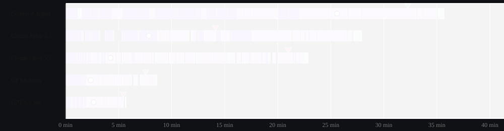
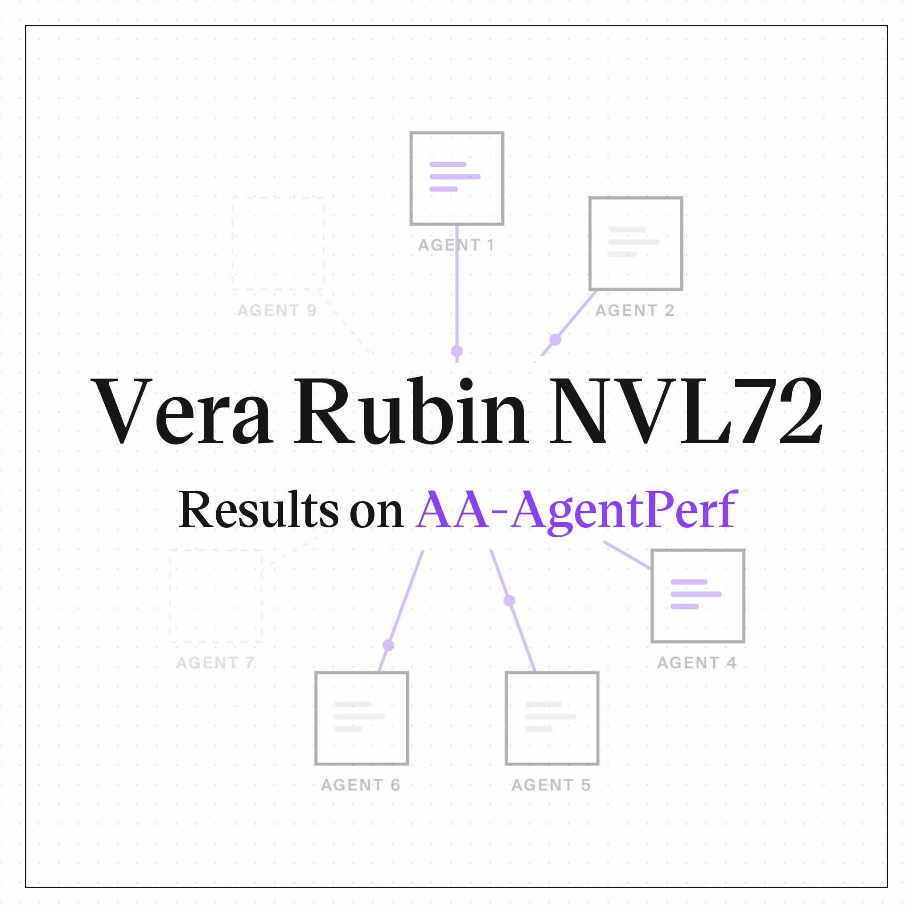
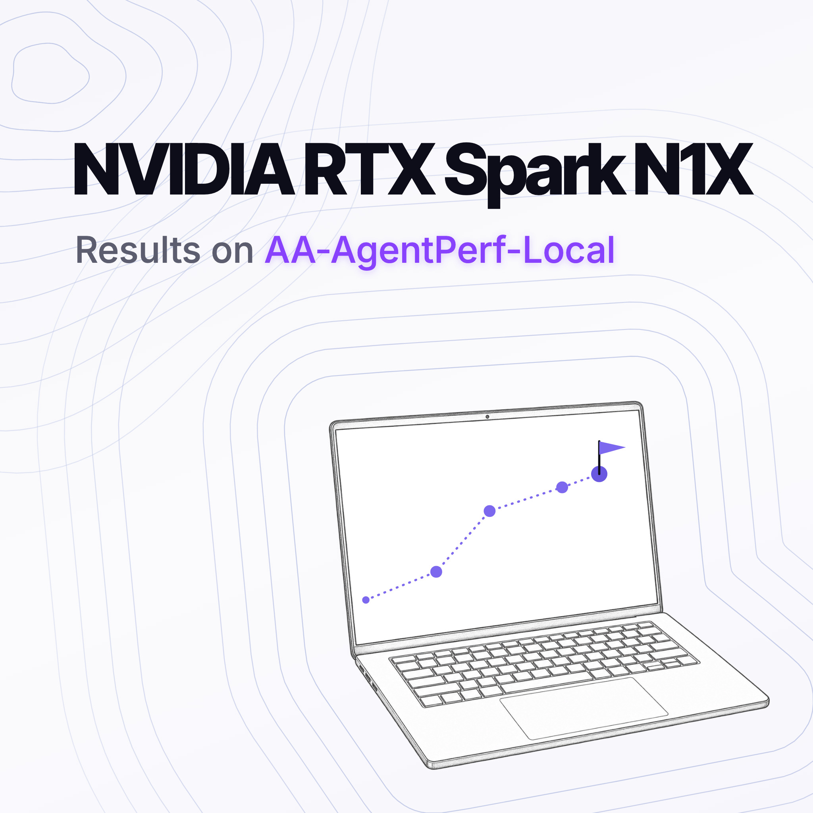
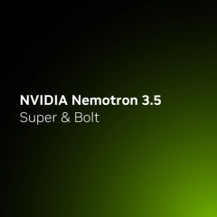

# AA-Robotics v0.1：给大模型接上机械臂

2026 年 10 月 14 日，Artificial Analysis 发布 AA-Robotics v0.1，尝试回答一个具体问题：不训练专门的机器人模型，前沿语言模型能否直接控制机械臂完成桌面任务？评测把模型放进编程智能体的运行环境（harness），交给它们一台 6 轴机械臂（5 个关节和 1 个夹爪）和一句任务指令，让它们按按钮、倒水、搭积木。

五个模型的首批结果显示，简单任务已经能够完成，但距离实用仍很远：模型每个任务平均耗时约半小时，人类平均只需 20 秒，时间上约慢 100 倍。GPT-6 Astra 以 69 分（满分 100 分）排名第一，平均每个任务耗时 30 分钟，成本为 16.36 美元。

Artificial Analysis 明确表示，他们并不认为前沿语言模型本身适合直接投入生产机器人，但判断机器人的未来很可能由强大的通用智能体主导，因此有必要持续追踪语言模型在机器人任务上的进展。AA-Robotics 正是围绕这一判断设计的研究预览：不训练专门的机器人模型，直接测试通用大模型完成任务的能力边界。

## 八个桌面任务，考三类能力

v0.1 首批包含八个桌面任务，仿照日常活动设计，覆盖三类机器人能力：控制与灵巧性（精确抓取、操作物体）、空间推理（理解物体之间的相互作用）、适应性（面对意外情况如何应对）。每次尝试按 100 分制评分，完整完成得 100 分，部分完成按进度给分。所有尝试均为 zero-shot（零样本），模型没有针对任务的练习机会，直接上场。

八个任务及通过标准如下：

- **按下红色按钮** ：用夹爪按下按钮，按钮闪烁即通过。
- **把鳄鱼玩具放进矩形框** ：鳄鱼整体位于矩形内即通过。
- **把饮料倒进杯子** ：饮料入杯、无洒漏、无损坏即通过。
- **把积木收进盒子** ：四块积木全部入盒、盖子盖平即通过。
- **完成形状配对挑战** ：积木在板上的摆法与图片一致即通过。
- **写 hello world** ：用马克笔在纸上的黑框内写出清晰可辨的 "hello world"。
- **搭最高的塔** ：用泡沫积木搭出可自立且达到最大可实现高度的塔。
- **测量盒子** ：量出盒子的长宽高，每个维度误差在 2 毫米以内。

## 成绩单：基础任务满分，复杂任务分化

五个模型的逐任务成绩如下。GPT 系列在 Codex 中运行，Claude 系列在 Claude Code 中运行，Gemini 4 Argon 在 Antigravity 中运行，均为 high effort 档位。

| 任务 | GPT-6 Astra | GPT-6.1 Sol | Gemini 4 Argon | Claude Opus 5.5 | Claude Fable 5.1 |
| --- | --- | --- | --- | --- | --- |
| 按下红色按钮 | 满分，100/100 | 满分，100/100 | 满分，100/100 | 满分，100/100 | 满分，100/100 |
| 把鳄鱼玩具放进矩形框 | 满分，100/100 | 满分，100/100 | 满分，100/100 | 满分，100/100 | 满分，100/100 |
| 把饮料倒进杯子 | 满分，100/100 | 零分，0/100 | 满分，100/100 | 部分，25/100 | 部分，30/100 |
| 把积木收进盒子 | 部分，40/100 | 满分，100/100 | 部分，40/100 | 部分，40/100 | 部分，40/100 |
| 完成形状配对挑战 | 部分，44/100 | 满分，100/100 | 零分，0/100 | 部分，38/100 | 满分，100/100 |
| 写 hello world | 满分，100/100 | 满分，100/100 | 部分，45/100 | 部分，45/100 | 零分，0/100 |
| 搭最高的塔 | 部分，71/100 | 零分，0/100 | 部分，57/100 | 部分，25/100 | 零分，0/100 |
| 测量盒子 | 零分，0/100 | 部分，17/100 | 零分，0/100 | 部分，17/100 | 零分，0/100 |
| **AA-Robotics 总分** | **69.4** | **64.6** | **55.3** | **48.8** | **46.3** |

按总分排序：GPT-6 Astra 第一（69.4），其后依次是 GPT-6.1 Sol（64.6）、Gemini 4 Argon（55.3）、Claude Opus 5.5（48.8）和 Claude Fable 5.1（46.3）。

这张表比单看总分更有信息量。按下红色按钮和放鳄鱼，五个模型都拿到满分；至少在这套评测设置下，简单的场景理解与抓取放置已经不再是区分点。真正的分水岭在后面六个任务：没有一个模型能在这六项任务中全部拿满分，而且各模型失分的方式不同——总分第二的 Sol 倒水零分、搭塔零分，却在收积木和形状配对上拿了满分；Fable 形状配对满分，写字却零分。"测量盒子"几乎全军覆没，最好成绩也只有 17 分，每个维度误差不超过 2 毫米的要求，对当前模型仍是明显难点。

## 评测是怎么跑起来的

> 图解：AA-Robotics 的完整流程。模型收到一段纯文本任务指令后，在摄像头与机械臂之间循环：通过四个摄像头观察场景，写代码规划并下发动作；当它自行判断任务完成（或放弃）时结束尝试，最后由人类评审对照通过标准给终态打分。

模型运行在一个隔离容器里，拿到的说明非常简短：如何通过一个简单的 HTTP API 控制机械臂、机械臂的型号（Hiwonder NexArm，不再提供其他规格参数），以及如何提交一次"已完成"的尝试。观察靠四个摄像头——三个架在桌面周围，一个装在机械臂手腕上。模型可以在容器里写代码、运行代码，规划并发送机械臂动作。

这个设定有两处值得注意。其一，模型没有拿到机械臂的运动学参数，需要在尝试中自行标定。其二，何时收手由模型自己判断，这本身就成了一项被测能力——后文的时间线会看到，判断任务何时完成并不总是容易。

## 时间与成本：慢约 100 倍，成本最低仍约贵 10 倍

时间上，今天的模型在 AA-Robotics v0.1 上大约比人类慢 100 倍：每个任务约半小时，人类平均 20 秒。五个模型中有四个平均每任务耗时在 30 分钟上下，最慢的 Gemini 4 Argon 达 52 分钟。但平均值掩盖了任务间的巨大差异：同样是按红色按钮，GPT-6 Astra 用 2.2 分钟完成按压，Claude Fable 5.1 却先花了约 10 分钟理解和规划，才做出第一个动作；差异最大的是放鳄鱼任务，GPT-6.1 Sol 五分钟就宣布完成，Claude Opus 5.5 用了 45 分钟，相差九倍。横向看，Gemini 4 Argon 最慢开始行动，平均花 21 分钟观察和推理才迈出第一步，接近其他模型的两倍。

成本上的差距相对小一些，但也有条件：最具性价比的模型，其花费大约是按美国平均时薪雇人做同样任务的 10 倍，作为对照，时间差接近 100 倍。模型之间价差悬殊：GPT-6.1 Sol 最便宜，平均每任务 1.93 美元；最贵的 GPT-6 Astra 为 16.36 美元，是 Sol 的八倍多，而总分只高了约 4 分（69 对 65）。Artificial Analysis 还指出了一个成本结构上的细节：由于机械臂和场景对模型完全陌生、需要处理大量视觉信息，70% 的花费用在输入侧，也就是上下文上。人类成本的基准，是把手工完成任务的时间按 37.81 美元/小时计价——这是美国劳工统计局公布的 2026 年 9 月私营非农部门全体员工平均时薪（初步数据）。

## 模型把时间花在了哪里

Artificial Analysis 把每次尝试的每一步（含思考和工具调用时间）按代码、图像和消息内容归类为五种活动，统计结果如下：

| 模型 | 理解场景、机械臂与运动 | 规划动作 | 查看相机 | 机械臂动作 | 其他 | 总耗时 |
| --- | --- | --- | --- | --- | --- | --- |
| Gemini 4 Argon | 42% | 45% | 6% | 6% | — | 419 分钟 |
| Claude Fable 5.1 | 33% | 37% | 9% | 18% | — | 249 分钟 |
| Claude Opus 5.5 | 21% | 45% | 9% | 23% | — | 253 分钟 |
| GPT-6 Astra | 20% | 59% | 6% | 13% | — | 242 分钟 |
| GPT-6.1 Sol | 17% | 61% | 6% | 13% | — | 224 分钟 |

> 注："其他"涵盖等待代码运行、写笔记和最终报告；Gemini 4 Argon 的数据为估算值——Antigravity 不给每步打时间戳，Artificial Analysis 按 token 量把各步摊入有精确时间的机械臂指令之间。

从表中可以看到，任务前期有大量时间用于标定机械臂、理解场景，一直持续到第一个动作；此后大部分时间用于规划下一步动作，期间穿插短促而精确的机械臂运动。真正驱动机械臂运动的时间只占 6% 到 23%。换句话说，在这项评测中，瓶颈更多在理解和规划，而不是机械臂执行。两个 GPT 模型把约六成时间花在规划上，理解阶段占比最低；在下方时间线的示例运行中，它们的首个动作也相对较早。

> 图解：某个选定任务中，五个模型从尝试开始后的活动时间线（横轴为开始后的分钟数）。彩色分段表示五种活动，圆点标记"首个动作"（第一次按压、抓取、推、倒或落笔），绿色三角标记"首次达到可通过状态"，红色三角标记"不可挽回的错误"（此后无法再拿满分）。图中示例里，Gemini 4 Argon 到 25 分 36 秒才做出首个动作，32 分 15 秒首次达标；Claude Fable 5.1 在 7 分 51 秒首次动作，却在 14 分 08 秒犯下不可挽回的错误。该图为某个选定任务的示例运行，各任务可切换查看。

这张图还暴露了一个反直觉的现象：模型经常在已经达到可通过状态之后继续"优化"，结果反而失败。Artificial Analysis 举的例子是 GPT-6.1 Sol——它在约 17 分钟时搭出了一座可以拿分的塔，继续操作之后任务失败。团队认为，模型在物理空间里判断任务是否已完成的能力仍待提升。

## 抓取精度：通向工具使用的第一道门槛

Artificial Analysis 把抓取和精细操作列为 v0.1 重点考察的技能，理由不止是更精确的控制——更重要的是它指向工具使用，以及工具使用所能解锁的更大能力空间。在八个任务中有六个涉及抓取（放鳄鱼、倒饮料、收积木、形状配对、搭塔、量盒子），统计所有抓取尝试的结果如下：

| 模型 | 抓取成功 | 抓空/部分抓住/抓错物体 | 尝试次数 |
| --- | --- | --- | --- |
| GPT-6 Astra | 45% | 55% | n = 95 |
| Claude Fable 5.1 | 44% | 56% | n = 89 |
| Claude Opus 5.5 | 40% | 60% | n = 100 |
| Gemini 4 Argon | 36% | 64% | n = 75 |
| GPT-6.1 Sol | 28% | 72% | n = 111 |

这里的"成功"指在抬起或搬运过程中始终夹住目标物体；夹爪没夹到、只夹住一部分、夹到后滑脱或掉落、无法抬起，以及夹错物体，都算作未成功。GPT-6 Astra 和 Claude Fable 5.1 以约 45% 的成功率领先，原文认为这显示出一定的精细控制能力；总分第二的 GPT-6.1 Sol 反而垫底，只有 28%。Gemini 4 Argon 居中（36%），Artificial Analysis 观察到它的许多次失误是夹爪合拢时刚好停在目标积木的正上方或旁边——差之毫厘。

## 失败模式：不是不动，是判断错

原文附有一面"错误墙"（mistake wall），把失败片段归为三类：

- **误判成败、不知何时收手** ：前面 Sol 搭塔的例子就属于这类——已经过了及格线却不收手，最终失败。
- **物理推理不足** ：对物体如何相互作用判断错误。
- **抓空、放错和掉落** ：执行层面的精度问题。

这些片段分别涉及完成状态判断、物理推理和抓取执行，说明问题并不只在机械臂是否移动，也在于模型如何判断和行动。

## 结语：一份基线，而非产品路线图

回到开头的问题：大模型直接操控机械臂，到了什么程度？AA-Robotics v0.1 给出的答案是——简单任务已经能做，后面六项任务没有模型全部满分；每个任务平均约半小时，最具性价比的模型成本仍约为人工的 10 倍。它提供的是一份研究预览基线，而不是生产方案：任务、通过标准、运行环境（Codex / Claude Code / Antigravity，high effort 档）都摆在那里，后续模型可以在相同任务和设置下继续比较。

对关注具身智能的读者，除了总分，抓取成功率和模型能否判断任务完成，也值得持续观察。需要记住的限制同样明确：这只是 v0.1 研究预览，八个桌面任务远不能代表真实世界的机器人作业；zero-shot、单臂、桌面场景、人类评审打分，都意味着结论不宜外推。Artificial Analysis 预计模型与人类的差距会很快缩小，但这一判断还需要后续评测验证。

## 原文图表补充

以下为原文结果页的模型标识和英文成绩表，便于与上面的中文表格对照。

| Task | GPT-6 Astra | GPT-6.1 Sol | Gemini 4 Argon | Claude Opus 5.5 | Claude Fable 5.1 |
| --- | --- | --- | --- | --- | --- |
| Press the red button | Full score, 100 of 100 | Full score, 100 of 100 | Full score, 100 of 100 | Full score, 100 of 100 | Full score, 100 of 100 |
| Place the crocodile toy in the rectangle | Full score, 100 of 100 | Full score, 100 of 100 | Full score, 100 of 100 | Full score, 100 of 100 | Full score, 100 of 100 |
| Pour the drink into the cup | Full score, 100 of 100 | Zero, 0 of 100 | Full score, 100 of 100 | Partial, 25 of 100 | Partial, 30 of 100 |
| Tidy the blocks into the box | Partial, 40 of 100 | Full score, 100 of 100 | Partial, 40 of 100 | Partial, 40 of 100 | Partial, 40 of 100 |
| Complete the shape matching challenge | Partial, 44 of 100 | Full score, 100 of 100 | Zero, 0 of 100 | Partial, 38 of 100 | Full score, 100 of 100 |
| Write hello world | Full score, 100 of 100 | Full score, 100 of 100 | Partial, 45 of 100 | Partial, 45 of 100 | Zero, 0 of 100 |
| Build the tallest tower | Partial, 71 of 100 | Zero, 0 of 100 | Partial, 57 of 100 | Partial, 25 of 100 | Zero, 0 of 100 |
| Measure the box | Zero, 0 of 100 | Partial, 17 of 100 | Zero, 0 of 100 | Partial, 17 of 100 | Zero, 0 of 100 |
| AA-Robotics Score | 69.4 | 64.6 | 55.3 | 48.8 | 46.3 |

原文页面末尾的相关文章配图：

> 本文参考自 [Welcome to the era of embodied AI: Introducing AA-Robotics v0.1](https://artificialanalysis.ai/articles/aa-robotics)