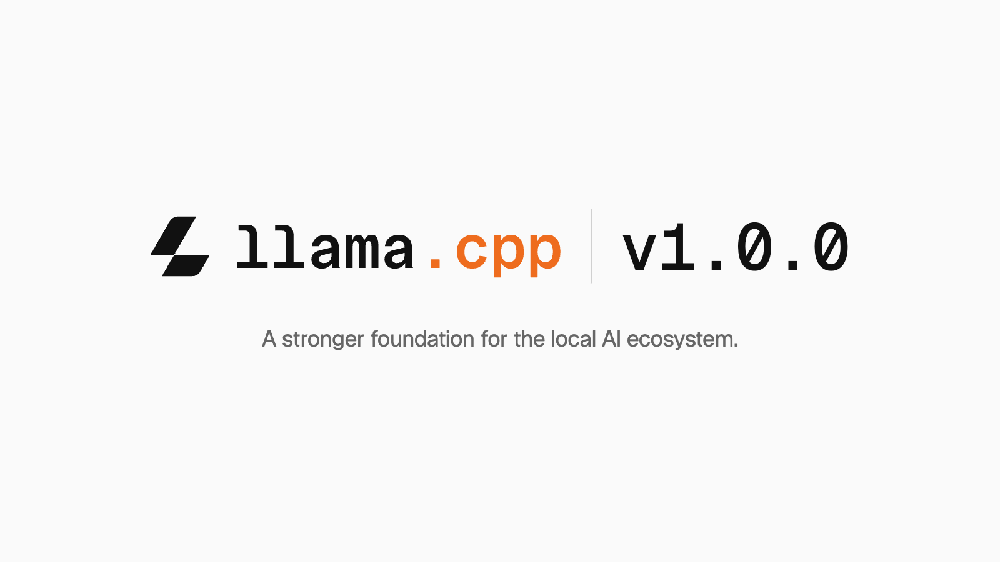

# llama.cpp v1.0.0：用稳定 API 和 ABI 支撑本地 AI 生态

llama.cpp 发布 v1.0.0，这次升级最重要的变化不是新增某一种模型或后端，而是给下游开发者一套更明确的版本承诺：今后，llama.cpp 和底层张量库 ggml 如果引入 API 或 ABI 不兼容，都会通过主版本号升级明确标示。

对一个已经走过 3.5 年、被众多下游应用依赖的项目来说，这条规则很实际。本地推理项目不能只考虑模型能否运行，还要考虑应用升级后是否仍能编译、动态库能否继续配合，以及打包者能否安全地交付更新。v1.0.0 将这些接口边界变成了公开的版本约定。

> 图解：llama.cpp v1.0.0 发布封面。本次发布同时覆盖 llama.cpp 与 ggml 两个库，重点是面向下游开发者的接口兼容规则。

## 两个库正式进入 v1.0.0

llama.cpp 的定位，是让多模态大语言模型运行在从消费级本地设备到高端企业服务器的广泛硬件上。它依靠量化、针对不同硬件优化的后端，以及可移植的 C/C++ 实现降低部署门槛，使开发者能够在不同软件层级构建跨平台、保护隐私的 AI 产品。

这次发布包含两个相互关联的库：上层的 `libllama` 负责 C/C++ 大语言模型推理，底层的 `libggml` 提供机器学习所需的张量计算能力。两者的公共头文件分别位于各自的 `include` 目录。

| 发布内容 | 库 | 公共头文件 |
| --- | --- | --- |
| llama.cpp v1.0.0：C/C++ 大语言模型推理 | `libllama` | `llama.cpp/include/` |
| ggml v1.0.0：机器学习张量库 | `libggml` | `ggml/include/` |

把两个库同时标为 v1.0.0，也意味着下游需要区分两类依赖：调用 llama.cpp 推理接口的应用，以及直接使用 ggml 张量接口的组件。它们各自遵循主版本号所表达的兼容边界，不能只看整个项目的发布名称。

## 版本号现在明确表达什么

这套语义化版本规则适用于所有采用该规则的 ggml-org 项目。判断依据主要是 `./include` 中公共 C API 是否发生不兼容变化，而不是内部实现改动的多少。

| 变更类型 | 版本号升级规则 |
| --- | --- |
| MAJOR | `./include` 中的公共 C API 出现不兼容变更 |
| MINOR | 增加向后兼容的功能、后端更新、模型支持或 API |
| PATCH | 不改变 API 的缺陷修复 |

其中，API 是源码调用库时看到的接口，例如函数与公共声明；ABI 则关系到已编译程序与二进制库之间能否正确配合。团队明确表示，llama.cpp 和 ggml 的 API、ABI 不兼容都会体现为主版本号升级，因此应用开发者和打包维护者可以把主版本变化当作重新检查集成方式的信号。

这也界定了承诺的范围。次版本可以加入后端、模型架构和 API，但应保持向后兼容；补丁版本处理不改变 API 的问题。它并不等于所有内部细节都永久不变，更不意味着主版本永远不会升级，而是让破坏性变化不再隐藏在普通更新中。

## 从源码项目走向更多分发渠道

稳定接口只有进入实际分发流程，才能减少终端用户的升级成本。团队表示，正在拓展 ggml-org 软件触达开发者和用户的方式，并为希望把项目接入打包、发布流程的维护者提供讨论入口。

当前列出的渠道已经覆盖桌面、移动设备和多种包管理生态：

| 分发渠道 | 支持平台 |
| --- | --- |
| 预发布构建产物 | Linux、macOS、Windows、Android、iOS |
| Docker | Linux |
| Debian | Linux |
| Homebrew | macOS、Linux |
| conda-forge | Windows、macOS、Linux |
| MacPorts | macOS |
| Winget | Windows |
| XCFramework | iOS、macOS |

这份清单体现出两种并行需求：开发者需要 Docker、conda-forge 等渠道把推理能力纳入应用环境，终端用户则更可能通过 Homebrew、Winget 或 XCFramework 获得安装包和系统框架。版本边界越清楚，这些不同渠道在跟进上游更新时就越容易判断兼容性风险；不过，各渠道的实际打包进度仍以对应仓库和发布流程为准。

## 硬件覆盖依赖可动态加载的后端

llama.cpp 能跨硬件运行，底层依靠 ggml 的专用后端机制。每个后端都可以编译成动态库，并可选择在运行时加载。这样，项目不必用一种实现覆盖所有设备，而是让计算引擎连接面向具体硬件的实现。

这种结构与本次接口承诺相互补充：后端可以继续增加和更新，按照规则归入向后兼容的次版本变化；公共 C API 若发生不兼容调整，则需要提升主版本号。扩展硬件支持与维持接口可见的兼容边界，成为两件可以同时推进的事。

模型侧，团队称 llama.cpp 当前支持超过 150 种架构变体，并覆盖所有主流推测解码方法。推测解码的作用，是利用额外的候选生成或验证机制减少解码开销；此次公告没有给出各方法的性能对比，因此这些覆盖数字应理解为功能与生态范围，而不是速度提升的测试结果。

## 加快开发，同时把正确性检查铺到更多硬件

项目仍在快速演进，团队也明确表示会在开发周期中审慎地使用大语言模型，同时把代码质量、架构掌控和实现细节理解放在优先位置。换言之，辅助开发工具并没有替代维护者对实现的责任。

为了支撑更快的开发节奏，团队持续投入 CI 基础设施。借助 Hugging Face 的 HF Buckets 和 HF Jobs，项目扩展了验证能力，目标是保证合入主分支的每项变更都经过正确性检查。NVIDIA、AMD、Qualcomm、Arm、IBM 和 Intel 提供硬件支持，使项目能够在主要硬件平台上继续增加自托管运行器。

对下游用户而言，这部分与版本号同样重要：语义化版本说明变更如何被标记，覆盖多种硬件的持续集成则支撑变更是否按预期工作。公告没有公开测试覆盖率或故障率等数字，但能确认的是，跨平台验证仍是项目继续扩张的基础设施投入方向。

## v1.0.0 真正交付的是可管理的升级边界

llama.cpp v1.0.0 的核心价值，是在模型、后端和分发渠道持续增加时，为下游提供一套可判断的升级规则。对于直接调用 `libllama` 或 `libggml` 的开发者，以及维护系统包和应用发布的团队，最实际的做法是按主版本管理依赖，在跨主版本升级时重新检查公共 C API 与二进制兼容性。

这次公告没有提供新的推理性能实验，也没有声称接口从此不再变化；它确认的是，项目会把破坏性变化明确放进主版本升级，并继续扩展模型、硬件和分发覆盖。对依赖本地推理能力的应用来说，这种可见、可管理的边界，正是 v1.0.0 为生态补上的基础。

> 本文参考自 [llama.cpp v1.0.0 : A stronger foundation for the local AI ecosystem](https://huggingface.co/blog/ggml-org/llama-cpp-v1)