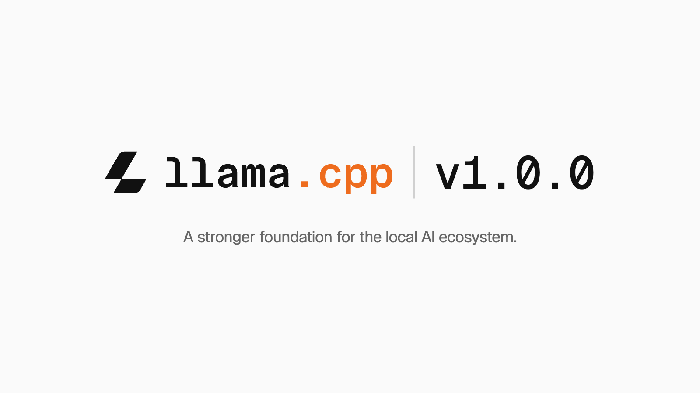

# llama.cpp v1.0.0：用稳定 API 和 ABI 支撑本地 AI 生态

llama.cpp 发布 v1.0.0，重点并非新增某种模型或后端，而是给下游开发者明确的升级承诺：今后，llama.cpp 与底层张量库 ggml 若出现 API 或 ABI 不兼容，都会通过主版本号升级标示。对一个已发展 3.5 年、被众多应用依赖的项目而言，这直接关系到应用升级后能否编译、已编译程序能否继续配合动态库，以及打包者能否安全交付更新。

> 图解：llama.cpp v1.0.0 发布封面。本次发布同时覆盖 llama.cpp 与 ggml 两个库，重点是面向下游开发者的接口兼容规则。

## 两个库，各自有明确的兼容边界

本次发布包含上层的 `libllama` 与底层的 `libggml`：前者负责 C/C++ 大语言模型推理，公共头文件位于 `llama.cpp/include/`；后者提供机器学习张量计算能力，公共头文件位于 `ggml/include/`。因此，调用推理接口的应用与直接使用张量接口的组件，需要分别关注对应库的主版本，不能只看整个项目的发布名称。

这套规则适用于所有采用语义化版本的 ggml-org 项目。`./include` 中的公共 C API 出现不兼容变化时升级 MAJOR；增加向后兼容的功能、后端、模型支持或 API 时升级 MINOR；不改变 API 的缺陷修复则升级 PATCH。API 关乎源码调用接口，ABI 关乎已编译程序与二进制库能否正确配合，两者的破坏性变化都会体现为主版本升级。承诺并不表示内部细节永远不变，而是让破坏性变化不再隐藏于普通更新。

## 从接口承诺到实际分发

稳定接口只有进入分发流程，才能降低终端用户的升级成本。当前列出的渠道包括覆盖 Linux、macOS、Windows、Android 和 iOS 的预发布构建产物，以及 Docker、Debian、Homebrew、conda-forge、MacPorts、Winget 和 XCFramework。清晰的版本边界有助于各渠道判断跟进上游更新的兼容性风险，但实际打包进度仍以对应仓库和发布流程为准。

跨硬件运行则依赖 ggml 的专用后端：每个后端都可编译为动态库，并在运行时加载。后端扩展可按规则进入向后兼容的次版本，公共 C API 的不兼容调整则提升主版本。团队称项目目前支持超过 150 种模型架构变体，并覆盖所有主流推测解码方法；公告没有给出性能对比，因此这些数字只能说明功能与生态覆盖，不能视为提速证据。

## 用跨硬件验证支撑快速开发

团队表示会在开发中审慎使用大语言模型，同时优先考虑代码质量、架构掌控和实现细节理解。项目还借助 Hugging Face 的 HF Buckets 与 HF Jobs 扩展验证能力，目标是让合入主分支的每项变更都经过正确性检查；NVIDIA、AMD、Qualcomm、Arm、IBM 和 Intel 提供硬件支持，用于继续增加主要平台上的自托管运行器。公告未公开测试覆盖率或故障率，但确认了跨平台持续集成仍是投入方向。

回到升级这个具体问题，v1.0.0 交付的是可管理的边界，而非新的推理性能结果或“接口不再变化”的保证。对直接调用 `libllama`、`libggml` 的开发者及软件包维护者，最实际的做法是按主版本管理依赖，并在跨主版本升级时重新检查公共 C API 与二进制兼容性。

> 本文参考自 [llama.cpp v1.0.0 : A stronger foundation for the local AI ecosystem](https://huggingface.co/blog/ggml-org/llama-cpp-v1)