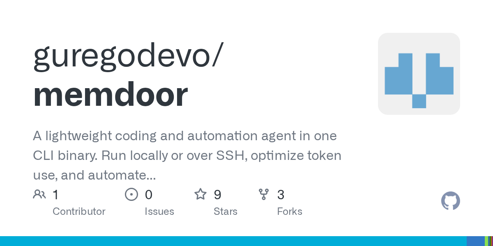

# team-solve：小模型靠协作解难题

让大模型一次性写对竞赛难题，难点不只是算法能力，还在于它能否发现错误、保留正确方案，并用真实测试结束任务。team-solve 将 GVS5H 的多智能体解题方法重建为 Memdoor 工作流：规划者、两个构思者、求解者、管理者和修复者分别从全新上下文启动，只通过磁盘文件交接，最终由 shell 脚本而非模型判定成败。

在 LiveCodeBench Hard 的前 10 道题上重复 5 轮后，Qwen3.8-27B 驱动的这套流程平均解出 9.8 题，原作者的 27B harness 为 9.6 题，Fable 5 单次调用为 8.0 题。这个结果指向的不是更大的模型，而是一种更严格的协作与验收方式。



> 图解：Memdoor 是一个轻量级编程与自动化 agent，可在本地或通过 SSH 运行。

## 9.8/10 是在什么条件下得到的

项目作者在 2026 年 10 月 31 日公布了五轮复现结果。实验使用相同的 Qwen3.8-27B、128K 回复上限、原作者提示词和循环流程；每份程序都经过修正后的评分器，在全部公开与隐藏测试上评分。

| 轮次 | Memdoor 工作流 | 原作者的 27B harness | Fable 5 单次调用 |
| --- | --- | --- | --- |
| 1 | 10 / 10 | 9 | 7 |
| 2 | 10 / 10 | 10 | 8 |
| 3 | 10 / 10 | 10 | 10 |
| 4 | 10 / 10 | 9 | 8 |
| 5 | 9 / 10 | 10 | 7 |
| 平均 | 9.8 | 9.6 | 8.0 |

50 次运行共解出 49 次，消耗 1530 万个输出 Token，计入成绩的运行花费 35.79 美元。若再算上 16 次因超时被截断、为修复而停止或暂停的尝试，总成本为 38.77 美元。单次运行的模型耗时中位数为 40 分钟，最长达到 4 小时，单次成本约 0.39 美元。

项目公开了每次请求与回复、生成程序、完整评分输出、调用成本、服务主机以及未计入成绩的尝试，因而这些数字可以逐次追查。

但这不是对完整 LiveCodeBench Hard 的普遍结论。实验只覆盖原作者清单中的前 10 题，而非其论文中的 100 题；竞赛日期为 2025 年 3 月 29 日至 4 月 6 日，模型可能在训练中见过题目，数据污染无法排除。

Fable 5 一栏来自原作者文件中的每题单次调用，并没有在 Memdoor 中重新运行；工作流本身只能看到公开样例，表中成绩则来自隐藏测试。

## 复现的难点是逐字节对齐请求

多智能体流程换一个框架实现，很容易在不易察觉的地方改变输入。team-solve 用 `lib/test_parity.py` 将原作者的 `multiagent_solve` 与新工作流接到同一个脚本化模型上，逐个比较请求：4 个测试用例全部逐字节一致，只要改动一个字符，比较就会失败。

对齐的不只是提示词，还包括一组会影响生成与循环行为的细节：

- 规划阶段温度为 0.3，构思阶段为 0.4，管理者与修复者为 0.2。
- `top_p` 为 0.95，`top_k` 为 20，后者沿用模型自身配置在原作者 vLLM 中的取值。
- 回复上限为 128K，最多循环 10 轮。
- 达到上限而被截断的修复者会被总结；若模型没有输出正文，则使用其 reasoning 作为回答。

真正不同的是推理服务。原作者使用自己的 FP8 vLLM，新实验通过 OpenRouter 调用，起初按 Modal、CoreWeave、Parasail、Wafer 的顺序选择服务；当 Modal 降至 14 Token/s 后，只在 Wafer、Parasail、CoreWeave 这些 FP8 服务间选择。

最终 Modal 处理 203 次调用，CoreWeave 处理 27 次，Wafer 处理 115 次，FP8 顺序下的调用全部由 Wafer 完成。3 次运行在途中切换了主机，但保留已经完成的步骤。Modal 没有公开其数值精度，因此服务差异仍是复现中的一个变量。

项目作者还遇到一个更隐蔽的问题：最初版本在每道题外自行包了一层任务文件，27B 模型据此做出的规划反而更差。以 `arc196_c` 为例，使用改写文本时规划通过 0/2，换回原作者的 LiveCodeBench 原文后变为 2/2。这说明复现多智能体方法时，任务文本本身也是实验条件，不能当成无关紧要的包装。

为此，Memdoor 增加了四项能力：无正文时返回 reasoning、在模型配置行设置 `top_p` 与 `top_k`、用 `mark_cutoff` 标记达到上限的回复，以及让单次调用拥有独立的 4 小时时钟。它们解决的都是请求与执行语义的一致性问题，而不是给模型额外提示答案。

## 用文件交接，而不是共享聊天记忆

team-solve 的核心约束是：每个 agent 都获得全新上下文，必须读取文件，不能依赖之前的聊天。磁盘上的 `plan.md`、`notes.md` 和测试日志因此成为共享账本，后续角色读到的是明确产物，而不是一段不断膨胀、可能夹杂猜测的对话。

```text
plan ──┬── ideate-a ──┬── solve ── test ── review ── repair ── verify
       └── ideate-b ──┘
```

| 步骤 | 类型 | 读取 | 写入 |
| --- | --- | --- | --- |
| `plan` | agent | `task.md` | `plan.md`，以及为两个构思者各设一个锚点的 `notes.md` 账本 |
| `ideate-a`、`ideate-b` | 并行 agent | `task.md`、`plan.md`、`notes.md` | 在各自锚点写入提案：A 选择最直接且可证明的算法，B 选择不同技术族的方案 |
| `solve` | agent | 两份提案 | 将决策写入 `notes.md`，生成 `solution.py` |
| `test` | command | `tests/` | `test-output.log`、`test-status.txt`，测试失败不会直接终止运行 |
| `review` | agent | 捕获的测试输出，而非模型自述 | `review.md`，以及写入 `notes.md` 的修复指令 |
| `repair` | agent | 管理者的指令 | 修复后的 `solution.py`；若样例已通过则不写入 |
| `verify` | command | `tests/` | `final-test-output.log`；非零退出码会使运行失败 |

两个构思者的分工值得注意：A 追求直接、可证明，B 被强制从不同技术族思考。这比让两个实例重复“再想一个方案”更容易形成实质差异；随后由求解者读取双方提案并作选择，而不是简单投票。

流程只有一轮修复，也没有人工审批。最后的 `verify` 才是完整裁决，它调用脚本重新跑样例，并把脚本退出码作为工作流退出码：

```yaml
type: command
requires:
  - table_pattern: repair
command: |
  check=.memdoor/workflows/team-solve/check-samples.sh
  [ -f "$check" ] || check="$HOME/.memdoor/workflows/team-solve/check-samples.sh"
  bash "$check" > final-test-output.log 2>&1
  result=$?
  cat final-test-output.log
  exit "$result"
```

每个步骤都是 `steps/` 下的一个 YAML 文件，底层采用 mario 引擎的格式。`requires` 定义 DAG（有向无环图），也就是步骤之间的依赖与执行顺序；调整角色时，主要修改相应提示词即可。

## 一个样例同时验证了算法与工程缺口

项目附带的题目要求统计由 `a`、`b`、`c` 组成、长度最高 20 万的字符串中，三种字母出现次数相等的子串数量。通过 OpenRouter 默认服务阶梯运行后，8/8 个步骤完成，5/5 个样例通过。求解者采用构思者 A 的前缀状态方法，以 `(a−b, a−c)` 为字典键，将复杂度降为 $O(N)$。

项目作者随后用 300 个随机字符串与暴力算法对照，没有发现不一致；在 $N=200{,}000$ 时，运行时间为 0.04 秒，管理者也没有提出修复。这一案例说明双构思加文件交接能够产生有效算法，但首次运行暴露的另外三个问题更偏工程：

- 一位构思者的服务在回答中途断开数据流，而自动生成的配置写着 `max_retries: 0`，整个运行随即终止。现在 agent 步骤改为 `max_retries: 1`，并可用 `--partition` 恢复，保留规划者和另一位构思者已经完成的工作。
- 自动生成的构思提示词直接写死了样例算法：A 用流式前缀状态计数，B 对前缀状态排序。这会把其他问题错误地引向本题套路，因此在 2026 年 10 月 28 日改为“最直接且可证明”与“不同技术族”两种通用要求。
- 最早尝试中，每一步都在 0 秒内报 `no agent named coder`，因为运行器只在自己的工作区查找 agent。该问题已在网关 v1.692.0 中修复。

项目作者称，这些工作流文件是 coder 在 2026 年 10 月 25 日根据方法描述自行生成的，没有人工手写。上述故障也因此很有代表性：自动生成的不只是角色提示词，还包括重试、查找路径等执行约束，任何一项都可能让看似完整的多智能体流程失效。

## 正确答案也可能被后续协作覆盖

五轮实验中唯一未完全解出的运行，暴露了比“算法没想出来”更棘手的问题。第 5 轮的 `abc399_e` 只通过 44 个隐藏测试中的 32 个：第 1 轮程序本来正确，管理者却捏造了一个反例，并给出错误的期望答案；团队据此重写程序，新程序虽然通过公开样例，但样例没有覆盖那个情况。

第 4 轮的 `arc196_c` 与 `arc196_d` 则展示了另一种浪费。已经通过全部隐藏测试的程序，因为管理者没有宣布完成而被后续轮次覆盖。两题最终都找回了正确程序——`arc196_d` 在第 8 轮，`arc196_c` 到最后一次调用才恢复——但成本分别达到 3.44 美元和 4.24 美元，成为最贵的两次运行。

这两个问题都不一定要靠换模型解决。项目作者提出，可以用小输入上的暴力实现检查管理者给出的反例，并始终保留最近一个通过样例的程序。不过，这些修复没有计入当前实验数字，不能把它们当成已经验证的改进。

从这里看，管理者的职责既是质量保障，也是新的故障源。它可以根据真实测试日志推动修复，却也能凭一个错误判断覆盖正确答案；因此，文件账本还需要配合版本保留和反例验证，而不只是把更多角色串起来。

## 如何在自己的题目上运行

安装与示例运行命令如下，需要 Python 3 和 bash：

```bash
curl -fsSL https://memdoor.ai/install.sh | bash
memdoor connect openrouter                 # 也可选 anthropic、openai、gemini、chatgpt
git clone --depth 1 https://github.com/guregodevo/memdoor

mkdir -p ~/.memdoor/workflows
cp -r memdoor/examples/workflows/team-solve ~/.memdoor/workflows/
mkdir my-problem && cd my-problem
cp -r ../memdoor/examples/workflows/team-solve/sample/* .
memdoor workflow run team-solve --wait
```

示例目录包含 `task.md` 和 `tests/1.in` 至 `tests/5.out` 等成对测试文件。运行时，进度写到 stderr，只有全部样例通过才以退出码 0 结束；在 Memdoor TUI 中输入 `/workflow`，可以实时查看同一次运行。

换成自己的题目时，替换 `task.md`，并在旁边放置成对的 `tests/N.in` 与 `tests/N.out`。生成的 `solution.py` 从标准输入读取数据，输出通过 `diff` 与样例比较。工作流复制到 `~/.memdoor/workflows/` 后可跨项目使用；若只希望某个仓库使用，则放进该项目的 `.memdoor/workflows/`，项目内副本优先。

步骤本身没有绑定模型，实际由 `/model` 固定的模型回答。除云端服务外，也可通过 `memdoor connect local` 接入 janis、Ollama 或 llama-server。不过，当前 9.8/10 的结果来自 OpenRouter 上的指定模型与服务组合，不能直接外推到任意本地模型。

## 这套流程适合谁

- 对竞赛编程与复杂代码任务，双构思、独立修复和脚本验收提供了一条不依赖增大模型的改进路径。
- 对多智能体工程，逐字节请求对齐、公开完整轨迹和保留失败尝试，比只汇报平均分更有复现价值。
- 对实际使用者，正确程序的版本保留、管理者反例校验和服务重试，与提示词本身同样重要。

如果准备复现，最稳妥的起点是原样运行附带样例，再替换题目与测试，同时检查每次调用的主机、成本和日志。现有证据支持的是“这套流程在 10 道题、5 轮运行中达到平均 9.8 题”，尚不能证明它在完整基准、无污染题目或其他模型上保持同样优势；40 分钟的中位模型耗时和正确方案被覆盖的案例，也提示了实际采用时需要权衡的成本与可靠性。

> 本文参考自 [memdoor/examples/workflows/team-solve at main · guregodevo/memdoor](https://github.com/guregodevo/memdoor/tree/main/examples/workflows/team-solve)