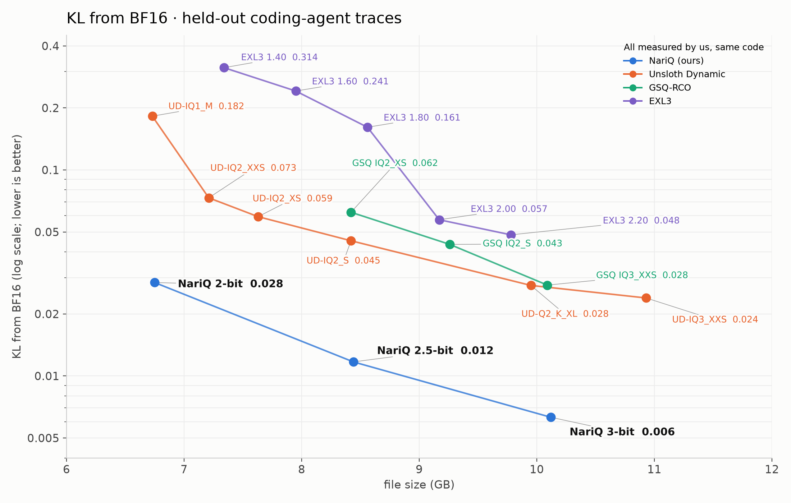
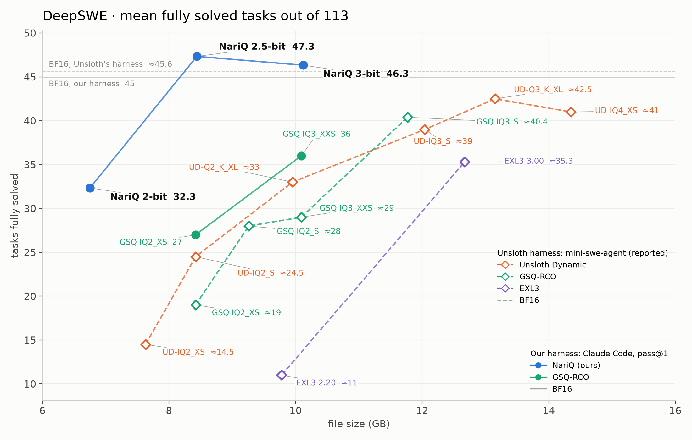
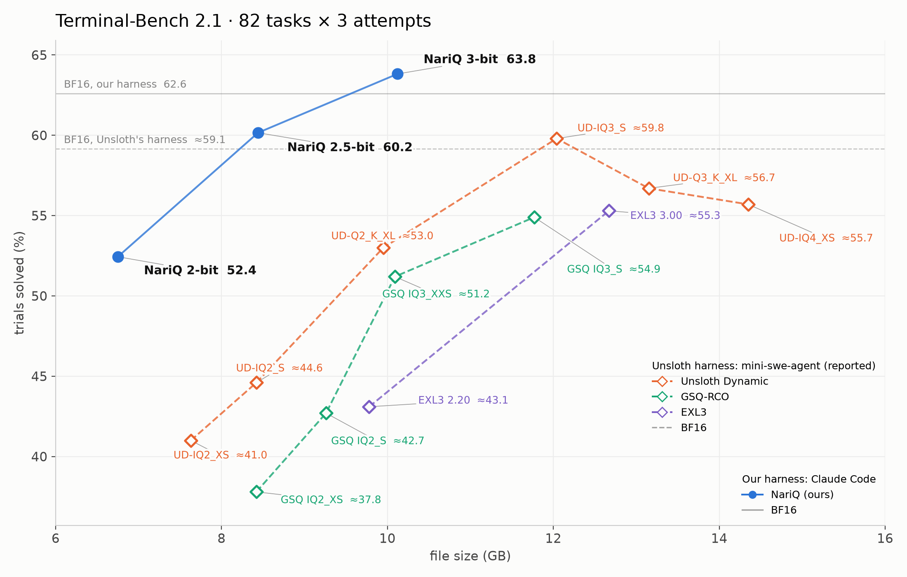

# NariQ：27B模型压至10GB，长程智能体对齐BF16

一个27B参数模型，BF16权重需要53.8GB；Nari Labs在2026年11月20日发布的NariQ 3-bit版本，把语言模型权重压到10.1GB。更关键的是，团队报告的DeepSWE长程软件工程任务平均pass@1从BF16的39.8%变为41.0%，Terminal-Bench 2.1从62.6%变为63.8%，没有因大幅压缩而出现预期中的明显掉分。

这里的“对齐BF16”有明确边界：它来自Nari Labs自己的测试，主要覆盖长程智能体、数学和图像理解，并不代表所有任务都已得到独立验证。NariQ也不是一份能直接放进现有GGUF工具链的普通模型文件——它必须搭配团队的llama.cpp分支运行。

## 不是只追求更小，而是校准真实智能体轨迹

NariQ是一种格编码训练后量化（PTQ）方法。PTQ在模型训练完成后压缩权重，不需要重新经历完整训练；“格编码”则用于组织低比特权重的表示。其技术报告说明，NariQ的格码建立在QTIP（Tseng等，2024）之上。

这次校准使用的不是泛化的文本样本，而是真实编程智能体轨迹，也就是模型在多步任务中产生的交互数据。这个选择与长程任务直接相关：模型不只回答一道孤立问题，还要持续规划、调用工具、读取环境反馈并修正后续动作。局部输出偏差如果沿着长链条累积，最终可能表现为任务无法完成，因此仅用简短问答的分数并不足以判断量化是否成功。

Nari Labs提供了3、2.5和2比特三种权重文件，并采用可在单张GPU上运行的存储布局。团队称，3-bit和2.5-bit在长程智能体、数学和图像理解上达到BF16水平，2-bit则有更明显的性能损失。

## 10GB版本保住了什么

下表保留了各测试的任务规模、重复次数和原始计数。每个单元格先给百分比，括号内为对应计数：DeepSWE是每轮完全解决任务数的均值，Terminal-Bench为解决的试验数，其余为正确答案数。

| 模型 | DeepSWE v1.1：113任务×3，平均pass@1 | Terminal-Bench 2.1：82任务×3 | AIME 25+26：60×8 | MGSM：250×11种语言 | RealWorldQA：765×3 |
| --- | --- | --- | --- | --- | --- |
| BF16（53.8GB） | 39.8（45.0） | 62.6（154） | 97.7（469） | 94.0（2584） | 82.4（1890） |
| NariQ 3-bit（10.1GB） | 41.0（46.3） | 63.8（157） | 98.3（472） | 93.1（2561） | 82.4（1890） |
| NariQ 2.5-bit（8.4GB） | 41.9（47.3） | 60.2（148） | 96.5（463） | 91.8（2525） | 81.3（1866） |
| NariQ 2-bit（6.8GB） | 28.6（32.3） | 52.4（129） | 86.0（413） | 90.6（2491） | 80.9（1856） |

3-bit并不是每项都更高：MGSM从BF16的94.0%降至93.1%，RealWorldQA则同为82.4%。2.5-bit在DeepSWE上达到41.9%，但Terminal-Bench回落到60.2%，MGSM和RealWorldQA也略低于BF16。因此，更准确的结论是这两款低比特文件在团队测试的整体能力上接近BF16，而不是量化带来了全面提升。

DeepSWE还有一项更细的结果：同一三轮测试中，每个任务新增测试通过比例的均值分别为BF16 83.1%、3-bit 82.9%、2.5-bit 83.2%、2-bit 77.2%。这与完全解决任务数的趋势一致，也进一步说明2-bit不适合作为追求整体性能的首选。

测试过程也有需要披露的不完整性。BF16在第3轮出现一次验证器超时，该次按零分计算，因此339次试验实际评分338次；三个NariQ版本均完成339次评分。所有智能体测试都使用Claude Code CLI 2.1.309，开启thinking并将effort设为max，由它驱动本地模型；上下文为262,144 tokens，采用思考模式采样参数：temperature 1.0、top-p 0.95、top-k 20。



> 图解：横轴比较文件大小，纵轴衡量量化模型在留出的编程智能体轨迹上相对BF16模型的KL散度，越低表示输出分布越接近BF16。所有点均由Nari Labs用同一套代码测得。



> 图解：纵轴为113项DeepSWE任务中完全解决的数量，越高越好。NariQ各点和实线BF16基线是Claude Code下三轮测试的均值；GSQ-RCO各点只跑了一轮。空心菱形来自Unsloth已发布的Dynamic V3.1图表，使用mini-swe-agent，数值为近似均值。不同测试框架不能横向混比，应各自对照同框架的BF16线。



> 图解：测试包含82项任务，每项尝试3次，得分越高越好。实心圆为团队的Claude Code测试，空心菱形为从Unsloth Dynamic V3.1公开图表读取的近似结果，后者使用mini-swe-agent并取多次通过的平均值。实线与虚线分别表示两套框架的BF16基线，跨框架的绝对分数不宜直接比较。

这三张图分别回答了不同问题：KL散度观察量化后输出分布与BF16的距离，DeepSWE观察长程软件工程任务能否完整完成，Terminal-Bench则观察终端任务结果。后两张图同时提醒读者，智能体分数不仅由模型决定，也受驱动它的测试框架影响。

## 三个文件怎么选，显存又该怎么算

团队把3-bit设为默认版本；需要进一步省显存时可选2.5-bit，它仍在智能体任务上接近BF16；2-bit体积最小，但数学和智能体能力明显较弱。视觉投影文件是单独的0.93GB BF16组件，三个版本共用。

| 文件 | 每权重比特数 | 大小 | 用途 |
| --- | --- | --- | --- |
| Qwen3.8-27B-NariQ-3.0bpw.gguf | 3.00 | 10.12GB | 默认选择 |
| Qwen3.8-27B-NariQ-2.5bpw.gguf | 2.50 | 8.44GB | 更少显存；智能体任务达到BF16水平 |
| Qwen3.8-27B-NariQ-2.0bpw.gguf | 2.00 | 6.75GB | 最小文件；数学和智能体任务较弱 |
| Qwen3.8-27B-NariQ-mmproj-BF16.gguf | 16 | 0.93GB | 三个版本共用的视觉投影组件 |

权重文件变小，不等于任意长上下文都能塞进小显存。当前KV缓存和激活仍保持BF16，上下文越长，权重之外的内存开销越重要。团队给出的估算如下：

| 显存条件 | 3-bit | 2.5-bit | 2-bit |
| --- | --- | --- | --- |
| 24GB GPU可容纳的上下文 | ≈135K | ≈160K | ≈184K |
| 完整262K上下文所需GPU显存 | ≈30GB | ≈28GB | ≈27GB |

因此，24GB GPU可以使用约135K上下文的3-bit版本，但若显示器也共享这张GPU，就需要继续降低上下文。要使用模型完整的262,144-token上下文，团队建议32GB或更大显存。未来对KV缓存和激活进行量化，目标之一正是让长上下文进入16GB消费级GPU，同时提升速度。

## 部署命令与实测解码速度

在带NVIDIA GPU、驱动版本570或更新的Linux机器上，可以用一条流程下载分支二进制和模型文件、执行校验，并按GPU容量选择上下文：

```bash
curl -fsSLO https://github.com/nari-labs/nari-llama.cpp/releases/download/b12431-nariv0/run.sh
bash run.sh 3.0   # 也可改为2.5或2.0
```

手动部署时，需要从Nari Labs的llama.cpp分支取得`llama-server`，并同时下载语言模型和视觉投影文件：

```bash
hf download nari-labs/Qwen3.8-27B-NariQ-GGUF \
    Qwen3.8-27B-NariQ-3.0bpw.gguf Qwen3.8-27B-NariQ-mmproj-BF16.gguf --local-dir .
llama-server -m Qwen3.8-27B-NariQ-3.0bpw.gguf --mmproj Qwen3.8-27B-NariQ-mmproj-BF16.gguf \
    -ngl 99 -c 131072 --jinja --port 8080 \
    --temp 1.0 --top-p 0.95 --top-k 20 --min-p 0
```

这里的采样参数与团队跑分使用的思考模式设置一致。`-c 131072`在24GB GPU上只剩很少余量；显示输出共享GPU时应调低，或者直接让`run.sh`选择能容纳的最大上下文。32GB及以上可改为`-c 262144`。

速度数据来自一张NVIDIA RTX PRO 6000（Blackwell），单会话、贪婪解码512个输出token，单位为tokens/s：

| 上下文 | NariQ 3.0bpw（10.1GB） | NariQ 2.5bpw（8.4GB） | NariQ 2.0bpw（6.8GB） | UD-IQ3_XXS（10.9GB） |
| --- | --- | --- | --- | --- |
| 4K | 88.9 | 99.2 | 111.7 | 94.7 |
| 16K | 84.5 | 93.8 | 105.1 | 89.8 |
| 64K | 70.7 | 77.5 | 85.0 | 74.8 |

NariQ测试使用团队llama.cpp分支，参数为`-fa on -ctk bf16 -ctv bf16 -t 1 -tb 16 --backend-sampling --samplers temperature`，即在GPU上贪婪采样并使用BF16 KV缓存。对照项UD-IQ3_XXS是Unsloth文件，此前在同型号GPU上用llama.cpp测得；测试时间不同，因此它适合作为参考，而不是严格同步的全面对比。

从团队数据看，上下文从4K升到64K后，三个NariQ版本都在减速；比特数越低，解码越快。但速度优势不能抹去2-bit在DeepSWE、Terminal-Bench和AIME上的损失，选文件时仍需同时看任务质量和显存。

## 真正的门槛在运行时和硬件适配

NariQ当前最需要留意的代价，是生态兼容性。文件使用新的张量类型，标准llama.cpp、Ollama和LM Studio暂时无法加载，必须运行支持NariQ的llama.cpp分支。团队希望把支持合并到上游；内部SGLang插件和基于Resin构建的推理引擎仍在开发中，尚未承诺公开可用。

硬件优化也不均衡。当前分支重点优化SM120，例如RTX PRO 6000；Ampere、Ada、Hopper和Apple M系列GPU现阶段慢于可比GGUF。早于Ampere的GPU会退回较慢的CPU执行，AMD和Intel GPU尚不支持，GeForce显卡也还没有测试。团队列出的已测GPU只有RTX PRO 6000、H100、L4和A10。

Apple M系列需要从源码构建Metal版本。团队在M3 Pro 18GB上测得，3.0bpw解码约3.8 tokens/s，2.0bpw约4.9 tokens/s，远低于CUDA平台，其他Mac尚未测试。

模型本身也有未压缩或未包含的部分：视觉塔仍为BF16，只有语言模型经过量化；多token预测（MTP）模块尚未包含，仍待量化。KV缓存和激活量化则属于后续工作。

## Qwen3.8-27B提供了哪些底座能力

NariQ的底座Qwen3.8-27B是一个带视觉编码器的27B稠密因果语言模型，原生支持图像和视频理解，并面向编程、专业工作、研究和长程智能体任务。它默认开启思考模式，可按请求关闭；`reasoning_effort`用于调节推理深度，`preserve_thinking`用于保留历史消息中的推理上下文。

其原生上下文为262,144 tokens，可通过RoPE缩放（例如YaRN）扩展到最多1,000,000 tokens。架构包含64层，隐藏维度5120，采用Gated DeltaNet与Gated Attention混合布局；这些底座能力解释了为何NariQ同时报告智能体、数学和视觉问答测试，但量化文件目前仍需额外携带BF16视觉投影组件。

对于想尝试长程本地智能体的用户，3-bit是证据最完整的默认起点，2.5-bit适合进一步压缩显存；若主要看重数学和智能体可靠性，现有结果不支持为了最小体积选择2-bit。更根本的成立条件仍是接受专用运行时，并确认自己的GPU在已测试和优化范围内。NariQ展示了真实智能体轨迹校准与低比特存储的潜力，但当前结论来自团队测试，跨硬件性能、上游生态支持和独立复现仍待补齐。模型文件继承底座模型的Apache-2.0许可证，进一步方法细节可查阅团队的[技术报告](https://arxiv.org/abs/2611.26157)。

> 本文参考自 [nari-labs/Qwen3.8-27B-NariQ-GGUF · Hugging Face](https://huggingface.co/nari-labs/Qwen3.8-27B-NariQ-GGUF)