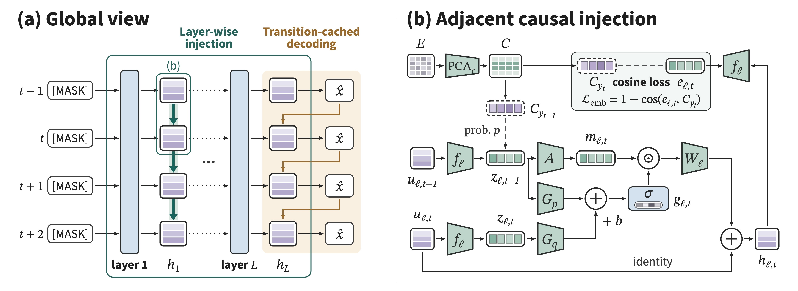

# DSpine：并行草稿让 Agent 吞吐最高达 3.84 倍

腾讯发布的 DSpine 把推测解码中的草稿生成改为并行进行，并用五层草稿模型服务 Qwen3.8-27B。团队报告的 Agent 端到端测试中，它在 WorkBuddy Office 低推理强度设置下达到 805.53 tokens/s，是自回归解码 210.03 tokens/s 的 3.84 倍；同一测试中，官方 DFlash2 为 664.77 tokens/s。

这个结果针对的是长输出、多轮工具调用的 Agent 回放负载，而不是所有生成任务的普遍加速。DSpine 的价值也不只在一次多写几个 token：它试图在并行生成草稿时保留位置之间的因果依赖，再把更长的草稿交给目标模型验证。

## 并行生成草稿，靠层间传递补上因果信息

推测解码先由轻量草稿模型提出候选 token，再由目标模型验证，以减少逐个 token 解码的开销。DSpine 的草稿 token 是并行生成的；与此同时，每一层都会把预测出的前驱特征传给相邻位置，让因果依赖沿网络深度传播。这一设计对应论文题目中的“相邻因果注入”：并行的位置并非完全独立地猜测，而是通过网络各层获得前序位置的信息。

当前 checkpoint 是一个面向 Qwen3.8-27B 的五层草稿模型，块大小为 16，即配置中一次生成 16 个草稿 token；滑动窗口为 8,192 token。推理时，DSpine 使用参考 DSpark 的动态验证，并启用 ReplaySSM。



> 图解：DSpine 并行产生草稿 token，同时让各层把前驱位置的特征注入相邻位置，以层间传播保留因果依赖；生成的草稿随后进入目标模型验证流程。

这套方案与对照组的配置差异需要一并看清：评测中的 DSpine 草稿块为 16，官方 DFlash2 为 8。因此，下面的结果比较的是两套完整推理配置，不能把全部收益单独归因于相邻因果注入或并行草稿中的某一项设计。

## 接受长度提高，但不同任务的余量并不相同

团队先报告了通用任务的接受长度。接受长度反映草稿经目标模型验证后能被保留的程度；在草稿生成和验证开销相近时，更高的接受长度通常意味着推测解码更有机会减少完整目标模型的串行调用。这里比较的是 DSpine 与 DFlash2，并不是任务正确率。

通用基准采用 xhigh 推理设置，分别测试贪心采样（T=0）和温度采样（T=1），每次最多生成 4,096 个新 token。

| 任务 | DFlash2（T=0） | DSpine（T=0） | DFlash2（T=1） | DSpine（T=1） |
| --- | ---: | ---: | ---: | ---: |
| GSM8K | 5.69 | 7.20 | 5.45 | 6.31 |
| MATH-500 | 5.49 | 6.49 | 5.27 | 5.66 |
| HumanEval | 4.87 | 5.71 | 4.34 | 4.71 |
| MBPP | 5.04 | 6.14 | 4.79 | 5.41 |
| MT-Bench | 4.11 | 4.48 | 3.89 | 4.03 |

DSpine 在这十组比较中都取得更高的接受长度。差距较明显的是贪心采样的 GSM8K，从 5.69 提高到 7.20；较温和的是温度采样的 MT-Bench，从 3.89 提高到 4.03。也就是说，“草稿更长且更容易被接受”在这些测试中成立，但收益幅度随任务和采样方式变化，不能只拿 GSM8K 的差值概括所有负载。

温度采样实验统一使用 `temperature=1.0`、`top_p=0.95`、`top_k=20`。因此，T=1 的数值对应这套具体采样参数，而不是任意随机采样设置。

## Agent 回放中，接受长度与端到端吞吐同步增长

Agent 测试进一步覆盖 WorkBuddy Bench 的 Code、Web、Office 子集，以及 SWE-bench Pro 和 τ²-bench，分别使用 low 与 xhigh 推理强度。WorkBuddy 使用 CodeBuddy 沙箱轨迹，每个子集回放 20 段对话；所有工具调用前缀按顺序回放，启用前缀缓存，每次请求最多生成 32,768 个新 token。这比最多 4,096 token 的通用测试更接近长轨迹 Agent 的生成压力。

| 基准 | low：DFlash2 | low：DSpine | xhigh：DFlash2 | xhigh：DSpine |
| --- | ---: | ---: | ---: | ---: |
| WorkBuddy Code | 4.19 | 5.08 | 4.06 | 4.92 |
| WorkBuddy Web | 3.95 | 4.91 | 3.95 | 5.01 |
| WorkBuddy Office | 4.24 | 5.63 | 4.20 | 5.49 |
| SWE-bench Pro | 4.19 | 4.99 | 4.00 | 4.77 |
| τ²-bench | 4.70 | 5.53 | 4.29 | 4.95 |

十组 Agent 接受长度同样全部由 DSpine 领先。WorkBuddy Office 的 low 设置从 4.24 增至 5.63，是其中较明显的一组；SWE-bench Pro 的 xhigh 设置则从 4.00 增至 4.77。对使用者而言，真正关键的是这些变化能否转化为完成整段并发回放所需的时间，而不只是草稿指标本身。

团队因此给出了端到端吞吐：总输出 token 数除以端到端并发回放的实际耗时，单位为 tokens/s。括号中的倍数以传统自回归解码（AR）为基线，不是相对于 DFlash2 的加速比。

| 基准 | low：AR | low：DFlash2 | low：DSpine | xhigh：AR | xhigh：DFlash2 | xhigh：DSpine |
| --- | ---: | ---: | ---: | ---: | ---: | ---: |
| WorkBuddy Code | 253.35 | 590.27（2.33×） | 686.23（2.71×） | 193.00 | 550.40（2.85×） | 613.55（3.18×） |
| WorkBuddy Web | 247.40 | 639.74（2.59×） | 773.19（3.13×） | 252.26 | 734.04（2.91×） | 840.14（3.33×） |
| WorkBuddy Office | 210.03 | 664.77（3.17×） | 805.53（3.84×） | 215.05 | 662.34（3.08×） | 763.83（3.55×） |
| SWE-bench Pro | 241.86 | 657.71（2.72×） | 713.41（2.95×） | 248.17 | 711.60（2.87×） | 791.30（3.19×） |
| τ²-bench | 301.39 | 891.37（2.96×） | 964.30（3.20×） | 340.39 | 871.98（2.56×） | 978.39（2.87×） |

DSpine 在所有十组端到端比较中都高于 DFlash2，并达到 AR 的 2.71 至 3.84 倍。最高倍数来自 WorkBuddy Office 的 low 设置；WorkBuddy Web 的 xhigh 设置则达到表中最高的绝对吞吐 840.14 tokens/s。接受长度的优势确实在这组回放中转化成了吞吐收益，但两者不是固定比例关系，实际加速仍受验证、缓存和运行配置共同影响。

## 部署不是一个 checkpoint 就能完成的替换

上述运行结果使用 SGLang 0.5.22、BF16、FlashAttention 3 和并发 8。要复现这套路径，需要先安装 DSpine：

```bash
git clone https://github.com/Tencent/DSpine.git
cd DSpine
pip install -e .
```

随后由 SGLang 同时加载 Qwen3.8-27B 目标模型和 DSpine 草稿模型。模型卡给出的完整启动命令如下：

```bash
sglang serve \
  --model-path Qwen/Qwen3.8-27B \
  --speculative-algorithm DSPINE \
  --speculative-draft-model-path /path/to/Qwen3.8-27B-DSpine-b16 \
  --speculative-num-draft-tokens 16 \
  --dtype bfloat16 \
  --attention-backend fa3 \
  --speculative-draft-attention-backend fa3 \
  --linear-attn-backend triton \
  --enable-linear-replayssm-spec \
  --mamba-ssm-dtype float32 \
  --mamba-radix-cache-strategy extra_buffer \
  --max-mamba-cache-size 64 \
  --mem-fraction-static 0.80 \
  --context-length 131072 \
  --max-running-requests 8 \
  --cuda-graph-max-bs-decode 8 \
  --min-free-slots-delay 1 \
  --sampling-backend flashinfer \
  --reasoning-parser qwen3 \
  --tool-call-parser qwen3_coder \
  --trust-remote-code
```

其中 `/path/to/Qwen3.8-27B-DSpine-b16` 需要替换为本地 checkpoint 路径。命令还固定了 ReplaySSM、Mamba 缓存、上下文长度、并发数以及 Qwen3 推理和工具调用解析器等配置；评估其他部署方式时，不能只改动草稿模型便默认得到相同结果。该项目采用 Apache 2.0 许可，相关论文为《Draft in Parallel, Condition Through Depth: Adjacent Causal Injection for Speculative Decoding》（arXiv:2609.36173）。

## 谁应该关注这组结果

如果正在用 Qwen3.8-27B 和 SGLang 服务长输出、多轮工具调用的 Agent，DSpine 值得在实际轨迹上测试：模型卡不仅报告了更高的接受长度，也给出了相对 AR 和 DFlash2 的端到端吞吐提升。通用基准则提供了另一层证据，说明收益没有只出现在 Agent 回放中。

现有证据仍有明确边界。模型卡未列出测试所用 GPU，也没有给出任务正确率、显存占用或单请求延迟，因此不能据此判断生成质量是否变化、额外资源成本是否合适，或把最高 3.84 倍外推到其他硬件与并发条件。更稳妥的验证方式是沿用自己的采样参数和真实 Agent 轨迹，同时测量端到端耗时、资源占用与任务结果，再决定 16-token 草稿块及配套运行时配置是否值得采用。

> 本文参考自 [tencent/Qwen3.8-27B-DSpine-b16 · Hugging Face](https://huggingface.co/tencent/Qwen3.8-27B-DSpine-b16)