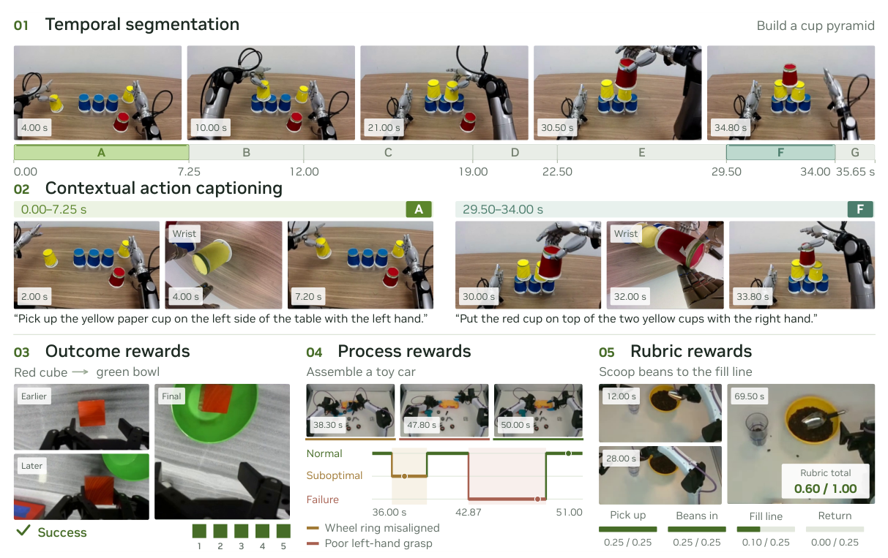
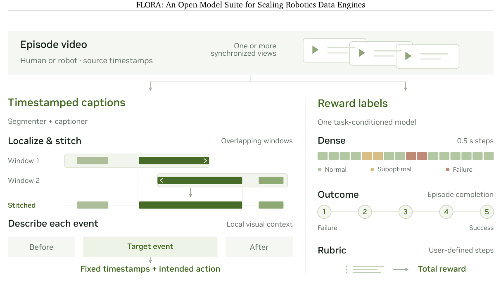
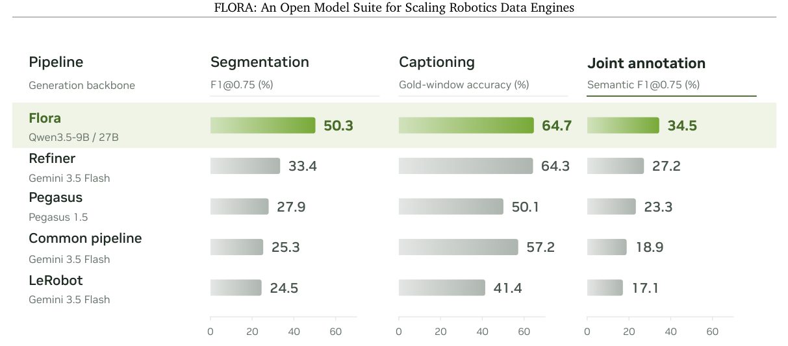
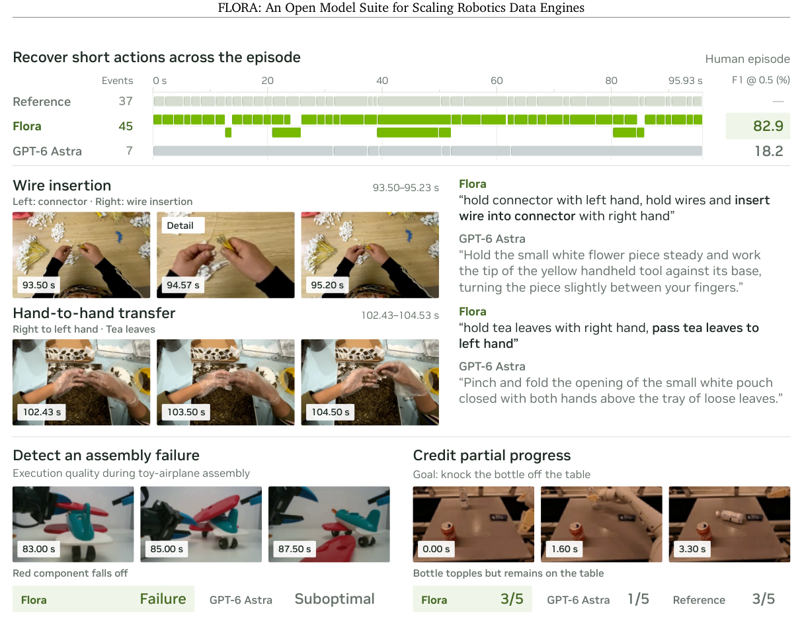
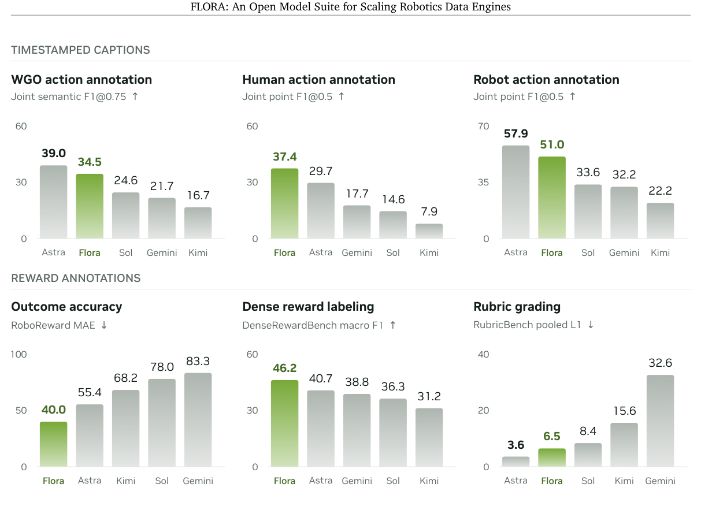
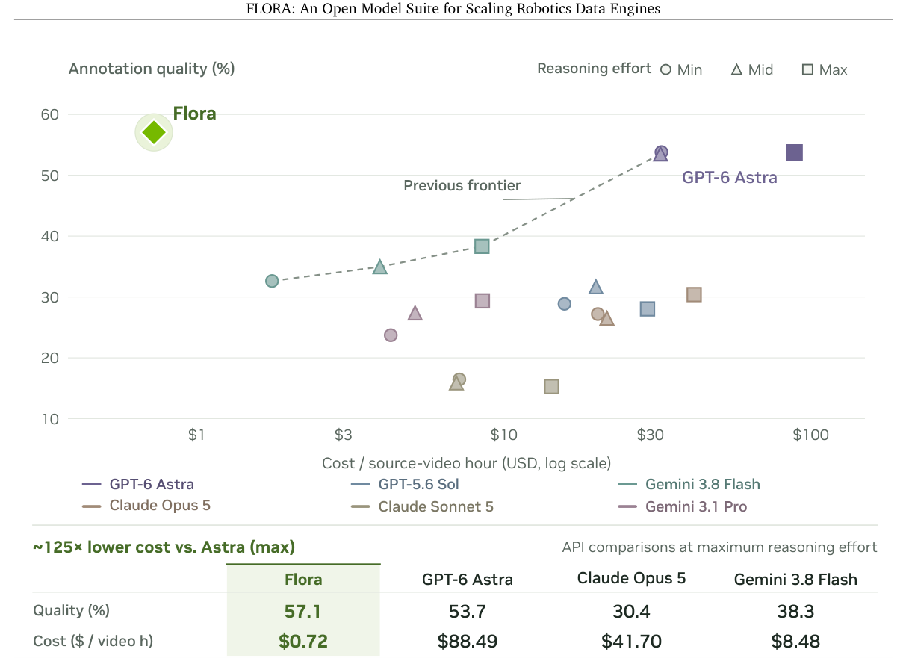

# FLORA：机器人标注成本降低 125 倍

给一小时机器人视频补上动作时间戳和执行质量评分，GPT-6 Astra 的 API 成本是 88.49 美元；NVIDIA 新开放的 FLORA 把这一估算降到了 0.72 美元，约为前者的 1/125。更重要的是，它并非只做视频描述，而是用三个模型同时生成带时间戳的动作指令、逐步过程奖励和整段结果奖励，覆盖机器人预训练、强化学习后训练与部署监控所需的三类标签。在 50 段视频的统一成本研究中，FLORA 的综合标注质量为 57.1%，高于 Astra 最大推理档的 53.7%；团队还报告它已在 512 张 GB300 上达到每天标注 20 万小时视频的生产规模。

> 图解：FLORA 先把长视频切为带起止时间的动作区间，再结合前后文描述每个动作；同一个奖励模型还能给出整段成败、每 0.5 秒的执行质量，以及按用户评分细则计算的分数。

## 机器人缺的不是一个“会看视频”的模型

机器人基础模型从单一本体策略走向大规模异构数据训练后，数据标签成了贯穿模型生命周期的基础设施。预训练需要知道“哪一秒做了什么”，才能进行语言条件训练、过滤数据和调整数据配比；RL 后训练需要知道“哪一步开始做错”，才能把信用分配到具体动作；真实部署则需要判断整段任务是否成功，用于筛数据、评估策略和发现故障。

通用视觉语言模型可以承担其中一部分工作，但按现代机器人语料的规模调用 API，费用很快成为瓶颈。已有的机器人标注流程又往往只覆盖一种标签，分段、描述与奖励分散在不同工具里。FLORA 的目标因此很具体：不是训练一个直接控制机器人的策略，而是把生产监督信号这件事做便宜、做完整。

这套系统由三个开源视觉语言模型组成：基于 Qwen3.5-9B 的分割器、基于 Qwen3.5-27B 的描述器，以及同样基于 Qwen3.5-27B 的奖励模型。前两者合作生成时间戳动作描述，后者通过不同提示词切换结果奖励、稠密奖励和评分细则奖励三种接口。它已经被用于 GR00T 模型的数据生产，而不是只停留在论文评测中。

## 长视频先拼出动作，再描述动作

给一段长度为 $T$ 的视频 $X$，FLORA 的输出不是一整段摘要，而是一组结构化记录：

$$
\mathcal{A}(X)=\{(s_i,e_i,c_i)\}_{i=1}^{N},\qquad I_i=[s_i,e_i),\quad 0\le s_i<e_i\le T
$$

其中 $s_i$ 和 $e_i$ 是动作起止时间，$c_i$ 是该区间内的意图动作描述。动作可以包含多个连续运动，也不要求最终成功；例如一次失败的抓取仍应被描述为“尝试抓取什么”，不能写成已经成功。

> 图解：左侧是重叠窗口分割、跨窗口拼接和带上下文的逐段描述；右侧是由同一个任务条件奖励模型提供的稠密、结果和自定义评分细则标签。

长视频无法简单塞进一次调用，FLORA 的解决方式是重叠窗口。分割器只在每个窗口的中央区域输出动作片段，同时预测片段是否延续到窗口左右边界之外；系统再把局部时间换算到整段视频时间，依据重叠关系和延续标志拼接同一动作，并保留同时发生的独立动作。未解决的边界还会用平移后的窗口再次细化。

分割之后，描述器独立处理每个区间，但能看到目标区间之前、之中和之后的视觉块。前后文用于辨认物体和局部意图，描述范围仍被限制在目标动作内。多机位视频会把同一物理时刻的主相机、左右腕部相机拼成一张图，避免模型把不同时间的画面误当成同步证据。

这套设计的价值在于把“找边界”和“写描述”解耦：分割器专注时间定位，描述器专注动作、物体、左右手分工和空间关系。不过，它也意味着最终效果依赖完整系统，不能只用基座模型能力解释。

## 时间戳描述：优势主要在定位，不是所有维度都领先

WGO-Bench 包含 100 段单视角视频：25 段第一视角人类操作、50 段 DROID 外部视角机器人操作和 25 段 Galaxea 头部相机操作。评测把时间分割、给定正确区间的描述质量，以及两者联合匹配分开计算；联合匹配要求预测区间与参考区间的时间交并比至少为 0.75，同时描述也被接受。

| 系统 | 生成骨干 | 分割 F1@0.75（%） | 正确区间描述准确率（%） | 联合语义 F1@0.75（%） |
|---|---|---:|---:|---:|
| FLORA | Qwen3.5-9B / 27B | 50.3 | 64.7 | 34.5 |
| Refiner | Gemini 3.5 Flash | 33.4 | 64.3 | 27.2 |
| Pegasus | Pegasus 1.5 | 27.9 | 50.1 | 23.3 |
| 通用两阶段流程 | Gemini 3.5 Flash | 25.3 | 57.2 | 18.9 |
| LeRobot annotate | Gemini 3.5 Flash | 24.5 | 41.4 | 17.1 |

> 图解：在相同的 WGO-Bench 指标上，FLORA 相比 Refiner 的分割 F1 高 16.9 个百分点、联合 F1 高 7.3 个百分点，正确区间描述准确率则基本持平。

FLORA 的提升主要来自时间定位，而非单纯“更会写句子”。面对同一批 WGO 视频，GPT-6 Astra 的正确区间描述准确率为 77.4%，高于 FLORA 的 64.7%；联合 F1 也以 39.0% 对 34.5% 领先，但 Astra 的分割 F1 只有 46.0%。因此，把结果概括成 FLORA 全面超过闭源模型并不准确。

团队还构建了 DenseCaptionBench，补足 WGO 在多视角、任务覆盖和灵巧手操作上的不足。它固定包含 300 段完整视频，人类、平行夹爪机器人和灵巧手机器人各 100 段，共 4,877 条参考区间；描述评分会分别检查意图动作、物体身份、操作者协调和细节，并对可证实的事实错误扣分，而不是只做二元文本匹配。

| 模型 | Human100 分割 F1 | Human100 描述质量 | Human100 联合 F1 | Robot200 分割 F1 | Robot200 描述质量 | Robot200 联合 F1 |
|---|---:|---:|---:|---:|---:|---:|
| FLORA | 54.6 | 66.5 | 37.4 | 66.9 | 73.7 | 51.0 |
| GPT-6 Astra | 44.2 | 60.3 | 29.7 | 71.9 | 80.2 | 57.9 |
| GPT-5.6 Sol | 32.6 | 36.4 | 14.6 | 45.8 | 69.6 | 33.6 |
| Gemini 3.8 Flash | 33.5 | 46.7 | 17.7 | 45.8 | 66.0 | 32.2 |
| Claude Opus 5 | 22.7 | 31.0 | 8.2 | 45.9 | 49.7 | 23.6 |
| Kimi K3 | 21.1 | 30.3 | 7.9 | 41.2 | 48.0 | 22.2 |
| Qwen3.5-397B-A17B | 19.6 | 29.1 | 7.8 | 37.0 | 49.5 | 19.8 |

> 表中指标均为百分比，Robot200 是平行夹爪与灵巧手两个各 100 段子集的等权平均；FLORA 在人类轨道三项领先，在机器人轨道三项均位居 Astra 之后。

骨干模型也会改变排序。把 Refiner 从 Gemini 3.5 Flash 换到 Gemini 3.8 Flash 后，其 WGO 联合 F1 从 27.2% 升至 36.4%，超过 FLORA 的 34.5%，尽管 FLORA 仍保持最高的分割分数。反过来，只把 FLORA 的两个模型替换成 API 骨干、保留窗口和拼接逻辑，联合 F1 会降至 16.4%。这组对照说明，训练与流程都在起作用，论文并没有证明仅靠其工作流就能复现结果。

## 一个奖励模型，覆盖三种时间粒度

结果奖励把整段任务按 1 到 5 分评分，1 表示完全失败，5 表示完全成功。除了输出整数等级，模型还读取五个分数 Token 的概率分布，用期望值构造 $[0,1]$ 范围内的连续奖励，供轨迹排序使用。

稠密奖励则每 0.5 秒给出正常、次优或失败标签，并为连续的非正常片段生成可见证据驱动的理由。这里的“失败”包括重大任务失败、不安全或破坏性行为，以及使任务失去可完成性的动作；“次优”指犹豫、低效、不精确但仍可恢复的行为。标签具有回溯性：后续画面可以证明此前的动作其实有错，但后来恢复成功不能反过来洗掉之前的错误。

每个稠密窗口长 16 秒、步进 10 秒。非末尾窗口会丢弃最后 4 秒的预测，给保留下来的标签留出后续视觉证据，再拼回整段视频。因此它明确面向离线标注、分析和数据筛选，不是无需等待未来帧的实时安全监控器。

第三种接口允许用户在测试时给出评分细则，例如“抓起苹果 0.4 分、拿起刀 0.3 分、切成两半 0.3 分”，每一步只能选预设档位，各步最高分之和为 1：

$$
R_\rho(X)=\sum_{j=1}^{n}\hat y_j,\qquad \hat y_j\in V_j,\qquad \sum_{j=1}^{n}\max V_j=1
$$

这让同一模型既能回答“最终成功了吗”，也能回答“在哪里做错”和“按这套业务标准该得多少分”。

## 奖励评测：最突出的能力是发现失败

公开基准和内部基准展示了不同侧面的结果。RoboRewardBench 用 2,831 段视频的人工 1–5 分标签衡量整段结果，报告平均绝对误差（MAE），数值越低越好；RobometerBench 则检查分布外轨迹排序，以及成功轨迹上的进度是否随时间增长。

| 模型 | RoboReward MAE ↓ | Robometer OOD Kendall $\tau_a$ ↑ | ID VOC ↑ | OOD VOC ↑ |
|---|---:|---:|---:|---:|
| FLORA-Rewarder | **40.0** | 72.0 | **98.9** | 99.6 |
| GPT-6 Astra | 55.4 | **82.3** | **98.9** | **99.7** |
| RoboReward | 66.5 | 47.0 | 82.0 | 88.0 |
| Robometer | 75.0 | 65.5 | 92.0 | 94.0 |
| RoboDopamine | — | 45.0 | 79.0 | 80.0 |
| RynnValue | — | 67.5 | — | — |

> 所有数值均按论文约定乘以 100；专用奖励模型的结果来自各自论文并保留原协议，其中 RynnValue 使用 976 条而非 567 条轨迹，不能视为完全同条件的重测。

FLORA 的结果评分 MAE 比 Astra 低 27.8%，优势主要来自“部分完成”的样本；完全成功和完全失败上，Astra 至少同样准确。它的 OOD 轨迹排序仍落后于 Astra。VOC 接近满分也不能被解读成失败检测能力，因为该指标只在成功轨迹上衡量进度与时间顺序的一致性。

真正能定位错误的是内部 DenseRewardBench：40 段未参与训练的双臂机器人视频，共 4,861 个时间步，其中正常 3,942 步、次优 619 步、失败 300 步。

| 模型 | 宏平均 F1 ↑ | 平衡准确率 ↑ | 非最佳动作 F1 ↑ | 失败召回率 ↑ | RubricBench L1 ↓ |
|---|---:|---:|---:|---:|---:|
| FLORA-Rewarder | **46.2** | **54.2** | **47.7** | **53.3** | 6.5 |
| GPT-6 Astra | 40.7 | 44.1 | 44.8 | 0.0 | **3.6** |
| Gemini 3.8 Flash | 38.8 | 40.2 | 31.2 | 11.7 | 32.6 |
| GPT-5.6 Sol | 36.3 | 37.8 | 26.4 | 1.0 | 8.4 |
| Qwen3.5-397B-A17B | 34.7 | 39.2 | 31.3 | 3.3 | 8.9 |
| Kimi K3 | 31.2 | 32.3 | 17.6 | 0.3 | 15.6 |

> 内部指标同样乘以 100。FLORA 能召回 53.3% 的失败步，其他对比模型最高仅 11.7%；但它也会把约 11% 的正常步骤误标成失败，自定义评分细则误差则仍高于 Astra。

> 图解：上方案例中，FLORA 找回更多短动作，并正确描述插线和左右手交接；下方案例中，它把掉落零件判为失败，并把“瓶子倒了但仍在桌上”评为部分完成的 3/5，而非完全失败的 1/5。

论文展示的定性案例解释了这些数字。在一段 95.93 秒的人类操作视频里，参考标注有 37 个区间，FLORA 匹配 34 个，Astra 只匹配 4 个，单段 F1@0.5 分别为 82.9% 和 18.2%。但附录也给出反例：当参考只包含两个粗粒度事件时，FLORA 会切出 17 段并只匹配一个，Astra 反而匹配两个；它还会把“伸手够线圈”误写为“放下物体”，把“擦盘子”误写为“叠餐巾”。稠密切分提高召回的同时，也可能牺牲边界精度。

> 图解：FLORA 在人类联合描述、结果评分误差和稠密奖励宏平均 F1 上领先；Astra 在 WGO 联合描述、机器人联合描述和评分细则误差上更好。不同子图的指标方向与测试条件不同，不能直接横向相减。

## 训练并不神秘，关键在监督目标对齐任务

三个模型都从 Qwen3.5 系列开源视觉语言模型微调而来，训练数据混合开源、授权和内部采集标注的数据。人工标注提供带时间戳的动作、执行质量、整段结果与评分细则分数。分割器以 Qwen3.5-9B 为起点，冻结视觉编码器，只训练 LoRA；描述器更新语言模型和视觉合并模块；奖励模型则联合更新语言模型、视觉合并模块和视觉编码器，并对视觉编码器使用更低学习率。

分割与描述在有监督微调后继续使用 GRPO 强化学习。分割奖励直接由不同时间交并比阈值下的 F1、精确率和边界质量组成：

$$
r_{\mathrm{seg}}=0.45F_{0.5}+0.15F_{0.75}+0.25P_{0.5}+0.15B
$$

描述奖励则要求覆盖参考中的动作、物体、协调与细节，同时惩罚可证实的事实错误：

$$
r_{\mathrm{cap}}=\frac{2M}{R+M+F}
$$

其中 $R$ 是有证据支持的参考信息量，$M$ 是已覆盖部分，$F$ 是事实错误惩罚。这个设计与 DenseCaptionBench 的评分逻辑一致：与其只奖励“句子像不像”，不如直接奖励标注是否覆盖所需信息。发布的奖励模型只经过 SFT，将三类奖励样本混合训练一个 epoch，没有按任务类型重新加权或过采样。

## 125 倍成本差，应该怎样理解

成本研究固定使用 DenseCaptionBench 的 50 段视频，包括 20 段人类、15 段平行夹爪和 15 段灵巧手视频，总时长 4,483.54 秒。综合质量先在每种本体内等权平均分割、正确区间描述和联合标注，再对三种本体等权平均；它不是某一个公开基准的单项分数。

| 系统 | 综合质量（%） | 每小时源视频成本（美元） |
|---|---:|---:|
| FLORA | 57.1 | 0.72 |
| GPT-6 Astra，最大推理档 | 53.7 | 88.49 |
| Gemini 3.8 Flash，最大推理档 | 38.3 | 8.48 |
| Claude Opus 5，最大推理档 | 30.4 | 41.70 |

> 图解：横轴是每小时源视频成本的对数刻度，纵轴为 50 段视频上的综合质量；圆、三角和方形分别代表低、中、高推理档。FLORA 的参考成本为 0.72 美元，Astra 最大档为 88.49 美元。

这里的 0.72 美元是部署模型估算，不是已经核验的生产账单。论文假设 8 张 GB300、每 GPU 小时 10 美元、数据并行和 batch size 16，并使用较早部署研究的 660 个窗口与 890 次描述作为工作负载；参考处理速率为每秒 1.23495 段视频，但作者明确说生产 GPU 小时分母尚未验证。按工程场景，成本范围为 0.5102–1.2600 美元；相对 Astra 的精确成本比为 122.49 倍，正文概括为约 125 倍。

Astra 的 88.49 美元也有口径限制：它按 2026 年 10 月 4 日的公开标准价格计算已返回用量的 API 成本，包含分割和预测区间描述，不含训练、参考答案构建与评审。7,062 次实际请求中有 106 次没有返回可计价用量，所以这是已知用量小计而非完整账单。不同厂商的推理档位也没有做计算量对齐。

每天 20 万小时与成本研究应分开看：前者是团队报告的生产规模，后者是小规模固定队列上的估算。附录给出的 96 GPU 吞吐数字同样来自线性复制假设，并非实测的 96 卡服务结果。FLORA 的成本优势很有吸引力，但实际迁移时仍需用自己的视频长度、视角数、调用频率和 GPU 利用率重新核算。

## 开放之后，证据仍有哪些边界

FLORA 最有说服力的不是“一个模型赢下所有榜单”，而是较小的开放模型经过任务化训练后，已经能以低得多的成本覆盖一套完整数据流程，尤其在短动作定位、部分完成评分和失败步骤发现上表现出明确差异。不过，阅读结果需要保留几项限制。

- 这是完整系统对比，不是纯模型能力对比。各系统的视觉输入、提示词、窗口、推理预算和服务重试不同，不能把每个分数差都归因于模型权重。
- DenseCaptionBench 使用 Astra 作固定评审，而 Astra 同时是被评模型，存在生成器—评审自偏好风险；部分机器人描述生成和 98 个评审任务仍缺失，排序不是完全观测下的排名。
- 高失败召回伴随误报。约 11% 正常步骤被标为失败，用于 RL 或自动筛数据时需要按下游容忍度决定是否增加人工复核。
- 稠密标签需要后续画面，适合离线数据引擎；目前证据不能支持把它当作在线故障拦截器。
- FLORA 也会过度分割、混淆动作阶段和物体；在人类与机器人数据上并不一致领先，评分细则和 OOD 轨迹排序也仍落后 Astra。

对于正在建设机器人数据集的团队，可执行的下一步不是直接替换全部人工标注，而是用一批带人工真值的视频分别测边界精度、失败召回和误报，再按源视频小时重算部署成本。FLORA 已开放模型套件，使这种本地验证和二次训练成为可能；它能否把低成本标注转化为更好的下游机器人策略，则不是这篇论文的基准分数本身能够证明的。

> 本文参考自 [FLORA: An Open Model Suite for Scaling Robotics Data Engines](https://research.nvidia.com/labs/gear/flora/assets/paper/flora.pdf)